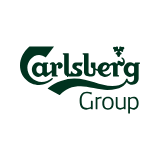
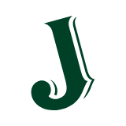

Fourth in the Christ Com prep set, after hotels, cosmetics and films: the drinks groups, the famous spirits, beers and champagnes, and India's and Kerala's labels, with founders, name and logo stories, CEOs, taglines and quiz hooks.

## Quiz-ready stories

If you only have ten minutes, revise these.

1. **Diageo** = *dies* (day) + *geo* (world). It was formed by the Guinness–Grand Metropolitan merger in 1997.
2. **Carlsberg** = Carl (J.C. Jacobsen's son) + *berg* (hill). The **pH scale** was invented at the Carlsberg Laboratory.
3. **Bacardi**'s bat comes from fruit bats in the first distillery. The family left Cuba after Castro.
4. **Smirnoff** began as Smirnov, from Moscow. The Moscow Mule was invented to sell it.
5. **Jack Daniel's** is made in a dry county, and was taught by Nathan "Nearest" Green.
6. **Johnnie Walker**'s square bottle wasted less space in crates. The Striding Man is by Tom Browne.
7. **Royal Salute** is 21 years old, for the 21-gun salute at the 1953 coronation. **VAT 69** was vat number 69.
8. **Guinness**: a 9,000-year lease; the harp that made Ireland's harp face the other way; the Guinness World Records.
9. **Budweiser** is named after Budweis (České Budějovice). **Stella** means star. **Corona** means crown. **Cuervo** means crow.
10. **Peroni Nastro Azzurro** = "blue ribbon", after the liner *Rex*. **Beck's** key = Bremen's coat of arms.
11. **Veuve** means widow (Clicquot). **Dom Pérignon** was a monk. **Cristal** was made for a tsar.
12. **Chartreuse**, the colour, is named after the liqueur.
13. **RCB** is named after Royal Challenge whisky. United Spirits sold it in Mar 2026 for ₹16,660 crore.
14. **Old Monk**'s brewery was founded by Edward Dyer, father of General Dyer of Jallianwala Bagh. It never advertised.
15. **Kingfisher Airlines** was named after the beer. **Bira 91**: 91 is India's dialling code.
16. **Sula** is named after Sulabha Samant. **Amrut**'s single malt launched in Glasgow (2004).
17. **Suntory time!** comes from *Lost in Translation*. Suntory bought Jim Beam in 2014.
18. **Kerala**: Bevco sold ₹771 crore in Onam 2026. Jawan rum is made by Travancore Sugars. The government brandy was renamed from Malabar Mystery to **Minnal Magic**.
19. **2026 CEO changes**: Sir Dave Lewis at Diageo; Rafael Oliveira at Heineken; Brown-Forman searching for a successor.
20. **Surrogate ads**: Indian liquor brands advertise soda, water or music CDs under the same name.

Logos are shown for Carlsberg and Jameson, the only drinks logos in the open icon set. The others are described in words.

## The big drinks groups

About ten groups own most famous labels. Three changed CEOs in 2026: Diageo (Sir Dave Lewis, ex-Tesco), Heineken (Rafael Oliveira, ex-JDE Peet's), and Brown-Forman, whose CEO is retiring with no successor yet.

| Group | Est., HQ | CEO (Nov 2026) | Origin | Brands, name and trivia |
| --- | --- | --- | --- | --- |
| **Diageo** | 1997, London | Sir Dave Lewis (from Jan 2026) | Formed when Guinness merged with Grand Metropolitan. | The name blends Latin *dies* (day) and Greek *geo* (world), meaning "every day, everywhere". Brands include Johnnie Walker, Smirnoff, Guinness, Baileys, Tanqueray, Captain Morgan and Don Julio. It paid up to $1 bn for Casamigos, George Clooney's tequila. It owns India's United Spirits, which sold the IPL team RCB (champions in 2025) in Mar 2026. Lewis was nicknamed "Drastic Dave" at Tesco. |
| **Pernod Ricard** | 1975, Paris | Alexandre Ricard (chairman and CEO) | Merger of Pernod (1805, absinthe) and Ricard (Paul Ricard's pastis, 1932). | Alexandre is Paul Ricard's grandson. Brands include Absolut, Chivas Regal, Jameson, Martell, The Glenlivet, Malibu and Beefeater. In India it owns Royal Stag and Blenders Pride. Its finance chief left for Chanel in 2026. |
| **AB InBev** | 2008, Leuven, Belgium | Michel Doukeris (since 2021) | Belgium's InBev bought Anheuser-Busch in 2008, then SABMiller in 2016 for about $100 bn. | The world's largest brewer, backed by the Brazilian investors of 3G Capital (Jorge Paulo Lemann). Brands include Budweiser, Corona (outside the US), Stella Artois, Beck's, Hoegaarden and Michelob. The 2023 Bud Light boycott cost it the top spot in US beer to Modelo. |
| **Heineken** | 1864, Amsterdam | Rafael Oliveira (from 1 Oct 2026) | Gerard Adriaan Heineken bought the De Hooiberg ("The Haystack") brewery. | Its red star and the "smiling" tilted e's are its trademarks. Freddy Heineken was kidnapped for ransom in 1983. It owns a majority of India's United Breweries, the maker of Kingfisher. |
|  **Carlsberg** | 1847, Copenhagen | Jacob Aarup-Andersen | J.C. Jacobsen named the brewery after his son **Carl** plus *berg* (hill). | The **pH scale** was invented at the Carlsberg Laboratory by Søren Sørensen (1909). Emil Hansen isolated pure brewing yeast there and gave it away free. The Carlsberg Foundation owns control. It bought Britvic in 2025. |
| **Bacardi** | 1862, Santiago de Cuba (now Hamilton, Bermuda) | — | Facundo Bacardí Massó began making rum in Cuba. | The **bat** logo: fruit bats lived in the first distillery's rafters, and his wife Doña Amalia read them as luck. The family left Cuba after Castro seized its assets in 1960, and the company is still family-owned. Also owns Grey Goose, Dewar's, Bombay Sapphire, Martini and Patrón. |
| **Brown-Forman** | 1870, Louisville, Kentucky | Lawson Whiting, retiring; a successor search began in July 2026 | George Garvin Brown sold Old Forester bourbon in **sealed glass bottles**, then a novelty that guarded against adulteration. | Owns Jack Daniel's and Woodford Reserve. The Brown family still controls it. |
| **LVMH (Moët Hennessy)** | 1971, Paris | Part of Bernard Arnault's LVMH | Moët & Chandon (1743) merged with Hennessy (1765, founded by Irishman Richard Hennessy). | Owns Dom Pérignon, Veuve Clicquot, Krug, Ruinart, Glenmorangie and Ardbeg. The "MH" in LVMH stands for Moët Hennessy. |
| **Suntory** | 1899, Osaka | Suntory Holdings | Shinjiro Torii started with wine and built Yamazaki, Japan's first malt-whisky distillery, in 1923. | Bought Beam (Jim Beam, Maker's Mark) in 2014 for $16 bn. Bill Murray's "It's Suntory time!" in *Lost in Translation* is the classic film link. |
| **Campari Group** | 1860, Novara (now Milan) | — | Gaspare Campari created the red bitter. | Its red colour came from carmine, a dye made from cochineal insects, until 2006. It owns Aperol. |
| **Kweichow Moutai** | Guizhou, China | State-owned | Makes *baijiu*, a sorghum spirit. | Often the world's most valuable drinks company by market value. Served at state banquets, including Nixon's 1972 visit. |

## Spirits brands

The logos and bottles carry the best stories: Bacardi's bat, Johnnie Walker's striding man, Glenfiddich's stag, Royal Salute's 21 years. Smirnoff was in his prelims, so expect more name origins like it.

### Whisky

| Brand | Est., place | Owner | Origin | Trivia |
| --- | --- | --- | --- | --- |
| **Johnnie Walker** | 1820, Kilmarnock | Diageo | John Walker was a grocer who blended whisky. | The **Striding Man** was drawn by cartoonist Tom Browne (1908). The **square bottle** wasted less space in crates and broke less, and the label is slanted at 24°. "Keep Walking" dates from 1999. |
| **Jack Daniel's** | 1866, Lynchburg, Tennessee | Brown-Forman | Jasper "Jack" Daniel learned distilling from **Nathan "Nearest" Green**, an enslaved man, who is now credited as the first master distiller. | The distillery is in a **dry county**, so you can't buy a drink in the town that makes it. It is "Tennessee whiskey", not bourbon, because it is filtered through charcoal (the Lincoln County Process). Nobody agrees why it is called "Old No. 7". |
|  **Jameson** | 1780, Dublin | Pernod Ricard | Founded by John Jameson, a Scotsman. | The family motto on the label is ***Sine Metu***, "without fear". It is triple-distilled. |
| **Glenfiddich** | 1887, Dufftown | William Grant & Sons (family) | William Grant built it with his nine children. | The name is Gaelic for "valley of the deer", hence the **stag** logo. Its triangular bottle was introduced in 1961. The same family makes Hendrick's gin. |
| **Chivas Regal** | 1909 blend, Aberdeen | Pernod Ricard | The Chivas brothers were Aberdeen grocers. | **Royal Salute** was created for Queen Elizabeth II's 1953 coronation. It is aged 21 years, for the 21-gun salute. |
| **The Macallan** | 1824, Speyside | Edrington | — | Holds the auction record for a bottle of whisky: the Macallan 1926 sold for about £2.1 m in 2023. |
| **Black & White** | Buchanan's, 1890s | Diageo | James Buchanan's whisky in black-and-white bottles. | Its two terriers, one black and one white, are the logo. |
| **VAT 69** | 1882, Leith | Diageo | William Sanderson had a panel taste 100 blends. | Vat number 69 won, and it became the name. |
| **Black Dog** | 1883 | Diageo | Walter Millard, a Scot who worked in India. | Named after his favourite fishing fly. The brand is hugely popular in India. |
| **Maker's Mark** | 1953, Kentucky | Suntory | The Samuels family. | Every bottle is hand-dipped in **red wax**. It spells "whisky" without the "e", to honour the family's Scottish roots. |
| **Yamazaki / Hibiki** | 1923, Japan | Suntory | Japan's first malt-whisky distillery. | Masataka Taketsuru learned whisky-making in Scotland, then co-founded Yamazaki and later Nikka. |

### Vodka, rum, gin and tequila

| Brand | Est., place | Owner | Origin | Trivia |
| --- | --- | --- | --- | --- |
| **Smirnoff** | 1864, Moscow | Diageo | Pyotr Smirnov's vodka. His son Vladimir fled the Bolsheviks and changed the spelling to Smirnoff. | The US rights passed to Rudolph Kunett, then Heublein. The **Moscow Mule** (vodka, ginger beer, copper mug) was invented in 1941 to sell it. |
| **Absolut** | 1879, Åhus, Sweden | Pernod Ricard | Lars Olsson Smith's "Absolut rent brännvin", or "absolutely pure vodka". | The bottle is based on an old Swedish medicine bottle. The "Absolut \_\_\_" ad series (TBWA, from 1980) ran for 25 years. Andy Warhol painted the bottle in 1985. |
| **Grey Goose** | 1997, Cognac, France | Bacardi | Sidney Frank invented a French super-premium vodka for the US market. | He sold it to Bacardi in 2004 for about $2 bn. |
| **Captain Morgan** | 1944 | Diageo | Seagram named it after **Henry Morgan**, a Welsh privateer. | Famous for the "Captain pose". |
| **Havana Club** | 1934, Cuba | Pernod Ricard (with Cuba) | A Cuban rum. | Pernod and Bacardi have fought over the US rights to the name for decades. |
| **Mount Gay** | 1703, Barbados | Rémy Cointreau | — | Often called the oldest rum brand. |
| **Gordon's** | 1769, London | Diageo | Alexander Gordon's gin. | The boar's-head logo. |
| **Tanqueray** | 1830, London | Diageo | Charles Tanqueray. | The bottle is said to be shaped like a cocktail shaker. |
| **Bombay Sapphire** | 1987 | Bacardi | A recipe from 1761. | Queen Victoria appears on the label, and it comes in a blue bottle. |
| **Beefeater** | 1876, London | Pernod Ricard | James Burrough. | Named after the Yeoman Warders of the Tower of London. |
| **Hendrick's** | 1999, Scotland | William Grant & Sons | — | Flavoured with cucumber and rose; sold in an apothecary-style bottle. |
| **Jose Cuervo** | 1795, Jalisco | Becknova (Beckmann family) | The oldest tequila maker. | *Cuervo* means crow, hence the crow on the label. Tequila must be made from blue agave in designated regions of Mexico, mainly Jalisco. |
| **Patrón** | 1989 | Bacardi (2018) | John Paul DeJoria (of Paul Mitchell hair care) and Martin Crowley. | Each bottle is handmade with a bee on the stopper. |
| **Casamigos** | 2013 | Diageo | George Clooney and Rande Gerber. | The name means "house of friends". Diageo paid up to $1 bn in 2017. |

### Cognac and liqueurs

| Brand | Est., place | Owner | Origin | Trivia |
| --- | --- | --- | --- | --- |
| **Hennessy** | 1765, Cognac | LVMH | Richard Hennessy, an Irish officer in the French army. | Created the first "XO" (extra old) in 1870. |
| **Rémy Martin** | 1724, Cognac | Rémy Cointreau | — | The centaur logo. |
| **Martell** | 1715, Cognac | Pernod Ricard | Jean Martell from Jersey. | The oldest of the great cognac houses. |
| **Courvoisier** | 1828 | Campari (2024) | — | Sold as "the brandy of Napoleon". |
| **Baileys** | 1974, Dublin | Diageo | The first Irish cream liqueur, invented by a Gilbeys team. | Named after Bailey's Bistro, a London restaurant, for an Irish-sounding name. |
| **Jägermeister** | 1934, Wolfenbüttel | Mast-Jägermeister (family) | Curt Mast's herbal liqueur, made from 56 herbs. | "Hunt master". The stag with a glowing cross comes from the legend of St Hubertus. |
| **Chartreuse** | 1737, France | Carthusian monks | Made by monks from about 130 herbs, to a secret recipe. | The colour **chartreuse** is named after the drink. |
| **Midori** | 1978 | Suntory | A Japanese melon liqueur. | Launched at Studio 54 in New York. |
| **Southern Comfort** | 1874, New Orleans | Sazerac | M.W. Heron. | Janis Joplin's favourite drink. |
| **Disaronno** | Saronno, Italy | Illva Saronno | Amaretto. | Legend links it to a model painted by Bernardino Luini, a pupil of Leonardo da Vinci. |
| **Absinthe** | 1790s, Switzerland | — | Wormwood spirit. | Called "la fée verte" (the green fairy), and linked to Van Gogh. Banned in many countries from about 1910 to the 2000s. |

## Beer and champagne

Beer names are often places (Budweiser, Tsingtao, Stella's Leuven roots), and champagne names are often people (a monk, a widow, a tsar). Guinness has the richest story: a 9,000-year lease and the Guinness World Records.

### Beer

| Brand | Est., place | Owner | Origin | Trivia |
| --- | --- | --- | --- | --- |
| **Guinness** | 1759, Dublin | Diageo | Arthur Guinness signed a **9,000-year lease** on St James's Gate at £45 a year. | The **harp** logo was trademarked in 1876, so the Irish state's harp faces the other way. Guinness World Records began in 1955 after Sir Hugh Beaver argued over Europe's fastest game bird. Its ads used a toucan, and the slogan "Good things come to those who wait". |
| **Heineken** | 1864, Amsterdam | Heineken | See the groups table. | Green bottle, red star. A long-time UEFA Champions League sponsor. |
| **Budweiser** | 1876, St Louis | AB InBev | Adolphus Busch and Eberhard Anheuser. | Named after **Budweis** (České Budějovice) in Czechia. It fought a century-long trademark war with the Czech brewer Budvar. "The King of Beers", the Clydesdale horses, and the 1999 "Whassup?" ads. |
| **Corona** | 1925, Mexico City | AB InBev (US rights: Constellation) | Grupo Modelo. | *Corona* means crown. It is served with a lime wedge. It suffered from the coronavirus name joke in 2020. |
| **Stella Artois** | 1926 brand; brewing roots in Leuven from 1366 | AB InBev | First brewed as a Christmas beer: *stella* is Latin for star. | Artois was Sébastien Artois, the brewery's master brewer. Its UK ads said "Reassuringly expensive". It is served in a chalice. |
| **Carlsberg** | 1847, Copenhagen | Carlsberg | Named after J.C. Jacobsen's son Carl. | "Probably the best lager in the world", voiced by Orson Welles in 1970s ads. |
| **Beck's** | 1873, Bremen | AB InBev | — | The **key** logo comes from Bremen's coat of arms. |
| **Peroni Nastro Azzurro** | 1846; Nastro Azzurro from 1963 | Asahi | — | *Nastro Azzurro* means "blue ribbon", after the Italian liner *Rex* won the Blue Riband for the fastest Atlantic crossing in 1933. |
| **Pabst Blue Ribbon** | 1844, Milwaukee | Pabst | — | The blue ribbons were once tied to bottles to mark prize-winning beer. |
| **Foster's** | 1888, Melbourne | Asahi / Heineken (UK) | Founded by two American brothers named Foster. | Sold abroad as "Australian for beer", but barely drunk in Australia, which drinks VB (Victoria Bitter, from his prelims). |
| **Tsingtao** | 1903, Qingdao | Tsingtao Brewery | Founded by German settlers in the German concession of Qingdao. | That is why a Chinese beer is a German-style lager. |
| **Asahi Super Dry** | 1987, Tokyo | Asahi | Japan's first "dry" beer. | The "Asahi Flame" on its Tokyo headquarters, by Philippe Starck, is nicknamed the "golden turd". |
| **Hoegaarden / Leffe** | Belgium | AB InBev | A witbier and an abbey beer. | Trappist beers (Westvleteren, Chimay) can only be made in Trappist monasteries. |

### Champagne

| Brand | Est. | Owner | Origin | Trivia |
| --- | --- | --- | --- | --- |
| **Moët & Chandon** | 1743 | LVMH | Claude Moët. | Long sprayed on Formula 1 podiums. Napoleon was a friend of the Moët family. |
| **Dom Pérignon** | 1921 vintage, launched 1936 | LVMH | Named after **Dom Pierre Pérignon**, a Benedictine monk. | He is wrongly credited with inventing champagne. "Come quickly, I am drinking the stars!" is a later invention. |
| **Veuve Clicquot** | 1772 | LVMH | *Veuve* means widow: Barbe-Nicole Ponsardin ran the house after her husband died. | She invented the riddling table, which clears the sediment, and made the first known blended rosé champagne. Famous for its yellow label. |
| **Cristal** | 1876 | Louis Roederer | Created for Tsar Alexander II. | Its clear, flat-bottomed bottle is said to have been designed so no bomb could be hidden in it. |
| **Bollinger** | 1829 | Bollinger (family) | — | James Bond's champagne. |
| **Krug** | 1843 | LVMH | Joseph Krug. | Krug Grande Cuvée is a blend of many different years. |

Only sparkling wine from France's Champagne region may be called champagne. The name was protected even in the 1919 Treaty of Versailles.

## Cocktails and wine brands

Cocktail origins are bar stories, so they are best asked as "which bar" or "which person". The Espresso Martini was made for a model in 1983. The Moscow Mule was invented in Los Angeles to sell unwanted vodka. 19 Crimes puts real convicts on its labels.

### Cocktails

| Cocktail | Born | The story | Trivia |
| --- | --- | --- | --- |
| **Espresso Martini** | c. 1983, Soho Brasserie, London | Bartender **Dick Bradsell** made it for a young model who asked for something to "wake me up, then f\*\*\* me up". He never named her; rumour says Marie Helvin. Naomi Campbell and Kate Moss were too young. | First called the **Vodka Espresso**. At Bradsell's Pharmacy bar it was the "Pharmaceutical Stimulant". Made with vodka, espresso and coffee liqueur (Kahlúa or Tia Maria). The three coffee beans on top are said to stand for health, wealth and happiness. It was the comeback drink of the 2020s. |
| **Moscow Mule** | 1941, Cock 'n' Bull pub, Sunset Strip, Los Angeles | Accounts differ, but three people each had something to sell. **John G. Martin** of Heublein had Smirnoff vodka that Americans wouldn't buy. **Jack Morgan**, the pub's owner, had unsold ginger beer. **Sophie Berezinski**, a Russian immigrant, had copper mugs. | Not Russian at all. Martin went from bar to bar with an early Polaroid camera, photographing bartenders holding the mug and Smirnoff. The **copper mug** is now its trademark. It became a symbol of the vodka boom that made Smirnoff America's top spirit. |
| **Martini / Vesper** | 1880s, US (origins disputed) | Gin and vermouth, possibly descended from the "Martinez". | James Bond's **Vesper** comes from *Casino Royale* (1953): Gordon's gin, vodka and Kina Lillet, "shaken, not stirred", named after Vesper Lynd. |
| **Bloody Mary** | 1921, Harry's New York Bar, Paris | **Fernand Petiot**; later served at New York's St Regis as the "Red Snapper". | Canada's version with clam juice is the **Bloody Caesar**. |
| **Piña Colada** | 1954, Caribe Hilton, San Juan | Bartender Ramón "Monchito" Marrero (one of several claims). | Puerto Rico's official drink since 1978. Made with Coco López cream of coconut. Rupert Holmes's 1979 "Escape (The Piña Colada Song)". It links to the hotel-chains doc. |
| **Singapore Sling** | c. 1915, Long Bar, Raffles Hotel | Ngiam Tong Boon. | Peanut shells on the floor. |
| **Bellini** | 1948, Harry's Bar, Venice | **Giuseppe Cipriani**: white peach and prosecco. | Named after the Renaissance painter **Giovanni Bellini**, for its pink colour. *Carpaccio* was also invented there, named after the painter Vittore Carpaccio. |
| **Negroni** | 1919, Florence | Count **Camillo Negroni** asked for his Americano to be strengthened with gin instead of soda. | Equal parts gin, Campari and sweet vermouth. Its charity week is called Negroni Week. |
| **Mojito / Daiquiri** | Havana | The Daiquiri is named after a beach and iron mine near Santiago de Cuba. | Hemingway: "My mojito in La Bodeguita, my daiquiri in El Floridita." JFK loved the daiquiri. |
| **Cuba Libre** | c. 1900, Havana | Rum, Coca-Cola and lime. | "Free Cuba", toasted after the Spanish–American War. |
| **Margarita** | 1930s–40s, Mexico (disputed) | Many people claim it. | Mariano Martínez's 1971 frozen-margarita machine is in the Smithsonian. |
| **Mai Tai / Zombie** | 1944 Oakland / 1934 Hollywood | Trader Vic (Mai Tai) and Don the Beachcomber (Zombie), the rival fathers of tiki. | *Maita'i* is Tahitian for "good". The Zombie was limited to two per customer. |
| **Irish Coffee** | 1943, Foynes flying-boat base, Ireland | Chef **Joe Sheridan** warmed up cold transatlantic passengers. | Asked if it was Brazilian coffee, he said "Irish coffee". San Francisco's Buena Vista Café made it famous in the US. |
| **Cosmopolitan** | 1980s, US | Credited to several bartenders, including Toby Cecchini at the Odeon, New York. | Made famous by *Sex and the City*. |
| **Old Fashioned** | 1880s, US | Whiskey, sugar and bitters. | Don Draper's drink in *Mad Men*, and Louisville's official cocktail. |
| **Mimosa / Buck's Fizz** | 1925, Ritz Paris / 1921, Buck's Club, London | Orange juice and champagne. | — |
| **Kir** | Dijon, France | Named after **Félix Kir**, priest, war hero and mayor of Dijon. | Crème de cassis with white wine (Kir Royale: with champagne). |
| **Gimlet** | Royal Navy | Gin with **Rose's lime cordial** (1867), against scurvy. | That's why British sailors were called "limeys". |
| **Dark 'n' Stormy** | Bermuda | Gosling's Black Seal rum and ginger beer. | One of the few **trademarked** cocktails: it has to be made with Gosling's. |
| **Aperol Spritz / Caipirinha / Pisco Sour** | Veneto / Brazil / Peru or Chile | — | The Caipirinha is made with cachaça and is Brazil's national cocktail. Peru and Chile both claim the Pisco Sour. |

### Wine brands

| Brand | Est., country | Owner | Story | Trivia |
| --- | --- | --- | --- | --- |
| **19 Crimes** | 2012, Australia | Treasury Wine Estates | Named after the **19 crimes** for which British convicts could be transported to Australia (1787–1868). The labels carry sepia mugshots of real convicts, such as the Irish Fenian poet **John Boyle O'Reilly**, who escaped Western Australia on an American whaler. | Every cork is printed with one of the crimes; the list is reported to include bigamy and stealing from a shipwreck. Its **Living Wine Labels** app (2017) uses augmented reality to make the convicts speak. Celebrity wines followed: **Snoop Cali Red** (2020) and **Martha's Cali Rosé** with Martha Stewart (2022). |
| **Penfolds** | 1844, Australia | Treasury Wine Estates | Dr Christopher Penfold made fortified wine as medicine for anaemia. | **Grange** (Max Schubert, 1951) is Australia's most famous wine. Same owner as 19 Crimes. |
| **\[yellow tail\]** | 2001, Australia | Casella family | A cheap, fruity wine made for American drinkers. | The yellow-footed rock wallaby on the label. It became America's top imported wine within a few years. |
| **Jacob's Creek** | 1847, Barossa | Pernod Ricard | Johann Gramp planted vines by Jacob's Creek. | — |
| **Casillero del Diablo** | Chile | Concha y Toro | Don Melchor spread the rumour that the devil lived in his cellar, to scare off thieves. | The name means "the devil's cellar". A former Manchester United sponsor. |
| **Château Mouton Rothschild** | Bordeaux | Rothschild family | A first-growth Bordeaux since 1973. | An artist designs each year's label: Picasso, Dalí, Chagall, Miró, Warhol, and the then Prince Charles (2004). |
| **Opus One** | 1979, Napa | Joint venture | Robert Mondavi with Baron Philippe de Rothschild. | A French–American wine marriage. |
| **Barefoot** | 1965, California | E. & J. Gallo | Started in a garage; its label shows a bare footprint. | Gallo is the world's largest family-owned winery. |
| **Blue Nun** | 1923, Germany | — | Liebfraumilch with nuns in blue habits on the label. | It was the world's best-selling wine brand in the 1980s. |
| **Mateus Rosé** | 1942, Portugal | Sogrape | Made for export, in a round flask-shaped bottle. | The label shows the Mateus Palace in Vila Real. |
| **Grover Zampa / Fratelli** | 1988 Nandi Hills / Akluj, Maharashtra | Indian | Kanwal Grover, with French help / founded by three pairs of brothers. | *Fratelli* is Italian for brothers. |

**2026 anniversary:** the **Judgment of Paris** (24 May 1976) turned 50. In a blind tasting organised by British merchant **Steven Spurrier**, California beat France: **Stag's Leap Wine Cellars 1973** Cabernet (winemaker Warren Winiarski) won the reds, and **Château Montelena 1973** Chardonnay (made by Mike Grgich) won the whites. *Time*'s George Taber was the only journalist there. Bottles are in the Smithsonian, and the 2008 film *Bottle Shock* told the story.

## Indian brands

The biggest Indian liquor story of 2026 is United Spirits selling **Royal Challengers Bengaluru**. The team was named after its Royal Challenge whisky, and it went to an Aditya Birla-led group for ₹16,660 crore (about $1.78 bn). The best old stories are Old Monk's and Kingfisher's.

| Brand / company | Est., base | Owner / leader (Nov 2026) | Origin | Trivia |
| --- | --- | --- | --- | --- |
| **United Spirits (McDowell's)** | 1826 (McDowell & Co., Madras) | Diageo; MD and CEO Praveen Someshwar (ex-PepsiCo) | Scotsman Angus McDowell's trading firm. Vittal Mallya took it over, and his son **Vijay Mallya** built UB Group. Diageo took control in 2013–14. | Brands include McDowell's No.1, Royal Challenge, Signature, Antiquity and Black Dog. **RCB** was named after Royal Challenge. It won its first IPL title in 2025 and was sold in Mar 2026 to Aditya Birla Group, Times Group, Bolt Ventures and Blackstone. |
| **Kingfisher (United Breweries)** | Kingfisher brand 1978; Bengaluru | Heineken holds a majority | UB Group's beer. | "The King of Good Times". It gave its name to **Kingfisher Airlines** (2005–2012) and the Kingfisher calendar. It advertises through soda and water "surrogate" brands, because liquor ads are banned in India. |
| **Old Monk** | 1954, Kasauli/Solan, Himachal | Mohan Meakin | The brewery was founded in 1855 by **Edward Dyer**, father of **General Reginald Dyer** of the Jallianwala Bagh massacre. N.N. Mohan later bought it, and Brigadier Kapil Mohan built Old Monk. | A cult rum famous for **never advertising**. Its maker's hometown in Ghaziabad is named Mohan Nagar, after the family. |
| **Amrut** | 1948, Bengaluru | Jagdale family | J.N. Radhakrishna Rao Jagdale founded the distillery. | Its single malt, India's first, launched in **Glasgow** in 2004. Whisky writer Jim Murray rated Amrut Fusion the world's third-best whisky in 2010. |
| **Paul John** | 1992 (John Distilleries), Goa distillery | Paul P. John | John Distilleries makes Original Choice, one of India's biggest-selling whiskies. | Paul John Port Select Cask was named **Best Indian Single Malt** at the 2026 World Whiskies Awards. |
| **Indri** | 2021, Indri village, Haryana | Piccadily Agro | A young single malt. | Its Diwali edition was named Best in Show at the 2023 Whiskies of the World awards. In 2026 it became the first Indian brand to win Best Special Edition Design at the World Whiskies Awards. |
| **Rampur / Radico Khaitan** | 1943, Rampur, UP | Radico Khaitan | Radico also makes 8PM whisky, **Magic Moments** (India's best-selling vodka) and **Jaisalmer** gin. | Rampur single malt is made in what was the Nawab of Rampur's princely state. |
| **Royal Stag / Blenders Pride** | Seagram's India, 1990s | Pernod Ricard | — | Royal Stag's slogan is "It's your life, make it large". |
| **Imperial Blue** | 1997 | **Tilaknagar Industries** (bought from Pernod in Dec 2025 for about ₹3,442 crore) | — | Its "Men Will Be Men" ads are a famous surrogate campaign. Tilaknagar also makes **Mansion House**, India's best-selling brandy. |
| **Officer's Choice** | 1988 | Allied Blenders and Distillers (listed 2024) | — | At times one of the world's best-selling whiskies by volume. |
| **Sula Vineyards** | 1999, Nashik | Rajeev Samant | A Stanford graduate who quit Oracle to plant grapes on family land. | Named after his mother, **Sulabha**. It made Nashik India's "wine capital" and listed in 2022. |
| **Bira 91** | 2015, Delhi | Ankur Jain (B9 Beverages) | A craft wheat beer. | **91** is India's international dialling code, and the logo is a monkey. A 2024 company-name change forced it to relabel stock, and losses and an investor revolt followed in 2025–26. |
| **Feni** | Goa | Many small makers | Cashew-apple or coconut spirit. | Cashew feni has had a GI tag since 2009. |
| **Mahua** | Central India | — | A tribal spirit distilled from mahua flowers. | Madhya Pradesh promoted it as a heritage liquor in 2021–22. |

## Kerala links

Kerala's government both sells and makes liquor. Its newest brand, a brandy, was renamed in Feb 2026 from **Malabar Mystery** to **Minnal Magic**, which makes a fresh, local question.

| Topic | Facts | Quiz hook |
| --- | --- | --- |
| **Bevco** (Kerala State Beverages Corporation) | Founded in 1984. The state-owned company has the monopoly on wholesale liquor and runs most retail shops; Consumerfed runs the rest. | During Onam 2026 it sold **₹771.29 crore** of liquor in 8 days (up from ₹694.96 crore), including ₹126.31 crore on **Uthradam**, the eve of Onam. Shops close on Thiruvonam itself. It reported a ₹180 crore loss in 2025. |
| **Jawan rum** | Made by government-owned **Travancore Sugars and Chemicals** at Thiruvalla. | Kerala's own cheap rum, about ₹640 a litre. Output was raised to 12,000 cases a day. |
| **Minnal Magic** (ex-Malabar Mystery) | A government brandy from **Malabar Distilleries**, Chittoor (Palakkad). | The public suggested "Malabar Mystery". It was renamed to avoid legal trouble and is sold as "MM". *Minnal* means lightning, as in the 2021 superhero film *Minnal Murali*. |
| **Liquor tax** | Spirits are taxed at about 251%. Kerala earned about ₹21,130 crore from liquor in 2025–26, of which ₹18,675 crore was tax. | Liquor tax is about 12% of the state's revenue receipts. |
| **2014 bar ban** | The UDF government (Oommen Chandy, with V.M. Sudheeran pushing it) closed more than 700 bars, leaving only five-star hotels licensed. | The LDF reversed it in 2017. It is a classic Kerala politics-and-business question. |
| **BevQ app** (2020) | A virtual-queue app for buying liquor during COVID, built by Kochi start-up Faircode Technologies. | It crashed on launch day. |
| **Toddy (*kallu*)** | Palm toddy sold in licensed toddy shops (*shappu*). | *Kallu shappu* food, such as spicy fish and tapioca, now has its own restaurant brands. |
| **Paul John / Original Choice** | John Distilleries, Paul P. John. | South India's mass-market whisky, and an award-winning Goan single malt. |

## Taglines, ads and signatures

In India, liquor ads are banned, so brands advertise "surrogates": the same name on soda, water, music CDs or glassware. That is why you see Kingfisher "packaged drinking water" and Bagpiper soda.

### Global

| Brand | Tagline / famous ad | Signature |
| --- | --- | --- |
| **Johnnie Walker** | **"Keep Walking"** (1999) | Striding Man; square bottle; colour labels (Red, Black, Gold, Blue) |
| **Jack Daniel's** | Folksy ads about Lynchburg and "Old No. 7" | Black label; square bottle; Nearest Green |
| **Absolut** | **"Absolut \_\_\_"** print ads (from 1980) | The medicine-bottle shape, with the text printed straight on the glass |
| **Guinness** | **"Good things come to those who wait"**; "Guinness is good for you" (1929); the "Surfer" ad (1999), often voted the best UK ad ever | The harp; the 119.5-second "perfect pour" |
| **Heineken** | "Refreshes the parts other beers cannot reach" (1970s UK); "Open your world" | Green bottle; red star |
| **Carlsberg** | **"Probably the best lager in the world"** (voiced by Orson Welles) | The crown on its label, from its royal warrant |
| **Budweiser** | **"King of Beers"**; "This Bud's for you"; "Whassup?" (1999) | Clydesdale horses; Super Bowl ads |
| **Stella Artois** | **"Reassuringly expensive"** (UK) | The chalice and a nine-step pouring ritual |
| **Corona** | **"Find your beach"** | Lime in the neck of the bottle |
| **Foster's** | **"Australian for beer"** | The oil-can-sized can |
| **Dos Equis** | **"The Most Interesting Man in the World"**: "I don't always drink beer, but when I do…" | A meme before memes |
| **Martini** | "Any time, any place, anywhere" (1970s) | The Martini Racing stripes in motorsport |
| **Bacardi** | "Do what moves you" | The bat |
| **Moscow Mule / Smirnoff** | The 1940s Moscow Mule campaign; "Smirnoff: it leaves you breathless" (1950s) | The copper mug |
| **Hennessy** | "Never stop. Never settle." | The arm-and-axe emblem; a long hip-hop connection |

### India

| Brand | Tagline / campaign | Signature |
| --- | --- | --- |
| **Kingfisher** | **"The King of Good Times"** | Red-and-white kingfisher logo; the Kingfisher calendar; Kingfisher Airlines |
| **Royal Stag** | **"It's your life, make it large"** | Music and cricket surrogate ads with Bollywood stars |
| **Imperial Blue** | **"Men Will Be Men"** | Comedy ads about men behaving badly, sold as music CDs |
| **McDowell's No.1** | "No.1 Yaari" (friendship) | Surrogate ads for soda |
| **Old Monk** | None: it famously never advertised | The monk's face; the ribbed bottle |
| **Royal Challenge** | Gave its name to **RCB** | — |
| **Bira 91** | Playful, start-up-style branding | The monkey logo; **91** for India's dialling code |
| **Sula** | Nashik wine tourism and the **SulaFest** music festival | Named after Sulabha Samant |

## Sources

CEOs, 2026 deals and the Kerala figures were checked against the pages below. Brand histories and slogans are standard drinks lore, so confirm any single date before using it in a tie-breaker.

- [Diageo appoints Sir Dave Lewis as CEO (Investegate)](https://www.investegate.co.uk/announcement/rns/diageo--dge/sir-dave-lewis-appointed-diageo-plc-ceo/9222252)
- [Heineken unveils new chief executive (BeverageDaily)](https://www.beveragedaily.com/Article/2026/06/23/heineken-unveils-new-chief-executive/)
- [Brown-Forman CEO retirement 8-K (SEC)](https://www.sec.gov/Archives/edgar/data/0000014693/000001469326000033/fy27julyceoannouncesretire.htm)
- [Pernod Ricard finance appointment, naming Alexandre Ricard as chairman and CEO (Business Wire)](https://www.businesswire.com/news/home/20260722084266/en/)
- [United Spirits appoints Praveen Someshwar as MD and CEO (Storyboard18)](https://www.storyboard18.com/brand-makers/united-spirits-appoints-praveen-someshwar-as-md-ceo-60455.htm)
- [USL sells RCB for ₹16,660 crore (Outlook Business)](https://www.outlookbusiness.com/corporate/usl-to-sell-rcb-in-16660-cr-deal-to-consortium-of-aditya-birla-gr-times-bolt-blackstone)
- [Tilaknagar completes Imperial Blue acquisition (exchange4media)](https://www.exchange4media.com/marketing-news/tilaknagar-industries-completes-imperial-blue-acquisition-from-pri-for-rs-3442-cr-149792.html)
- [Paul John Port Select Cask named Best Indian Single Malt, WWA 2026](https://pauljohnwhisky.com/world-whiskies-awards-2026-paul-john-port-select-cask-named-best-indian-single-malt.php)
- [Indri wins Best Special Edition Design (BevNET)](https://www.bevnet.com/pr/2026/04/15/indri-single-malt-indian-whisky-becomes-first-indian-brand-to-win-best-special-edition-design-at-world-whiskies-awards)
- [Bira 91 after its year of trouble (Inc42)](https://inc42.com/features/can-bira-91-reclaim-indias-craft-beer-crown-after-its-yearlong-hibernation)
- [Bevco Onam 2026 sales of ₹771 crore (Kerala Kaumudi)](https://www.keralakaumudi.com/en/kerala/general/bevco-sales-rise-during-onam-season-liquor-worth-rs-771-crore-sold-rs-126-crore-on-uthradam-alone-1796353)
- [Bevco's record sales and losses (The Week)](https://www.theweek.in/news/biz-tech/2026/08/24/kerala-liquor-body-bevco-kicks-off-onam-season-with-record-sales-but-is-it-running-at-a-loss.html)
- [Kerala's new liquor brand renamed Minnal Magic (Hindusthan Samachar)](https://english.hindusthansamachar.in//Encyc/2026/2/21/Kerala-govt-new-liquor-brand-.php)
- [Jawan production increase (Kerala Kaumudi)](https://keralakaumudi.com/en/news/kerala/general/jawan-production-to-be-increased-half-liter-and-premium-bottles-also-expected-1088894)
- Logos: [Simple Icons](https://simpleicons.org) (Carlsberg, Jameson)

Cocktails and wine:

- [Espresso martini (Wikipedia)](https://en.wikipedia.org/wiki/Espresso_martini)
- [The origin story of the Moscow Mule (InsideHook)](https://www.insidehook.com/cocktails/origin-story-moscow-mule-most-la-drink-ever)
- [How every 19 Crimes bottle tells a story (Coldist)](https://coldist.com/from-infamous-to-legendary-how-every-19-crimes-bottle-tells-a-story/)
- [19 Crimes living labels with a holographic Snoop Dogg (The Drinks Business)](https://www.thedrinksbusiness.com/2021/12/19-crimes-living-wine-labels-include-holographic-snoop-dogg/)
- [50 things to know about the Judgment of Paris (Napa Valley)](https://www.napavalley.com/blog/judgment-of-paris-facts/)
