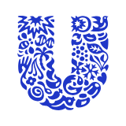
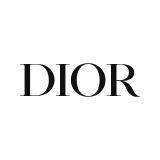

A companion to the hotel-chains doc for the Christ Com finals: the beauty groups, the famous brands and India's names, with founders, name and logo stories, CEOs, taglines and quiz hooks.

## Quiz-ready stories

If you only have ten minutes, revise these. Each one is a likely connect or identify question.

1. **Maybelline** = Mabel (the founder's sister) + Vaseline.
2. **Revlon**: the "L" is for Charles Lachman, the partner of the Revson brothers.
3. **Nivea** comes from Latin *nivis*, snow. **Vaseline** is said to come from *Wasser* + *elaion*.
4. **Lakmé** is named after a French opera. Tata created it at Nehru's urging, to save foreign exchange.
5. **Vicco** = Vishnu Industrial Chemical Company. **Dabur** = Daktar Burman. **FSN** (Nykaa) = Falguni Sanjay Nayar. **VLCC** = Vandana Luthra Curls and Curves. **MAC** = Make-up Art Cosmetics.
6. **Avon** is named after Stratford-upon-Avon. It began when a book salesman gave away perfume.
7. **Sephora** = Greek *sephos* (pretty) + Zipporah.
8. **Shalimar** perfume (Guerlain) is named after Lahore's Shalimar Gardens. **Lakmé** is ultimately Lakshmi. That makes two South Asian links in French beauty.
9. **Chanel No. 5** was the fifth sample. Chanel's global CEO is Leena Nair from Kolhapur.
10. **Indian-origin CEOs:** Leena Nair (Chanel), Shailesh Jejurikar (P&G, from Jan 2026), Priya Nair (HUL).
11. **Soap opera** comes from P&G sponsoring radio serials.
12. **Thrissur:** Chandrika soap (Irinjalakuda, 1940; Wipro since 2003) and Ujala (Jyothy Labs, named after the founder's daughter).
13. **Indulekha** hair oil shares its name with the first Malayalam novel's heroine.
14. **Boroline**'s elephant logo gives it the nickname *haathi chhaap*. **Godrej**'s Chavi (1918) is presented as the first soap made from vegetable oil.
15. **2025–26 deals and moves:** HUL bought Minimalist; L'Oréal agreed to buy Kering Beauté; Coty's CEO Sue Nabi left; Glow & Lovely was renamed from Fair & Lovely back in 2020.

Logos are shown for Unilever and Dior, the only ones available in an open icon set. The rest are described in words.

## The big beauty groups

A handful of groups own most of the famous names. Three Indian-origin leaders run some of them: Leena Nair (Chanel), Shailesh Jejurikar (P&G) and Priya Nair (Hindustan Unilever).

| Group | Est., HQ | CEO (Oct 2026) | Origin and history | Brands, name and trivia |
| --- | --- | --- | --- | --- |
| **L'Oréal** | 1909, Clichy (Paris) | Nicolas Hieronimus (since 2021) | Chemist Eugène Schueller invented a safe hair dye and called it Auréale, after a fashionable hairstyle, the auréole. The company became L'Oréal. | The world's largest beauty company. The founder's family, the Bettencourts, still control it, and Nestlé is a major shareholder. Brands include Lancôme, Maybelline, Garnier, Kérastase, Kiehl's, CeraVe, La Roche-Posay and Aesop, plus YSL Beauté under licence. In 2025 it agreed to buy Kering Beauté, including Creed. |
| **Estée Lauder Companies** | 1946, New York | Stéphane de La Faverie (since Jan 2025) | Estée Lauder, born Josephine Esther Mentzer, sold her uncle's skin creams and started the company with her husband Joseph. | She pioneered the free gift with purchase. Brands include Clinique (1968), MAC, La Mer, Bobbi Brown, Jo Malone, Aveda and Tom Ford Beauty. The Lauder family still controls the votes. |
|  **Unilever** | 1929, London | Fernando Fernandez (since 2025). India: Priya Nair, HUL's first woman CEO (2025) | Formed by merging Britain's Lever Brothers (Sunlight soap) with Margarine Unie of the Netherlands. | The "U" logo is made of 25 small icons, each standing for part of the business, such as a hand, a heart, a bee and a lock of hair. Beauty brands include Dove, Pond's, Vaseline, Lakmé and Dermalogica. HUL bought 90.5% of Minimalist in 2025. |
| **Procter & Gamble** | 1837, Cincinnati | Shailesh Jejurikar (since Jan 2026) | Candle maker William Procter and soap maker James Gamble had married sisters. Their father-in-law suggested they go into business together. | Owns Olay, SK-II, Pantene, Head & Shoulders and Gillette. Ivory soap was sold as "99 44⁄100% pure" and "It floats". Soap operas got their name from P&G sponsoring radio dramas. |
|  **LVMH (beauty)** | 1987, Paris | Bernard Arnault (group chairman and CEO) | Formed by merging Moët Hennessy with Louis Vuitton. Its beauty arm grew around Parfums Christian Dior. | Owns Dior, Guerlain, Givenchy and Benefit, incubates Fenty Beauty, and owns the Sephora stores (bought in 1997). The name Sephora mixes the Greek *sephos* (pretty) with Zipporah, Moses's wife. |
| **Chanel** | 1910, Paris (now London) | Leena Nair, global CEO since 2022 | Coco Chanel opened a hat shop in 1910. Today the privately owned Wertheimer brothers control it. | Chanel No. 5 (1921) was the fifth sample perfumer Ernest Beaux showed her. Leena Nair grew up in Kolhapur and was Unilever's head of HR. |
| **Coty** | 1904, Paris (now New York) | Markus Strobel, executive chairman and interim CEO (from Jan 2026) | Perfumer François Coty founded it in Paris. | Controlled by JAB Holding. Brands include CoverGirl, Max Factor, Rimmel and Kylie Cosmetics. Sue Nabi left as CEO at the end of 2025. |
| **Shiseido** | 1872, Tokyo | Kentaro Fujiwara | Arinobu Fukuhara, a former navy pharmacist, opened Japan's first Western-style pharmacy in Ginza. | The name comes from a line in the I Ching praising the earth that nurtures new life. The camellia logo dates from 1915. It ran one of Japan's first soda fountains. |
| **Beiersdorf** | 1882, Hamburg | Vincent Warnery (since 2021) | Pharmacist Paul Carl Beiersdorf patented a medical plaster. | Nivea (1911) comes from the Latin *nivis*, "of snow", for its white cream. The blue tin arrived in 1925. Also owns Eucerin, La Prairie and Tesa tape. |
| **Puig** | 1914, Barcelona | José Manuel Albesa (2026) | Antonio Puig began by importing perfume into Spain. | Owns Rabanne, Carolina Herrera, Charlotte Tilbury and Byredo. Listed in 2024. |
| **Amorepacific** | 1945, Seoul | — | Suh Sung-whan built it on his mother's camellia hair oil. | The power behind K-beauty: Sulwhasoo, Laneige and Innisfree. |
| **Avon** | 1886, New York (now London; Natura &Co) | — | Book salesman David McConnell gave away perfume to sell his books. The perfume sold better than the books. | Named after Stratford-upon-Avon, Shakespeare's town. The door-to-door saleswomen were called "Avon ladies", and the ads said "Avon calling". |
| **Revlon** | 1932, New York | — | Brothers Charles and Joseph Revson and chemist Charles Lachman. | The "L" in Revlon is Lachman's. It started with nail enamel and went bankrupt in 2022. |

## Iconic global brands

The best stories hide in the names: Maybelline is a sister plus Vaseline, Revlon contains a partner's initial, and Nivea means snow.

| Brand | Est., founder | Owner today | Name and origin | Trivia |
| --- | --- | --- | --- | --- |
| **Maybelline** | 1915, T.L. Williams | L'Oréal | His sister **Mabel** mixed Vaseline with coal dust to darken her lashes. Mabel plus Vaseline made Maybelline. | It started as a mail-order mascara. |
| **Lancôme** | 1935, Armand Petitjean | L'Oréal | Named after the Château de Lancosme in central France. | The rose is its symbol. |
| **MAC** | 1984, Toronto, Frank Toskan and Frank Angelo | Estée Lauder | Make-up Art Cosmetics, first made for professional make-up artists. | Every penny from Viva Glam lipstick goes to HIV/AIDS charity. |
| **Clinique** | 1968 | Estée Lauder | Grew out of a *Vogue* article, "Can great skin be created?" | The first dermatologist-guided, allergy-tested brand. Staff wear white lab coats. |
| **Dove** | 1957 | Unilever | Not technically soap: a "beauty bar" that is one-quarter moisturising cream. | The Real Beauty campaign (2004) used ordinary women instead of models. |
| **Pond's** | 1846, Theron Pond | Unilever | Began as Pond's Extract, a witch-hazel remedy. | Its cold cream and talc are household names in India. |
| **Olay** | 1952, South Africa, Graham Wulff | P&G | First sold as **Oil of Olay**. It was "Oil of Ulay" in the UK and "Oil of Olaz" in Europe. | Wulff made it as a pink beauty fluid based on lanolin. |
| **Nivea** | 1911, Hamburg | Beiersdorf | Latin *nivis*: "of snow". | Its blue tin is one of the most recognised packs in the world. |
| **Vaseline** | 1870, Robert Chesebrough | Unilever | He found oil workers using "rod wax" on wounds and purified it. The name is said to blend German *Wasser* (water) and Greek *elaion* (oil). | Chesebrough claimed he ate a spoonful a day. |
| **Rimmel** | 1834, London, Eugène Rimmel | Coty | Named after its perfumer founder. | His mascara was so famous that "rimel" means mascara in Portuguese, Turkish and other languages. |
| **Max Factor** | 1909, Los Angeles, Maksymilian Faktorowicz | Coty | A Polish-born make-up artist to Hollywood stars. | He popularised the term "make-up". |
| **Elizabeth Arden** | 1910, New York, Florence Nightingale Graham | Revlon | The name is said to come from the novel *Elizabeth and Her German Garden* and Tennyson's poem *Enoch Arden*. | Known for its Red Door salon on Fifth Avenue. Its feud with Helena Rubinstein was called the "powder war". |
| **Guerlain** | 1828, Paris | LVMH | A family perfume house. | The perfume **Shalimar** (1925) is named after the Shalimar Gardens of Lahore. |
| **Chanel No. 5** | 1921 | Chanel | The fifth sample Ernest Beaux showed Coco Chanel. | Marilyn Monroe said she wore "just a few drops of No. 5" to bed. |
| **Garnier** | 1904, Alfred Amour Garnier | L'Oréal | Started with a plant-based hair lotion. | Fructis and Micellar Water are its best sellers. |
| **Kiehl's** | 1851, New York pharmacy | L'Oréal | A neighbourhood apothecary in the East Village. | Stores display a skeleton nicknamed "Mr Bones". |
| **The Body Shop** | 1976, Brighton, Anita Roddick | Sold several times since 2023 | Campaigned against animal testing and sold refills. | Its owners went from L'Oréal (2006) to Natura (2017) to Aurelius (2023), and it fell into administration in 2024. |
| **Fenty Beauty** | 2017, Rihanna | LVMH's Kendo incubator | Fenty is Rihanna's surname. | Launched with 40 foundation shades. Rival brands rushed to widen their ranges, which became known as the "Fenty effect". |
| **Kylie Cosmetics** | 2015, Kylie Jenner | Coty owns a majority | Started with lip kits. | Its sell-outs made celebrity brands big business. |
| **Rare Beauty** | 2020, Selena Gomez | Gomez | Built around mental-health messaging. | Gives a share of sales to the Rare Impact Fund. |
| **Huda Beauty** | 2013, Dubai, Huda Kattan | Founder-led | A beauty blogger who started by selling false lashes. | One of the best-known Middle Eastern beauty brands. |
| **Glossier** | 2014, Emily Weiss | Founder-led | Grew out of her beauty blog, *Into the Gloss*. | Its pink packaging became known as "Glossier pink". |
| **Benefit** | 1976, San Francisco, twins Jean and Jane Ford | LVMH | Started as a shop called The Face Place. | Known for its brow bars and "Benetint" cheek stain. |
| **NARS** | 1994, François Nars | Shiseido | Founded by a make-up artist. | Its best-known blush is named "Orgasm". |

## Indian brands

India's beauty stories fall into three eras. Swadeshi balms like Boroline and Vicco came first. Lakmé was created to save foreign exchange. Now direct-to-consumer brands are founded by Shark Tank judges.

| Brand | Est., HQ | Leader / owner (Oct 2026) | Origin and history | Name and trivia |
| --- | --- | --- | --- | --- |
| **Lakmé** | 1952, Mumbai | Hindustan Unilever (CEO Priya Nair) | Tata Oil Mills started it after Nehru worried about Indian women spending scarce foreign exchange on imported make-up. Simone Tata later led it. It went to Hindustan Lever in 1998. | Named after Léo Delibes' French opera *Lakmé*, whose heroine's name comes from Lakshmi. Lakmé Fashion Week is one of India's main fashion events. |
| **Nykaa (FSN E-Commerce)** | 2012, Mumbai | Falguni Nayar, re-appointed MD and CEO for five years (2025) | A former Kotak investment banker started an online beauty store at 49. | The name comes from the Sanskrit *nayaka*, the one in the spotlight. FSN stands for Falguni Sanjay Nayar. Its 2021 listing made her India's richest self-made woman. |
| **Honasa Consumer (Mamaearth)** | 2016, Gurugram | Varun Alagh (co-founder and CEO) | Varun and Ghazal Alagh couldn't find toxin-free baby products, so they made their own. | Listed in 2023. Ghazal was a Shark Tank India judge. Its other brands include The Derma Co, Aqualogica, BBlunt and Dr Sheth's. |
| **SUGAR Cosmetics** | 2015, Mumbai | Vineeta Singh (co-founder and CEO) | Founded by two IIM Ahmedabad graduates, Vineeta Singh and Kaushik Mukherjee. | Vineeta is a Shark Tank India judge. Its matte lipsticks are made for Indian skin tones. |
| **Minimalist** | 2020, Jaipur | HUL owns 90.5% (2025) | Brothers Mohit and Rahul Yadav built it on listing actives and percentages on the label ("10% niacinamide"). | HUL paid about ₹3,000 crore for its stake. |
| **Himalaya Wellness** | 1930, Dehradun (now Bengaluru) | Founded by the Manal family | Muhammad Manal started making herbal medicines. The first was Serpina, for blood pressure. | **Liv.52** (1955) is its most famous product. Its face washes made it a beauty brand. |
| **Biotique** | 1992, Delhi | — | Vinita Jain mixed Ayurveda with Swiss biotechnology. | Its slogan is "Ayurvedic recipes, Swiss biotechnology". |
| **Forest Essentials** | 2000, Delhi | Estée Lauder holds a minority stake | Mira Kulkarni started it by making Ayurvedic soaps by hand. | India's best-known luxury Ayurveda brand. |
| **Kama Ayurveda** | 2002, Delhi | Puig holds a majority | Founded by Vivek Sahni. | Another luxury Ayurveda brand, now Spanish-owned. |
| **Vicco** | 1952, Nagpur/Mumbai | Pendharkar family | Keshav Vishnu Pendharkar started with Vajradanti tooth powder. | Vicco stands for **Vishnu Industrial Chemical Company**. Jingle: "Vicco Turmeric, nahin cosmetic, Vicco Turmeric Ayurvedic cream". |
| **Boroline** | 1929, Kolkata | G.D. Pharmaceuticals | Gour Mohan Dutta made it as a swadeshi answer to British imports. | Its logo is an elephant, so people call it *haathi chhaap*. Legend says it gave away a lakh tubes on Independence Day 1947. The name comes from boric acid and oleine. |
| **Emami** | 1974, Kolkata | Founded by R.S. Agarwal and R.S. Goenka | Two school friends started with cosmetics and talc. | Owns Boroplus, Navratna, Zandu, Kesh King and Fair and Handsome. |
| **Dabur** | 1884, Kolkata | Burman family | S.K. Burman, a doctor, made Ayurvedic medicines. | Dabur is formed from **Da**ktar (doctor) and **Bur**man. Its beauty brands include Vatika and Gulabari. |
| **Glow & Lovely** | 1975 as Fair & Lovely | HUL | A fairness cream. | Renamed in 2020 after protests against colourism. |
| **VLCC** | 1989, Delhi | Founder Vandana Luthra | Began as a slimming and beauty-salon chain. | The name stands for Vandana Luthra Curls and Curves. |
| **Shahnaz Husain** | 1971, Delhi | Founder-led | A pioneer of herbal beauty salons. | She received the Padma Shri in 2006. |
| **Purplle** | 2011, Mumbai | Manish Taneja (co-founder and CEO) | An online beauty store for smaller cities. | Owns the brands Good Vibes and Faces Canada. |
| **Tira** | 2023, Mumbai | Reliance Retail | Reliance's beauty store chain, overseen by Isha Ambani. | Its rivals are Nykaa and Purplle. |

## Kerala links

With a Kerala quizmaster, Thrissur's soap-and-whitener stories are the most likely to come up. Chandrika and Ujala both started in Thrissur district.

| Brand | Base | Story | Quiz hook |
| --- | --- | --- | --- |
| **Chandrika** | Irinjalakuda, Thrissur | Ayurvedic physician C.R. Kesavan Vaidyar launched the herbal soap in 1940 through SV Products. | Wipro took over the marketing rights in 2003, so a Kerala soap became part of an IT company's consumer business. The soap is made from coconut oil, wild ginger, lime peel and sandalwood. |
| **Ujala / Jyothy Labs** | Thrissur (now Mumbai) | M.P. Ramachandran developed a liquid fabric whitener in his kitchen in 1983. | The company is named after his daughter, Jyothy. In 2011 it bought Henkel's Indian business, which added Margo neem soap, Henko and Fa. |
| **Indulekha** | Kerala | A Kerala hair oil sold with a comb-like bottle that applies oil straight to the scalp. Hindustan Unilever bought it in 2016. | It shares its name with the heroine of O. Chandu Menon's *Indulekha* (1889), often called the first Malayalam novel. |
| **Medimix** | Chennai | Dr V.P. Sidhan, a railway doctor, made it in 1969 from his family's Ayurvedic oil recipe to treat skin problems among railway workers. | Called India's largest-selling handmade soap. The business later split between the Cholayil and AVA groups, and its pitch is "18 herbs". |
| **Kottakkal Arya Vaidya Sala** | Kottakkal, Malappuram | P.S. Varier founded it in 1902. | Kerala's best-known Ayurveda house, and it runs as a charitable trust. |
| **K.P. Namboodiri's** | Thrissur | A long-running Ayurvedic tooth-powder and personal-care maker. | It is a good Thrissur-specific "identify the brand" question. |
| **Kerala Ayurveda / Vaidyaratnam / Nagarjuna** | Aluva / Ollur, Thrissur / Thodupuzha | Classical Ayurveda makers that also sell oils and skincare. | Kerala's Ayurveda tourism links them to the resorts in the hotel-chains doc. |

## Taglines, signatures and product quirks

Slogans and jingles are the most common way to set a beauty question: quote the line, ask for the brand.

### Global

| Brand | Tagline / slogan | Signature product or touch | More tidbits |
| --- | --- | --- | --- |
| **L'Oréal Paris** | **"Because you're worth it"** (1971, written by copywriter Ilon Specht) | Its hair colour started the company. | Aishwarya Rai has been a brand ambassador since 2003, and walks the Cannes red carpet for it. |
| **Maybelline** | **"Maybe she's born with it. Maybe it's Maybelline."** | Great Lash mascara, in the pink-and-green tube | Added "New York" to its name after moving there from Memphis. |
| **Estée Lauder** | Estée's own marketing rule: "Telephone, telegraph, tell-a-woman" | **Advanced Night Repair**, the "little brown bottle" (1982) | It pioneered the free gift with purchase. |
| **Clinique** | "Allergy tested. 100% fragrance free." | The 3-Step skincare system and its yellow moisturiser | Counter staff wear lab coats. |
| **MAC** | "All Ages, All Races, All Genders" | Viva Glam lipstick and Ruby Woo | Every penny from Viva Glam goes to charity. |
| **Lancôme** | *La vie est belle* (a fragrance, fronted by Julia Roberts) | Génifique serum | The rose logo comes from the founder's love of roses. |
| **Chanel** | — | **No. 5** in its square bottle. The interlocking double-C logo (1925). | Marilyn Monroe wore "nothing but a few drops of No. 5". Brad Pitt was the first man to front No. 5 (2012). |
| **Dior** | *J'adore* (Charlize Theron) | Rouge Dior 999 lipstick, and Sauvage fragrance | Dior Beauty is LVMH's biggest beauty brand. |
| **Dove** | **"Real Beauty"**; "one-quarter moisturising cream" | The beauty bar shaped like a dove | Its Self-Esteem Project runs workshops in schools. |
| **Lux** (Unilever) | **"Beauty soap of film stars"** | Film stars in bathtubs | Leela Chitnis was the first Indian actress in a Lux ad (1941). Shah Rukh Khan was its first male face (2005). |
| **Olay** | "Love the skin you're in" | Regenerist and Total Effects | Sold as Oil of Ulay in the UK. |
| **Nivea** | — | **Nivea Creme** in the blue tin | The tin's blue and white have barely changed since 1925. |
| **Revlon** | The "Fire and Ice" ad (1952) | It started with long-lasting nail enamel. | The ad asked, "Are you made for Fire and Ice?" |
| **Avon** | **"Ding dong, Avon calling"** | Door-to-door "Avon ladies" | The first Avon lady was Mrs P.F.E. Albee (1886). |
| **Rimmel** | **"Get the London look"** | Mascara | "Rimel" means mascara in several languages. |
| **Benefit** | **"Laughter is the best cosmetic"** | Benetint cheek stain and brow bars | Started by twins in San Francisco. |
| **Fenty Beauty** | "Beauty for All" | Pro Filt'r foundation in 40 shades | *Time* named it one of the best inventions of 2017. |
| **Glossier** | "Skin first. Makeup second." | Boy Brow and pink zip-up pouches | Grew out of the blog *Into the Gloss*. |
| **Lush** | "Fresh handmade cosmetics" | **Bath bombs**, invented by co-founder Mo Constantine (1989) | Sells "naked", unpackaged products. |
| **The Body Shop** | "Enrich not exploit" | Refill stations and White Musk | Anita Roddick campaigned against animal testing. |
| **Sephora** | "We Belong to Something Beautiful" | Black-and-white striped stores and the flame logo | Its loyalty programme is Beauty Insider. |
| **Kiehl's** | — | Ultra Facial Cream and apothecary-style labels | A skeleton called "Mr Bones" stands in every store. |

### India and Kerala

| Brand | Tagline / jingle | Signature product or touch | More tidbits |
| --- | --- | --- | --- |
| **Lakmé** | — | Eyeconic kajal and Absolute range | Lakmé Fashion Week; Lakmé Salons |
| **Nykaa** | "Your Beauty, Our Passion" | Pink Friday sale; the Nykaaland beauty festival | It is the rare Indian tech company that was profitable when it listed. |
| **Mamaearth** | "Goodness Inside" | "Plant Goodness": it plants trees in return for orders | Was the first Asian brand certified "Made Safe" (toxin-free). |
| **Vicco** | **"Vicco Turmeric, nahin cosmetic, Vicco Turmeric Ayurvedic cream"** | Vajradanti tooth powder | Its Doordarshan-era jingles are still widely remembered. |
| **Boroline** | "Khushboodar antiseptic cream" | The green tube with the elephant logo | Called *haathi chhaap*. |
| **Godrej (Cinthol, Godrej No. 1)** | Cinthol: "Alive is awesome" | **Chavi** (1918), presented as the world's first soap made from vegetable oil | Rabindranath Tagore endorsed Godrej soap. |
| **Himalaya** | — | Neem face wash; Liv.52 | Started with Ayurvedic medicines before beauty. |
| **Medimix** | "18 herbs" | Its green handmade bar | It began as a doctor's prescription for railway workers. |
| **Chandrika** | Sold as an Ayurvedic soap | Its pale-green bar | Kerala-made since 1940, marketed by Wipro since 2003. |
| **Ujala** | "Ujala supreme" for whiter whites | A liquid blue whitener | Named for light. The company is named after the founder's daughter. |

## Sources

CEOs were checked against 2025–26 reports. The older history and slogans come from standard brand histories, so verify any single detail before using it in a tie-breaker.

- [L'Oréal 2025 annual results](https://www.globenewswire.com/news-release/2026/02/12/3237534/0/en/2025-annual-results.html)
- [Estée Lauder names Stéphane de La Faverie CEO (GCI)](https://www.gcimagazine.com/brands-products/news/news/22924695/its-official-the-este-lauder-companies-new-ceo-stphane-de-la-faverie)
- [Priya Nair takes over as HUL CEO (Outlook Business)](https://www.outlookbusiness.com/markets/hindustan-unilever-shares-surge-5-as-priya-nair-takes-over-as-ceo-analysts-see-a-new-chapter-unfolding)
- [Coty appoints Markus Strobel executive chairman and interim CEO](https://www.businesswire.com/news/home/20251221766663/en)
- [Shiseido board and executive officers](https://corp.shiseido.com/en/company/executiveofficers/)
- [Beiersdorf CEO Vincent Warnery (MarketScreener)](https://www.marketscreener.com/quote/stock/BEIERSDORF-AG-435740/news/Beiersdorf-CEO-to-resign-board-member-Warnery-to-take-over-33083675/)
- [Puig names José Manuel Albesa CEO (Cosmetics Business)](https://cosmeticsbusiness.com/puig-ceo-jose-manuel-albesa-next-chapter)
- [Leena Nair, Fortune Most Powerful Women 2026](https://fortune.com/ranking/most-powerful-women/2026/leena-nair/)
- [Nykaa re-appoints Falguni Nayar as MD and CEO](https://inshorts.com/en/news/nykaa-reappoints-falguni-nayar-as-md---ceo-for-5-years-1762520129838)
- [HUL acquires 90.5% of Minimalist (The Morning Context)](https://themorningcontext.com/business/hul-acquires-905-stake-in-skincare-startup-minimalist)
- [Chandrika (soap), Wikipedia](<https://en.wikipedia.org/wiki/Chandrika_(soap)>)
- [50 years of Medimix (The News Minute)](https://www.thenewsminute.com/article/50-years-medimix-brief-history-india-s-largest-selling-handmade-soap-82272)
- Logos: [Simple Icons](https://simpleicons.org) (Unilever, Dior)
