## Desserts named after people and places

| Dessert | Named after / origin | The story |
| --- | --- | --- |
| 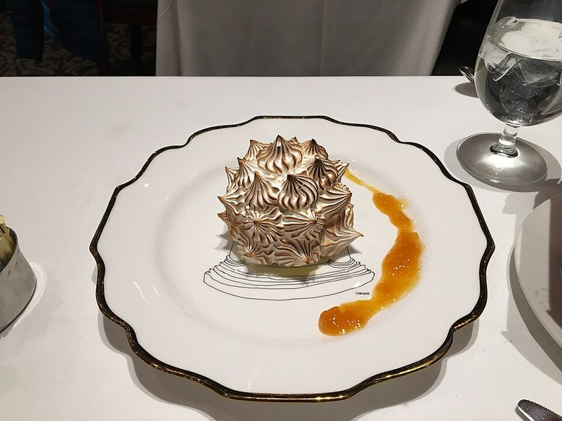{: .place-thumb } **Baked Alaska** | The **US purchase of Alaska** (1867) | Ice cream on sponge, covered in meringue and browned in a hot oven. The meringue insulates the ice cream. The name is credited to **Delmonico's**, New York (Charles Ranhofer, c. 1867–76). Earlier versions were the French **omelette norvégienne** ("Norwegian omelette") and **Count Rumford**'s experiments on meringue's insulating power. **1 Feb** is Baked Alaska Day in the US. |
| 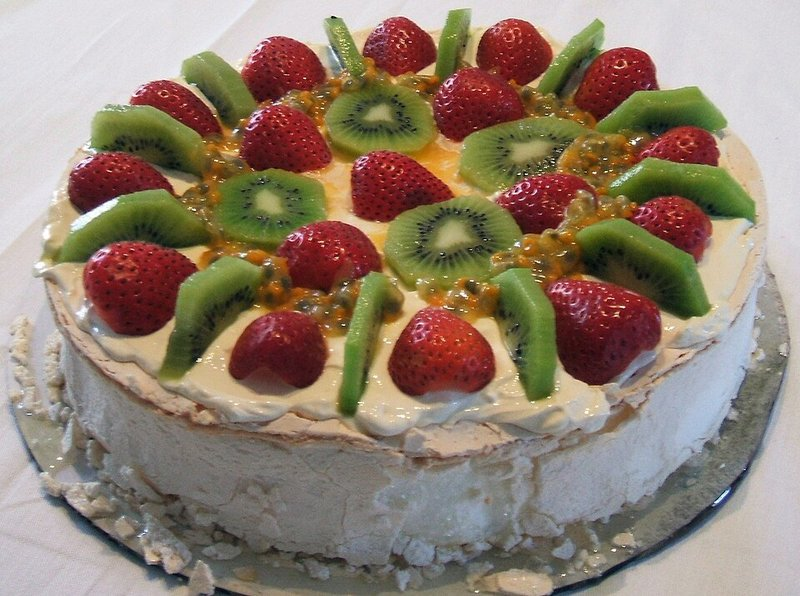{: .place-thumb } **Pavlova** | Russian ballerina **Anna Pavlova** | Created for her **1926 tour of Australia and New Zealand**. Meringue with a crisp shell, marshmallowy inside, topped with cream and fruit, meant to be as light as her tutu. **Australia and New Zealand both claim it**: NZ's Wellington hotel version is usually dated earlier. The Oxford English Dictionary sided with NZ, citing a 1927 NZ recipe.\* |
| 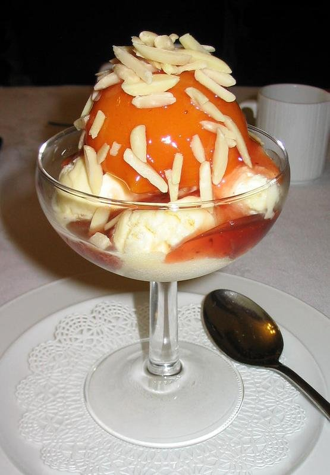{: .place-thumb } **Peach Melba** | Australian soprano **Dame Nellie Melba** | Created by **Auguste Escoffier** at the **Savoy, London** (1892–93): peaches, vanilla ice cream and raspberry sauce. First served on an **ice swan**, after she sang *Lohengrin*. **Melba toast** was also named after her, made when she was dieting. She took her stage name from **Melbourne**. |
| 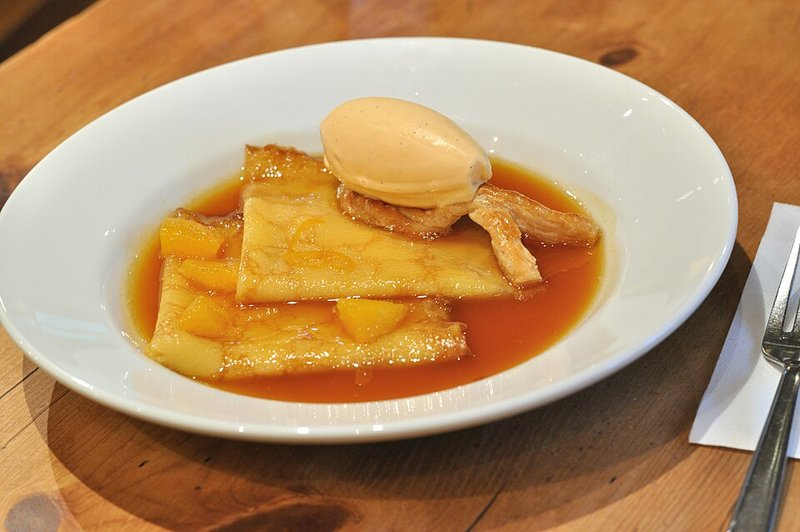{: .place-thumb } **Crêpe Suzette** | Said to be **Suzette**, a companion of the **Prince of Wales (Edward VII)** | Legend says 14-year-old waiter **Henri Charpentier** at Monte Carlo's Café de Paris (1895) **accidentally set the liqueur alight**. Orange-butter sauce with Grand Marnier, flambéed.\* |
| 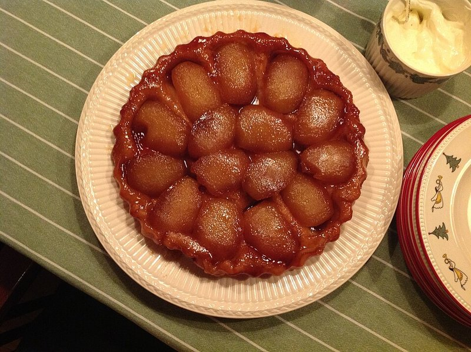{: .place-thumb } **Tarte Tatin** | The **Tatin sisters**, Stéphanie and Caroline, of **Hotel Tatin**, Lamotte-Beuvron, France | Legend says Stéphanie **forgot the pastry** under the apples and put it on top, then flipped the tart. It's an **upside-down** caramelised apple tart. Maxim's of Paris made it famous.\* |
| 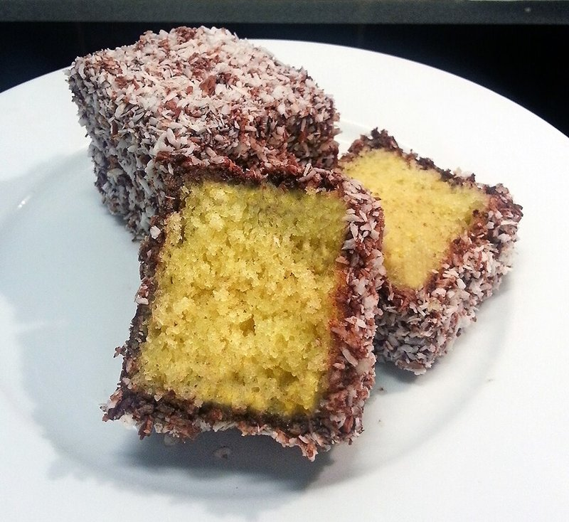{: .place-thumb } **Lamington** | **Lord Lamington**, Governor of Queensland (1896–1901) | Sponge squares dipped in chocolate and coconut. NZ claims this one too.\* |
| 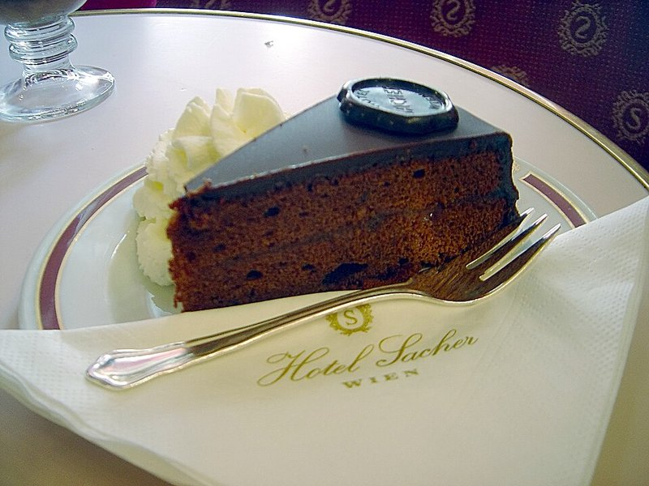{: .place-thumb } **Sachertorte** | **Franz Sacher**, aged 16 (1832), for Prince **Metternich** in Vienna | Chocolate cake with apricot jam. The **"Sweet Seven Years' War"** was a court fight between **Hotel Sacher** and **Demel** bakery over the right to "The Original Sacher-Torte". Sacher won (1963). |
| 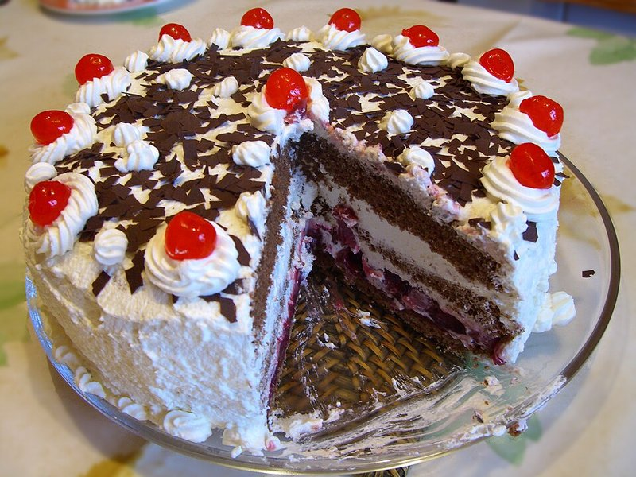{: .place-thumb } **Black Forest gateau** | The **Black Forest** (Schwarzwald), Germany | Its signature is **Kirschwasser** (cherry brandy). The look echoes the regional costume: black, white cream, and the **red pom-pom hat (Bollenhut)**. Credited to Josef Keller (1915).\* |
| 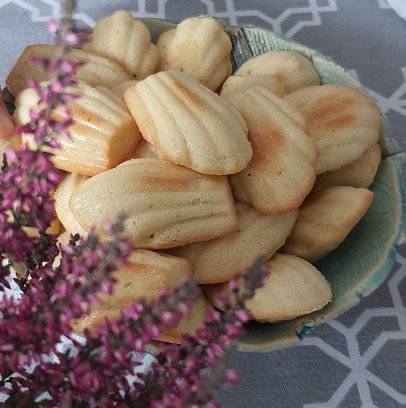{: .place-thumb } **Madeleine** | Possibly the pastry cook **Madeleine Paulmier**, Commercy | **Proust**'s *In Search of Lost Time* has the madeleine dipped in tea, which triggers involuntary memory. This is the "**Proustian moment**".\* |
| 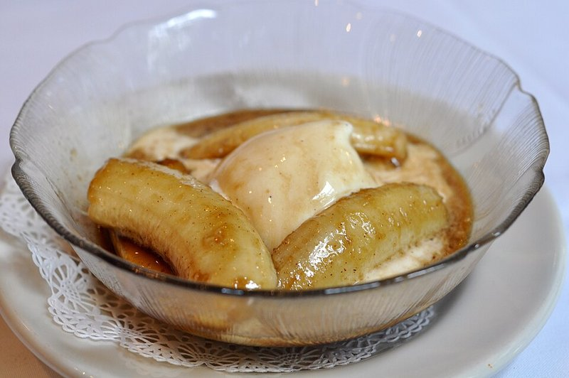{: .place-thumb } **Bananas Foster** | **Richard Foster**, a New Orleans crime commission chair | Created at **Brennan's**, New Orleans (1951), when the city was a hub of banana imports. Flambéed in rum.\* |
| 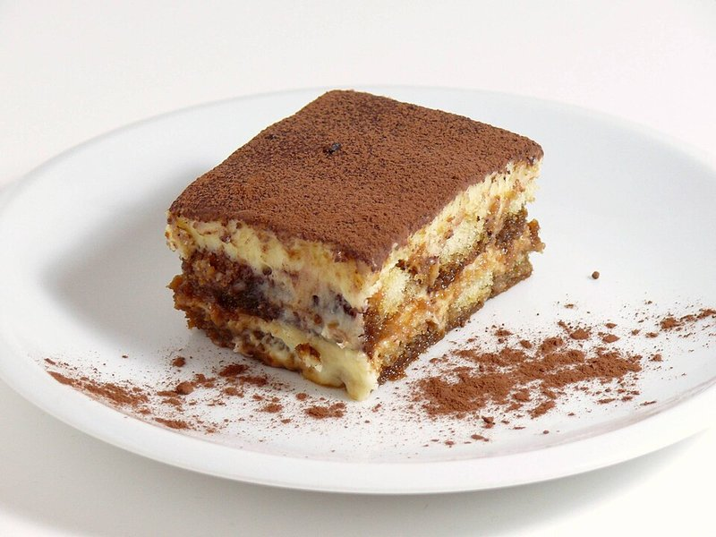{: .place-thumb } **Tiramisu** | "**Pick me up**" in Italian | Coffee and mascarpone. **Veneto vs Friuli** fought over it; Italy's agriculture ministry recognised Friuli Venezia Giulia (Tolmezzo) in 2017. Veneto's claim is Le Beccherie in Treviso (1970s). Ado Campeol died in 2021.\* |
| 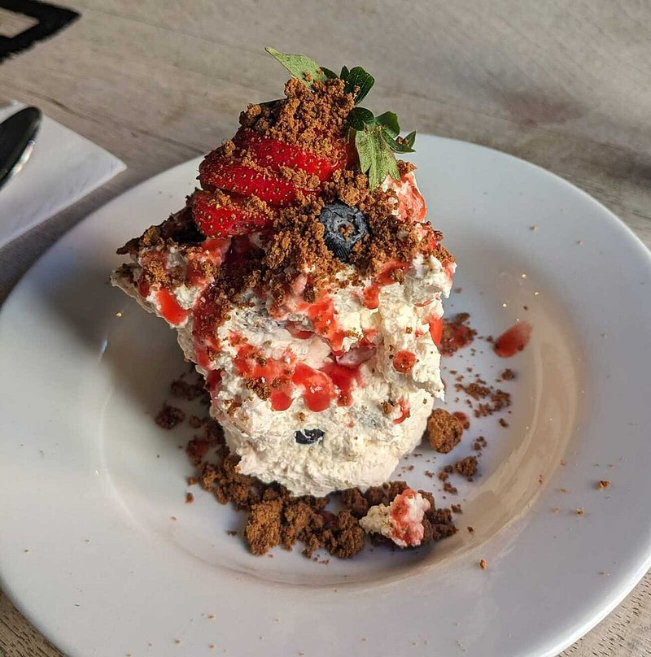{: .place-thumb } **Eton Mess** | **Eton College** | Strawberries, cream and meringue. Legend says a **dog sat on a pavlova** at the Eton v Harrow cricket match.\* |
| 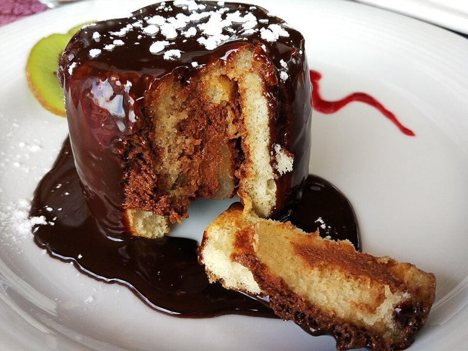{: .place-thumb } **Charlotte Russe** | Created by Carême for **Tsar Alexander I** | Named "Russian", possibly for Queen Charlotte.\* |
| 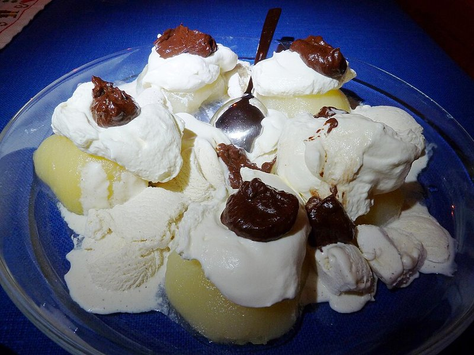{: .place-thumb } **Pear Belle Hélène** | Offenbach's operetta *La belle Hélène* | By Escoffier.\* |
| 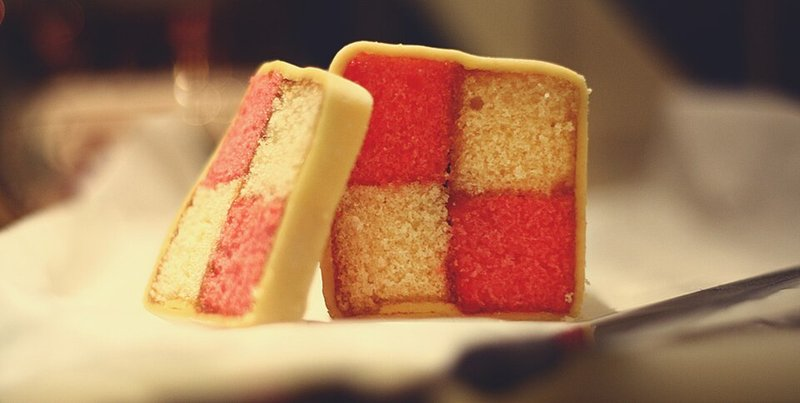{: .place-thumb } **Battenberg cake** | The 1884 marriage of Princess Victoria to **Prince Louis of Battenberg** | The pink-and-yellow chequerboard represents the four Battenberg princes. The family later anglicised its name to **Mountbatten**.\* |
| 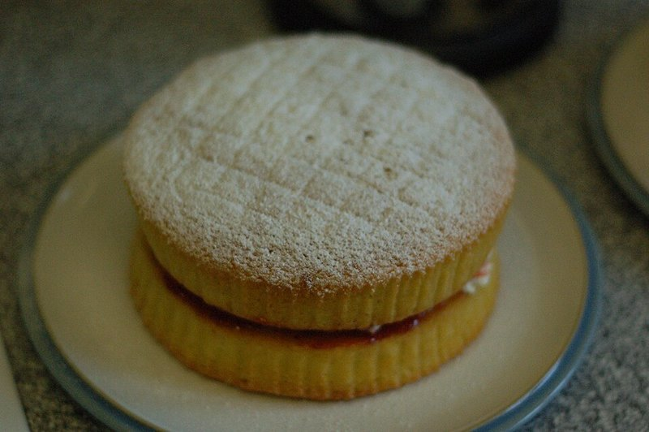{: .place-thumb } **Victoria sponge** | **Queen Victoria** | Her afternoon tea favourite.\* |
| 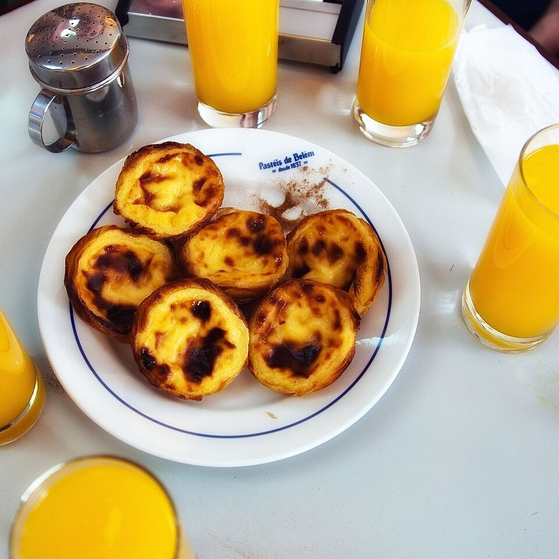{: .place-thumb } **Pastel de nata** | Monks at **Jerónimos Monastery, Belém** (Lisbon) | Egg whites were used to starch habits, so the leftover yolks went into tarts. The monks sold the recipe in 1837 to the shop **Pastéis de Belém**, which still keeps it secret.\* |
| 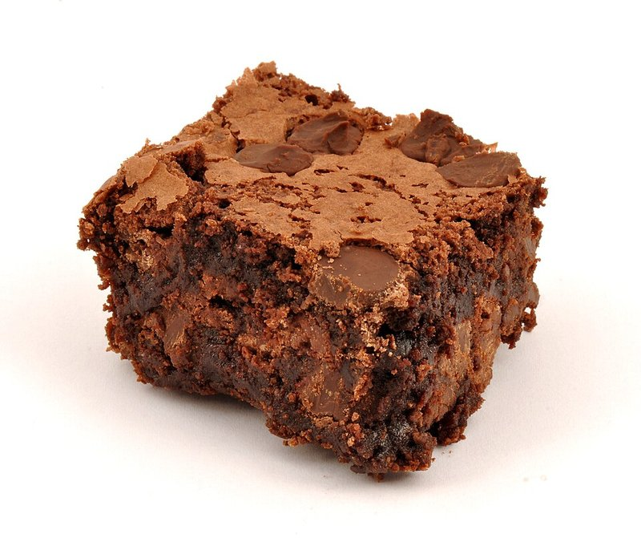{: .place-thumb } **Brownie** | Palmer House Hotel, Chicago (1893) | Made for **Bertha Palmer** for the World's Columbian Exposition, as a ladies' boxed-lunch dessert.\* |
| 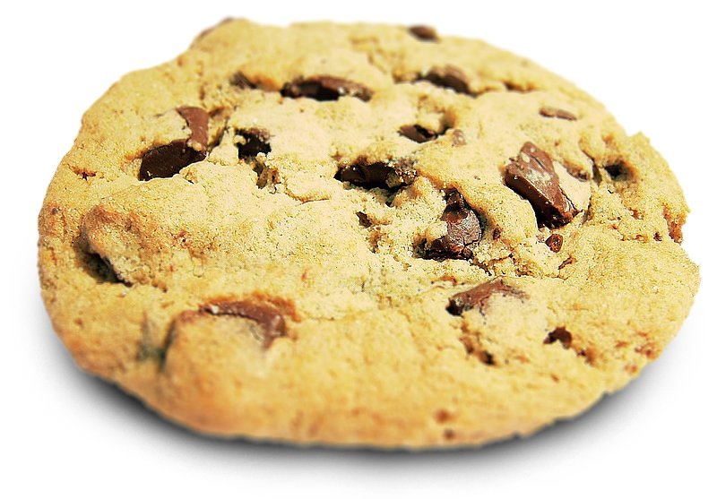{: .place-thumb } **Chocolate chip cookie** | **Ruth Wakefield**, at the **Toll House Inn**, Massachusetts (1938) | She sold the recipe to **Nestlé** for a lifetime supply of chocolate.\* |
| 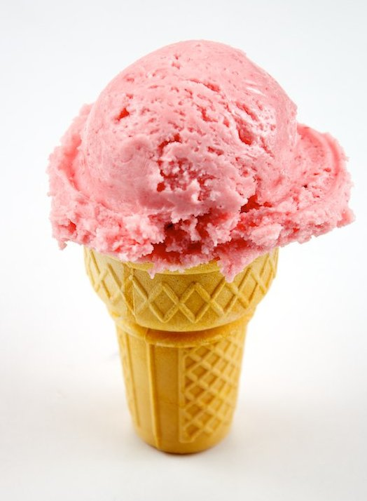{: .place-thumb } **Ice-cream cone** | 1904 **St Louis World's Fair** | Legend: a waffle seller rolled cones for an ice-cream vendor who had run out of dishes.\* |
| 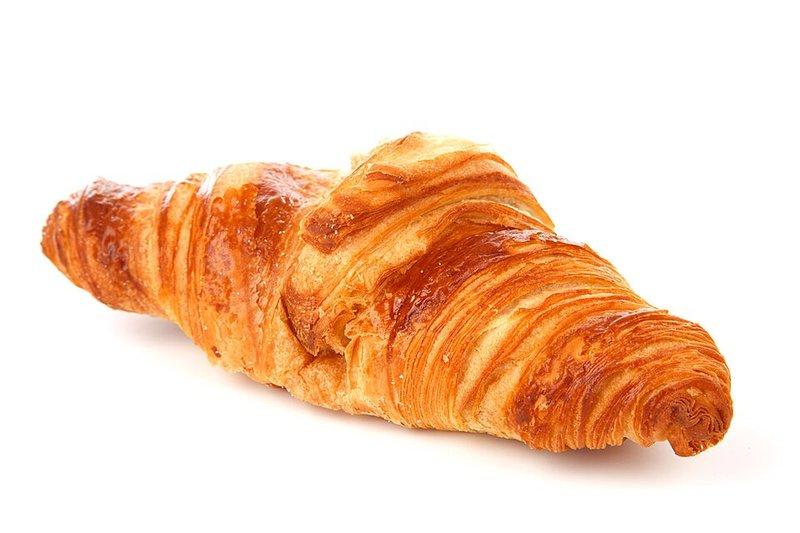{: .place-thumb } **Croissant** | Vienna's *Kipferl*, said to celebrate the defeat of the Ottomans in **1683** (the crescent) | That's legend. The modern croissant is French: Viennese baker August Zang opened a shop in Paris in 1839.\* |
| 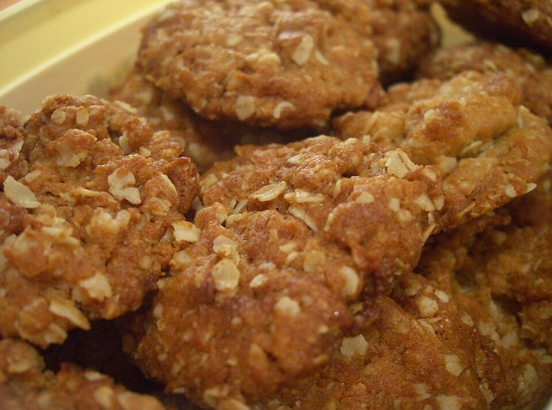{: .place-thumb } **Anzac biscuit** | The Australian and New Zealand Army Corps | Anzac biscuits were sent to WWI soldiers; "Anzac" is legally protected.\* |
| 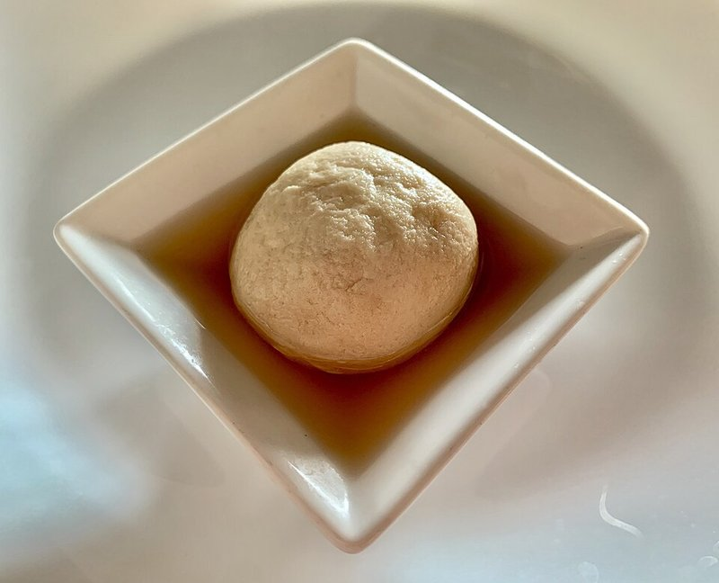{: .place-thumb } **Rasgulla** (India) | **Odisha vs West Bengal** | Bengal got a GI tag for **Banglar Rasogolla** (2017), and Odisha got one for **Odisha Rasagola** (2019). Odisha marks Rasagola Dibasa. |

*\* From general knowledge; food origins are often legend, so treat dates as approximate.*

## Savoury dishes with a story

| Dish | Named after / origin | The story |
| --- | --- | --- |
| 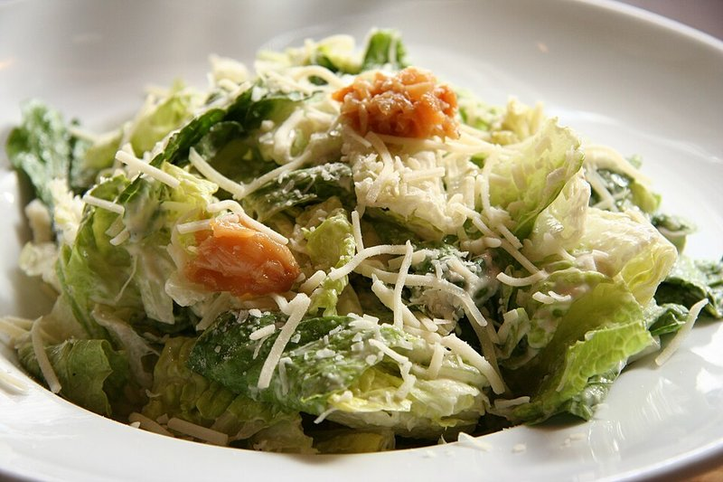{: .place-thumb } **Caesar salad** | **Caesar Cardini**, an Italian-American restaurateur in **Tijuana, Mexico** (1924) | Not Julius Caesar. On a busy **4 July** with supplies running out, he improvised with romaine, Parmesan, egg, croutons and Worcestershire. The original had **no anchovies**, which came from the Worcestershire sauce. Prohibition-era Americans crossed the border to drink.\* |
| 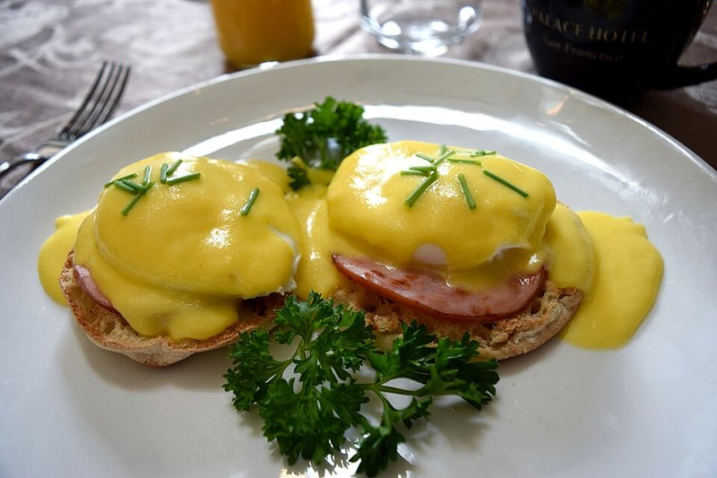{: .place-thumb } **Eggs Benedict** | Competing claims: **Lemuel Benedict**, a hungover stockbroker at the **Waldorf** (1894), or Mrs **LeGrand Benedict** at **Delmonico's** | Poached egg, ham and hollandaise on an English muffin.\* |
| 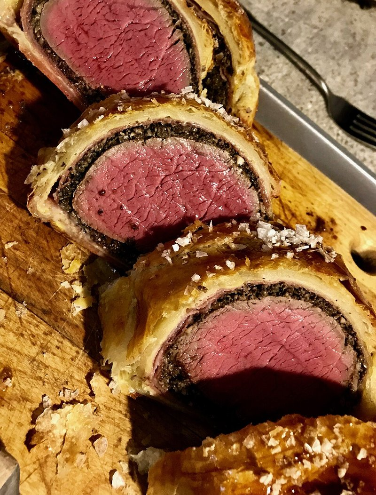{: .place-thumb } **Beef Wellington** | Supposedly the **Duke of Wellington** (Waterloo, 1815) | The link is unproven; it may just be a patriotic rename of *filet de bœuf en croûte*. Gordon Ramsay's signature dish.\* |
| 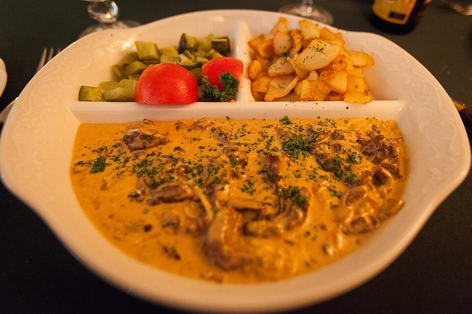{: .place-thumb } **Beef Stroganoff** | The **Stroganov** family, Russian nobles | Probably a French chef working for Count Pavel Stroganov.\* |
| 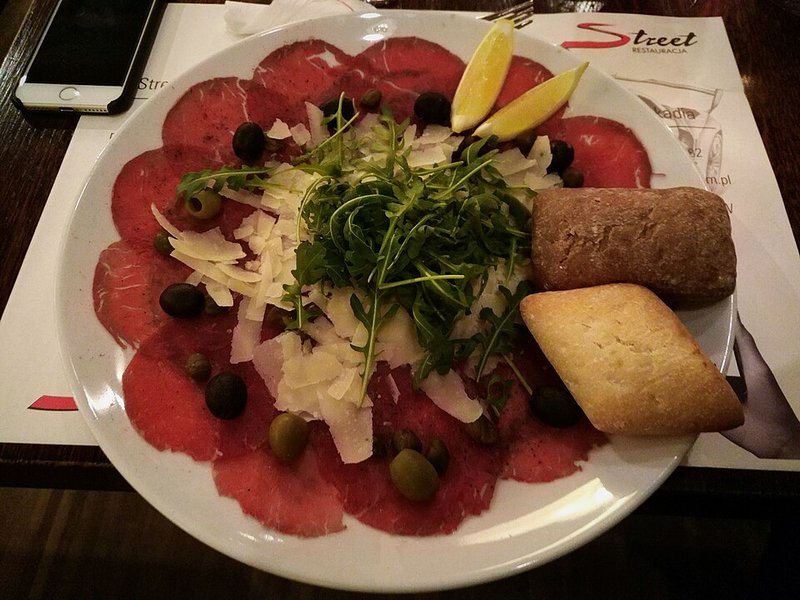{: .place-thumb } **Carpaccio** | Venetian painter **Vittore Carpaccio** | Created at **Harry's Bar, Venice** (1950) by **Giuseppe Cipriani** for Countess Amalia Mocenigo, whose doctor had banned cooked meat. The red and white echoed Carpaccio's palette. Harry's Bar also invented the **Bellini**.\* |
| 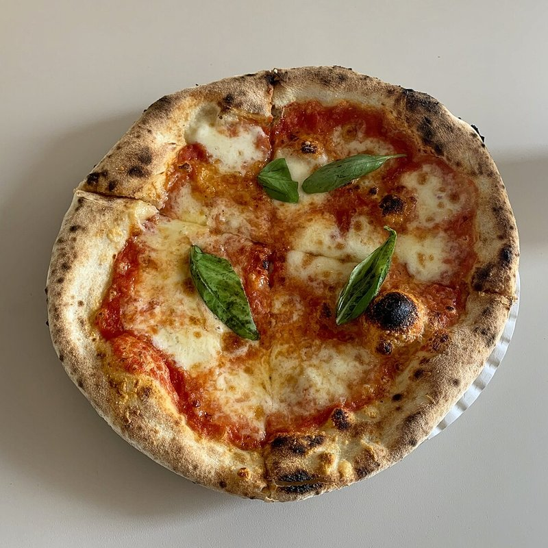{: .place-thumb } **Pizza Margherita** | **Queen Margherita of Savoy** | **Raffaele Esposito** of Pizzeria Brandi, Naples (1889). Tomato, mozzarella and basil, the colours of the **Italian flag**. The story is disputed.\* |
| 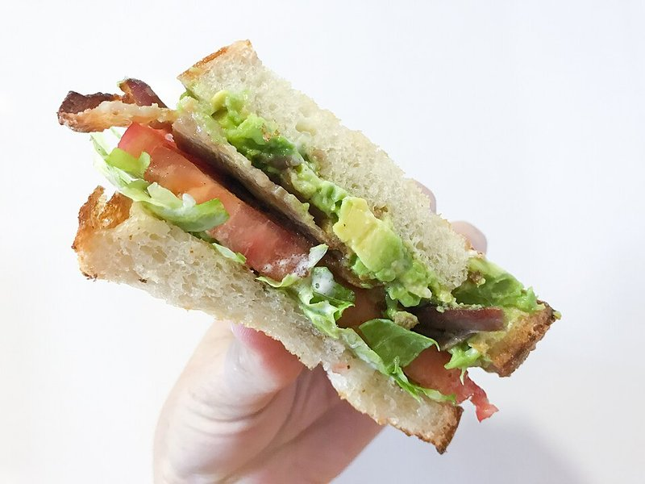{: .place-thumb } **Sandwich** | **John Montagu, 4th Earl of Sandwich** | Legend says he ate meat between bread so he wouldn't leave the **card table**. The Sandwich Islands (Hawaii) were also named after him, by **Captain Cook**.\* |
| 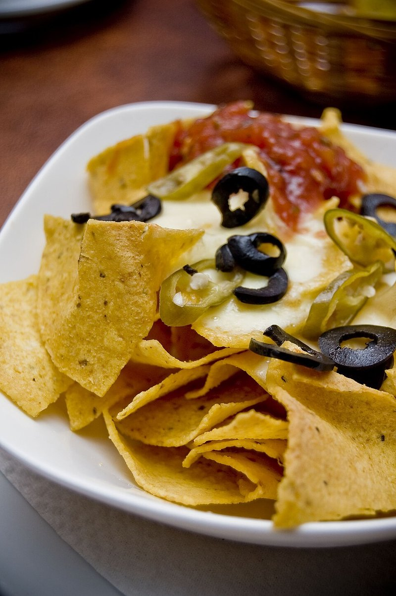{: .place-thumb } **Nachos** | **Ignacio "Nacho" Anaya**, a maître d' at Piedras Negras, Mexico (1943) | He improvised for US Army wives from nearby Fort Duncan after the cook had gone. 21 Oct is International Day of the Nacho.\* |
| 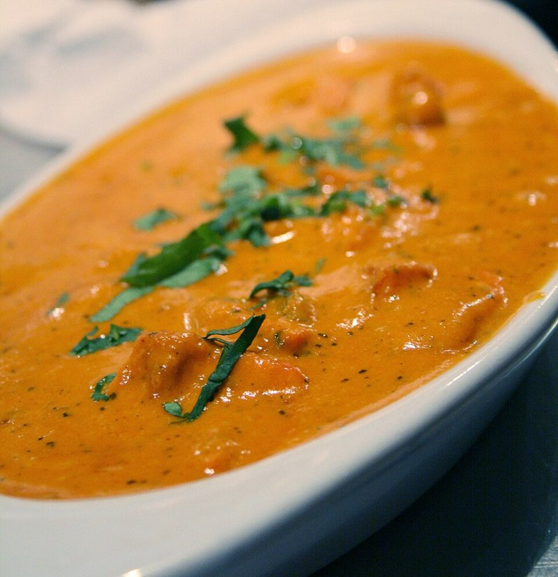{: .place-thumb } **Chicken Tikka Masala** | Disputed. Usually credited to **Ali Ahmed Aslam** at **Shish Mahal, Glasgow** (around 1971) | A customer complained the chicken was dry, so Aslam added tomato soup and spices. UK foreign secretary **Robin Cook** called it "**Britain's true national dish**" (2001). Aslam died in 2022.\* |
| 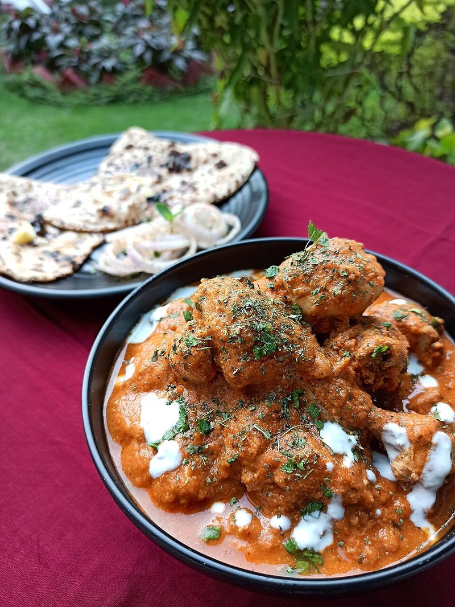{: .place-thumb } **Butter chicken** | **Moti Mahal, Delhi** (Kundan Lal Gujral) | In **2024 the Delhi High Court** heard **Moti Mahal vs Daryaganj** over who invented butter chicken and dal makhani. Daryaganj's founders claim Kundan Lal Jaggi. |
| 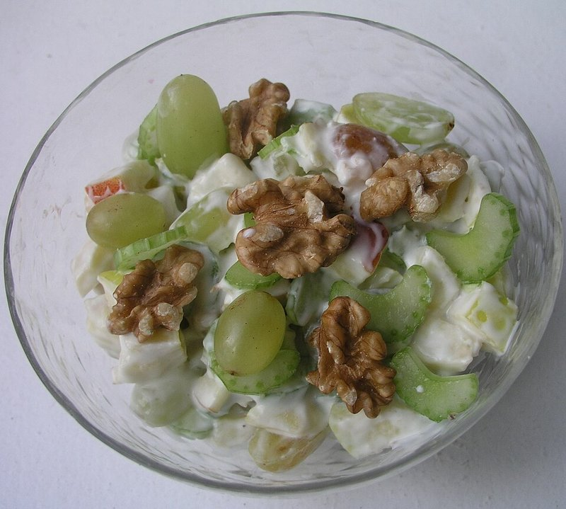{: .place-thumb } **Waldorf salad** | The **Waldorf Hotel**, New York (1893) | Created by maître d' **Oscar Tschirky** ("Oscar of the Waldorf"), who never cooked. Apples, celery and mayonnaise; walnuts came later.\* |
| 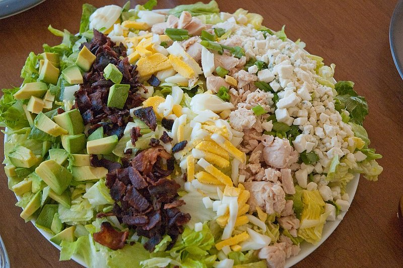{: .place-thumb } **Cobb salad** | **Robert Cobb**, owner of the **Brown Derby**, Hollywood (1937) | A midnight raid on the fridge.\* |
| 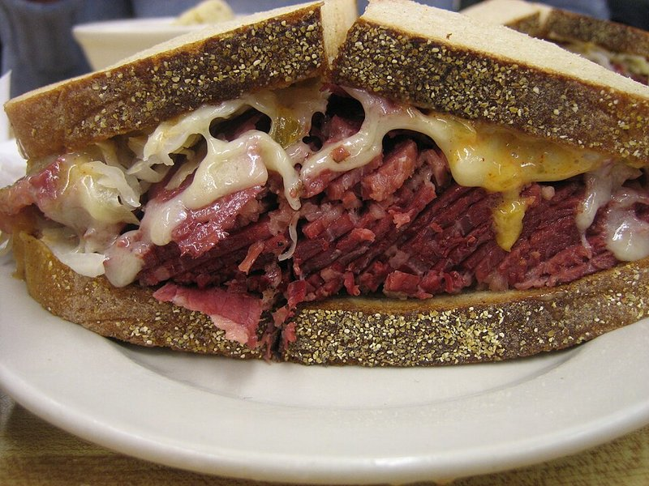{: .place-thumb } **Reuben sandwich** | **Arnold Reuben** of New York, or **Reuben Kulakofsky** of Omaha | Disputed.\* |
| 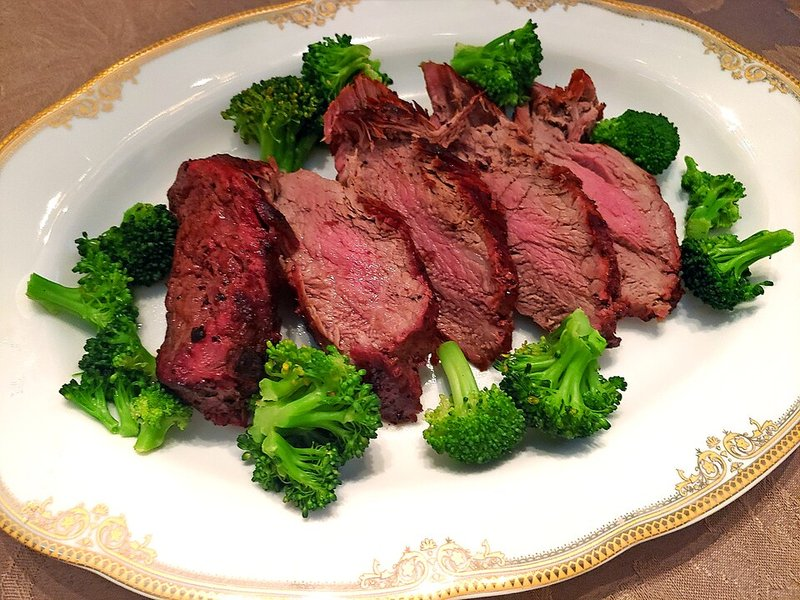{: .place-thumb } **Chateaubriand** | The writer and diplomat **François-René de Chateaubriand** | Created by his chef Montmireil.\* |
| 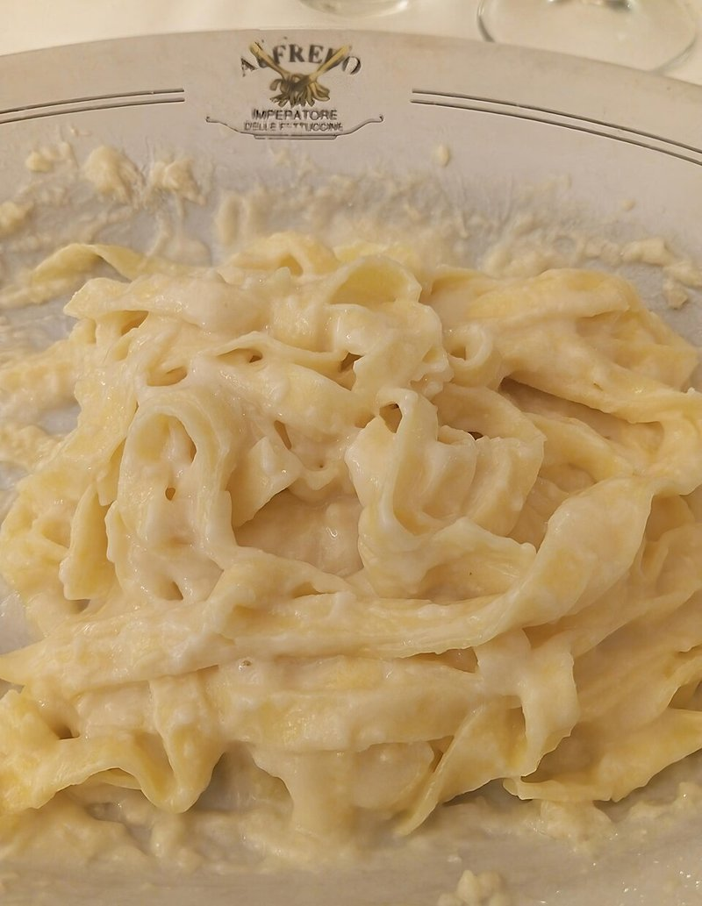{: .place-thumb } **Fettuccine Alfredo** | **Alfredo di Lelio**, Rome (1908–14) | Made for his wife after she gave birth. **Mary Pickford and Douglas Fairbanks** made it famous in the US on their honeymoon, gifting him a gold fork and spoon.\* |
| 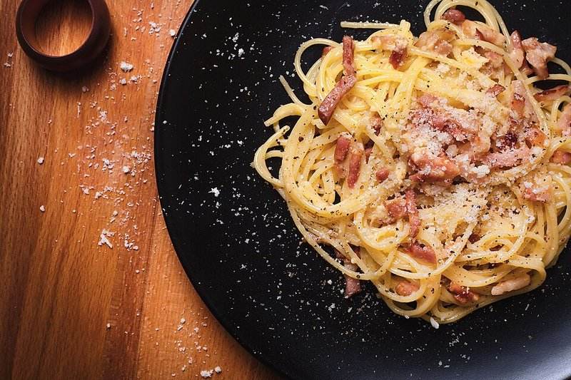{: .place-thumb } **Spaghetti carbonara** | Possibly from **American GIs' bacon and eggs** in 1944 Rome | "Carbonara" may mean "charcoal-burner style".\* |
| 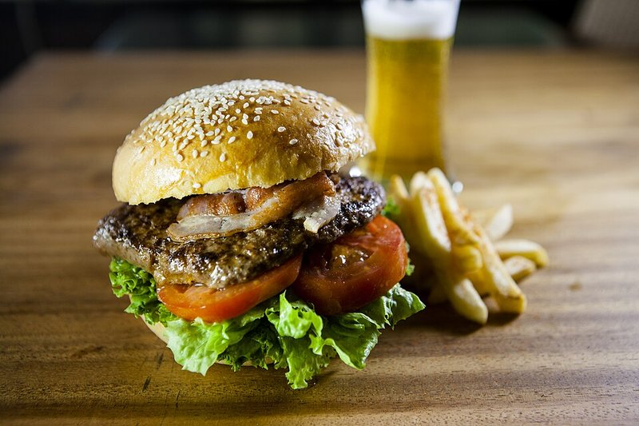{: .place-thumb } **Hamburger** | The city of **Hamburg** | Many US claimants. **Louis' Lunch**, New Haven, says it served the first burger (1900).\* |
| 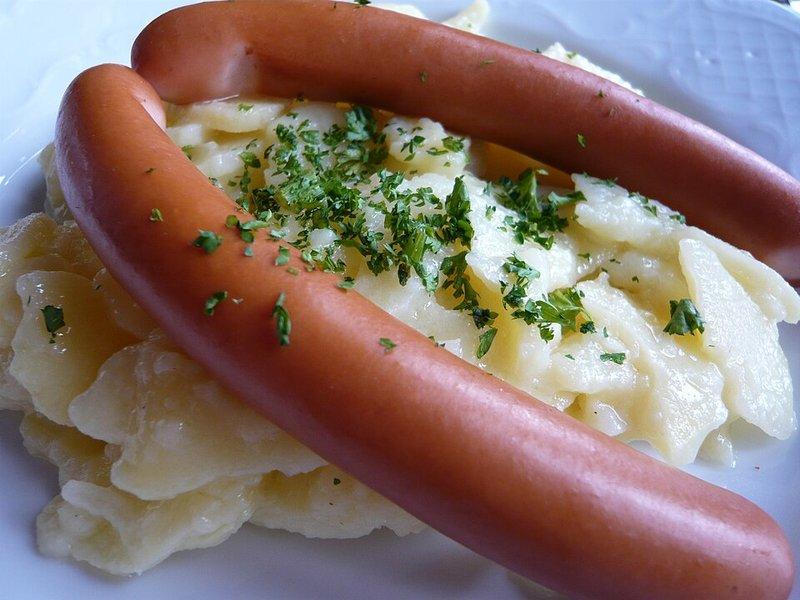{: .place-thumb } **Frankfurter / Wiener** | **Frankfurt** / **Vienna** (Wien) |  |
| 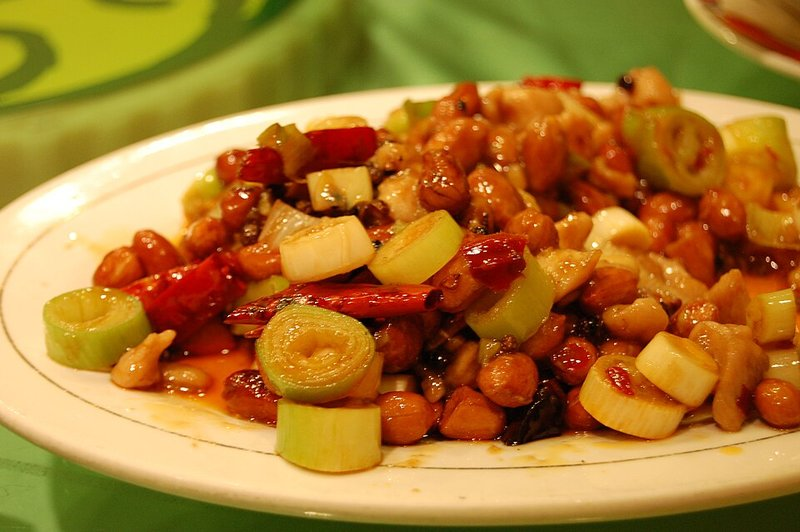{: .place-thumb } **Peking duck, Kung Pao chicken, General Tso's chicken** | Kung Pao is named after **Ding Baozhen**, whose title was Gongbao. General Tso's is named after **Zuo Zongtang**, but was invented in Taiwan in the 1950s by Peng Chang-kuei and later adapted in New York. |  |
| 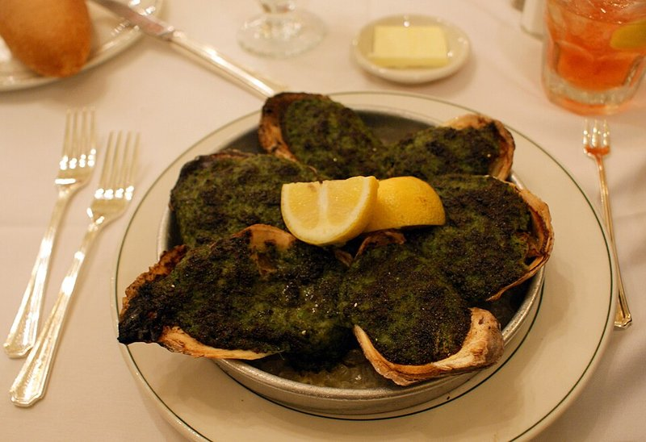{: .place-thumb } **Oysters Rockefeller** | **John D. Rockefeller** | Created at **Antoine's**, New Orleans (1889), because the sauce was so rich.\* |
| 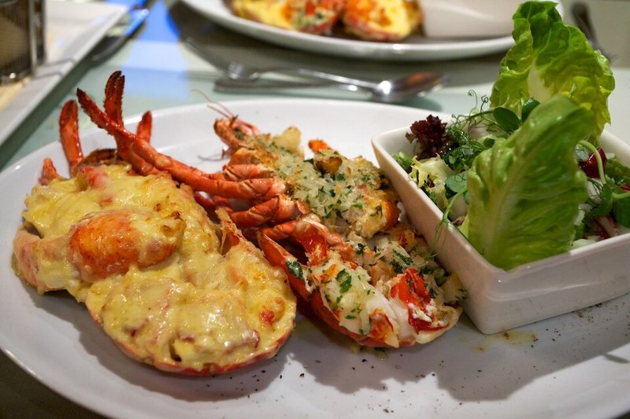{: .place-thumb } **Lobster Thermidor** | Victor Sardou's play *Thermidor* (1894) | Created at Maison Maire, Paris.\* |
| 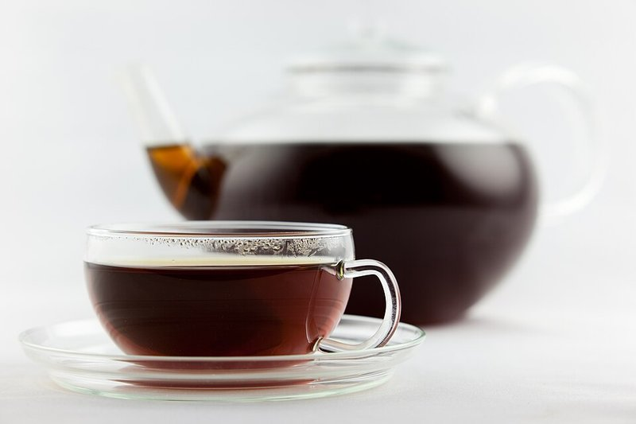{: .place-thumb } **Earl Grey tea** | **Charles Grey, 2nd Earl Grey**, the British PM | Bergamot-flavoured tea. **Twinings** and Jacksons both claim the original.\* |
| 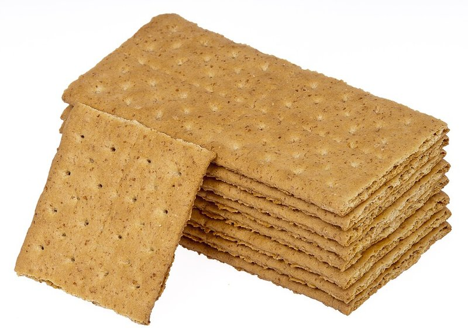{: .place-thumb } **Graham cracker** | **Rev. Sylvester Graham** | Made as a bland food to curb "lust".\* |
| 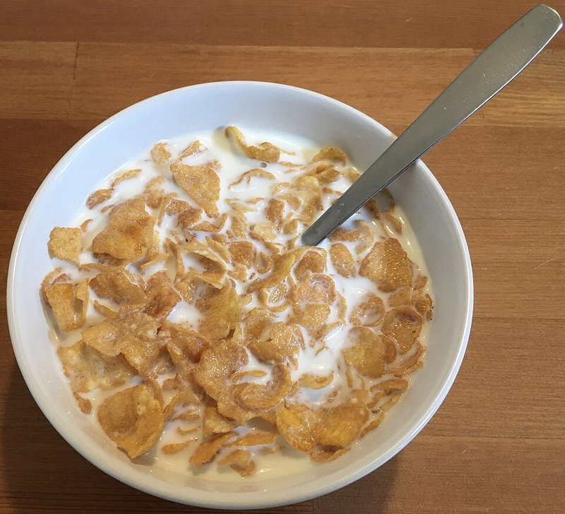{: .place-thumb } **Corn flakes** | **John Harvey Kellogg** | Same reason as the Graham cracker; an accident with stale wheat at the Battle Creek Sanitarium. His brother **Will Keith Kellogg** added sugar and founded the company.\* |
| 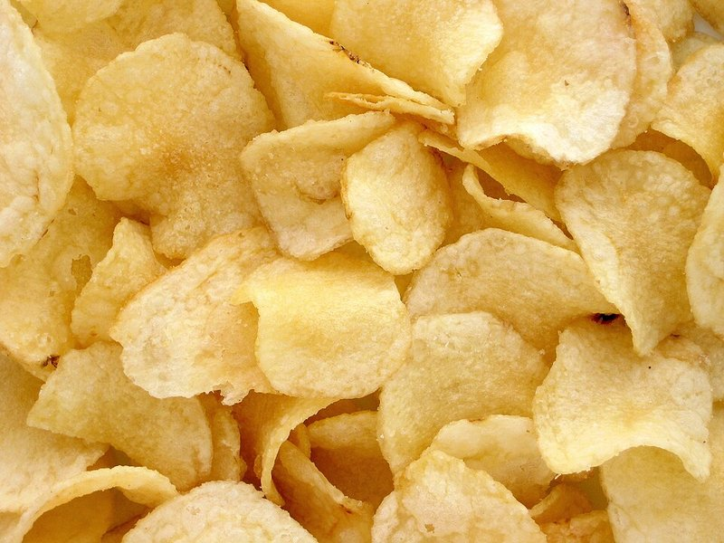{: .place-thumb } **Potato chips** | Legend: **George Crum** at Saratoga Springs (1853) | He made them thin to annoy a customer, said to be **Cornelius Vanderbilt**, who complained the fries were too thick. A myth, but a quiz favourite.\* |
| 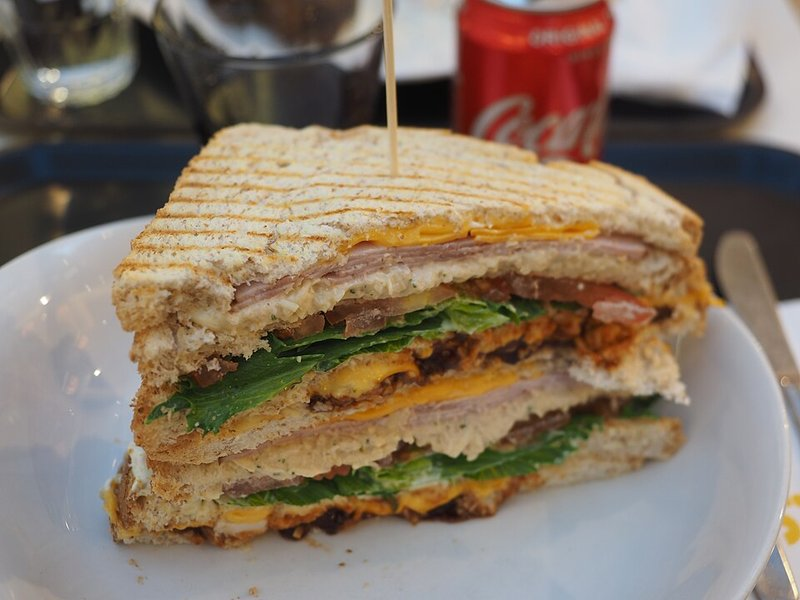{: .place-thumb } **Club sandwich** | The **Saratoga Club House** casino (1894) |  |
| 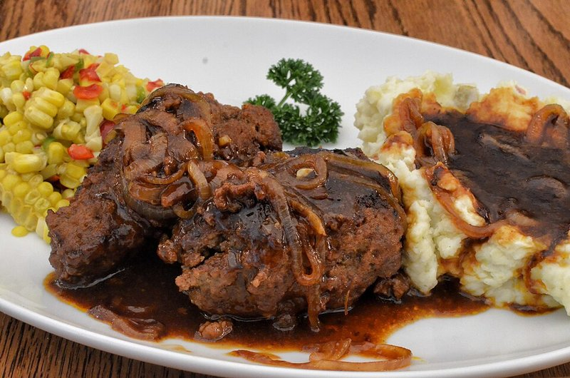{: .place-thumb } **Salisbury steak** | **Dr James Salisbury** | A 19th-century health food.\* |

*\* From general knowledge; food origins are often legend.*

## Cocktails with a story

| Cocktail | Origin | The story / business hook |
| --- | --- | --- |
| {: .place-thumb } **Moscow Mule** | **Cock 'n' Bull** pub, Los Angeles (1941) | A **marketing fix for three unsold products**: **John G. Martin** of Heublein had bought the **Smirnoff** rights and couldn't sell vodka; pub owner **Jack Morgan** had too much of his own **ginger beer**; and a woman (often named as Sophie Berezinski) had a stock of **copper mugs**. Martin took a **Polaroid** of bartenders holding the mug and Smirnoff, which helped start the US vodka boom. |
| {: .place-thumb } **Espresso Martini** | **Dick Bradsell**, London (1983, at the Soho Brasserie) | A young model (rumoured to be **Kate Moss** or Naomi Campbell, though both denied it) asked for a drink to "**wake me up, and then f\*\*\* me up**". Vodka, Kahlúa and fresh espresso. First called the **Vodka Espresso**, then the **Pharmaceutical Stimulant**. Bradsell also created the **Bramble**. It boomed again in the 2020s.\* |
| {: .place-thumb } **Bloody Mary** | **Fernand Petiot** at **Harry's New York Bar, Paris** (1921), later perfected at the **St Regis, New York** (King Cole Bar), where it was called the "**Red Snapper**" because "Bloody" was too crude | Said to be named after **Queen Mary I** ("Bloody Mary"). The Bloody Caesar (Canada) uses clam juice.\* |
| {: .place-thumb } **Margarita** | Many claimants: **Carlos "Danny" Herrera** (1938, for actress Marjorie King, who was allergic to everything except tequila), **Margaret Sames** in Acapulco (1948), and others | **Margarita** is Spanish for "daisy": it follows the Brandy Daisy format. The **frozen margarita machine** was invented by **Mariano Martinez**, Dallas (1971), from a soft-serve machine; it's in the Smithsonian.\* |
| {: .place-thumb } **Mojito** | Havana, Cuba | **Hemingway** is linked to it with "My mojito in La Bodeguita, my daiquiri in El Floridita", though the quote is probably fake. It descends from Sir Francis Drake's **El Draque**.\* |
| {: .place-thumb } **Daiquiri** | Named after **Daiquirí beach and iron mine** near Santiago de Cuba; credited to US mining engineer **Jennings Cox** (1898) | **JFK**'s favourite. Hemingway's frozen **Papa Doble**, with no sugar and double rum.\* |
| {: .place-thumb } **Piña Colada** | **Caribe Hilton**, San Juan (1954; Ramón "Monchito" Marrero) | The **national drink of Puerto Rico** since 1978. **Coco López** cream of coconut (1954) made it possible. Rupert Holmes' 1979 "Escape (The Piña Colada Song)".\* |
| {: .place-thumb } **Negroni** | **Count Camillo Negroni**, Florence (1919, Caffè Casoni) | He asked for his **Americano** to be made stronger, with **gin instead of soda water**. Equal parts gin, Campari and sweet vermouth. Orange garnish instead of lemon to mark the change. Negroni Week is run by *Imbibe* and **Campari**. The **Negroni Sbagliato** ("mistaken") uses prosecco instead of gin and went viral in 2022 through a TikTok of Emma D'Arcy.\* |
| {: .place-thumb } **Americano** | Gaspare Campari's bar, Milan (1860s) | Named for the American tourists who loved it. It's the **first drink James Bond orders** in *Casino Royale* (the novel).\* |
| {: .place-thumb } **Bellini** | **Giuseppe Cipriani**, **Harry's Bar, Venice** (1948) | Prosecco and white-peach purée. Its pink colour reminded him of the robes in a painting by **Giovanni Bellini**. Same bar as carpaccio.\* |
| {: .place-thumb } **Mimosa** | Possibly the **Ritz, Paris** (Frank Meier, 1925) | Champagne and orange juice, named after the yellow mimosa flower. The British **Buck's Fizz** came first (1921, Buck's Club).\* |
| {: .place-thumb } **Cosmopolitan** | Disputed. Usually credited to **Toby Cecchini** (Odeon, NYC, 1988) or Cheryl Cook (Miami) | Made a global hit by ***Sex and the City***. **Absolut Citron** was a key ingredient.\* |
| {: .place-thumb } **Martini** | Possibly the **Martinez** (California, Gold Rush era) or the Knickerbocker Hotel's Martini di Arma di Taggia (1911) | **James Bond**'s "**shaken, not stirred**" vodka martini, and the **Vesper** (*Casino Royale*), named after Vesper Lynd. FDR mixed martinis for Stalin at Tehran.\* |
| {: .place-thumb } **Gin and tonic** | **British India** | Officers mixed **quinine** tonic (against **malaria**) with gin, lime and sugar to make it palatable. Schweppes launched Indian Tonic Water (1870). Churchill: "The gin and tonic has saved more Englishmen's lives…than all the doctors in the Empire." |
| {: .place-thumb } **Gimlet** | Possibly Royal Navy surgeon **Sir Thomas Gimlette** | Gin and **lime cordial** to prevent **scurvy**; this is why British sailors were called "limeys". **Rose's Lime Juice** (1867) was the first patented fruit concentrate. Raymond Chandler's *The Long Goodbye*.\* |
| {: .place-thumb } **Old Fashioned** | **Pendennis Club**, Louisville (disputed) | The original definition of a "cock-tail" (1806): spirit, sugar, water and bitters. **Don Draper**'s drink in *Mad Men*. The official cocktail of **Louisville**.\* |
| {: .place-thumb } **Manhattan** | Long credited to the **Manhattan Club**, NYC (1874), at a party thrown by **Jennie Jerome**, Churchill's mother | This is false, because she was in England giving birth to Winston at the time.\* |
| {: .place-thumb } **Tom Collins** | The **Great Tom Collins Hoax** of 1874 | A prank in New York in which people were told "Tom Collins" had been badmouthing them at a nearby bar. Bartenders then created a drink of the name.\* |
| {: .place-thumb } **Singapore Sling** | **Ngiam Tong Boon**, at the **Long Bar, Raffles Hotel**, Singapore (c. 1915) | Pink, so that women could drink alcohol in public while appearing to drink fruit juice. Peanut shells are thrown on the floor at the Long Bar.\* |
| {: .place-thumb } **Mai Tai** | **Trader Vic** (Victor Bergeron), Oakland (1944), though **Don the Beachcomber** also claims it | When Tahitian friends tasted it, they said "**Maita'i roa ae!**" ("Out of this world, the best!"). It's the iconic tiki drink.\* |
| {: .place-thumb } **Long Island Iced Tea** | **Robert "Rosebud" Butt**, Oak Beach Inn, **Long Island** (1972) | It contains **no tea**: just vodka, gin, rum, tequila and triple sec, topped with cola.\* |
| {: .place-thumb } **Sex on the Beach** | Florida (1987) | A peach-schnapps distributor ran a contest for bartenders to boost sales during **spring break**.\* |
| {: .place-thumb } **Irish coffee** | **Joe Sheridan**, **Foynes** flying-boat terminal, Ireland (1943) | Made for cold transatlantic passengers. A passenger asked if it was Brazilian coffee: "No, that's Irish coffee." Journalist **Stanton Delaplane** took it to San Francisco's **Buena Vista Café** (1952).\* |
| {: .place-thumb } **Dark 'n' Stormy** | Bermuda | **Gosling's Black Seal** rum and ginger beer. It's a **registered trademark**, so the official version must use Gosling's.\* |
| {: .place-thumb } **Kir / Kir Royale** | **Félix Kir**, the priest and mayor of **Dijon** | Crème de cassis with white wine (or champagne for the Royale), promoting Burgundy's produce.\* |
| {: .place-thumb } **Aperol Spritz** | **Aperol** (Barbieri brothers, Padua, 1919) | The spritz came from Austrian soldiers "spritzing" Veneto wine with water. **Campari Group** bought Aperol in 2003 and made it a global brand.\* |
| {: .place-thumb } **Cuba Libre** | Cuba Libre = rum and Coke | A toast to a "**free Cuba**" after the Spanish–American War (1900), made by US soldiers using the newly arrived Coca-Cola.\* |
| {: .place-thumb } **Sazerac** | New Orleans | Named after **Sazerac de Forge et Fils** cognac. The **official cocktail of New Orleans** (2008). Absinthe rinse.\* |
| {: .place-thumb } **Paloma** | Mexico | Tequila and grapefruit soda (Jarritos/Squirt). More popular than the margarita in Mexico.\* |
| {: .place-thumb } **Caipirinha** | Brazil | Cachaça, lime and sugar. The name means "little countryside girl".\* |
| {: .place-thumb } **Pisco Sour** | **Victor Morris**, an American in Lima (1920s) | **Peru vs Chile** both claim pisco.\* |

*\* From general knowledge; cocktail origins are usually disputed legend.*

## Indian food stories

### Kerala and Thrissur (expect at least one)

| Item | Story |
| --- | --- |
| {: .place-thumb } **The first cake in India** | **Mambally Bapu**, at the **Mambally Royal Biscuit Factory, Thalassery**, baked a **Christmas plum cake in 1883** for British planter **Murdoch Brown**, using local fruit and a dash of brew made from cashew apples. Thalassery is called the town of the **three Cs: Cricket, Cake and Circus**. **Keeleri Kunhikannan** is the father of Indian circus.\* |
| {: .place-thumb } **Tellicherry pepper** | Thalassery's export-grade pepper, often called "**black gold**". It's why **Vasco da Gama** landed at **Kappad** (Kozhikode) in **1498**.\* |
| **Indian Coffee House** | Run by a **workers' co-operative** after the Coffee Board shut its outlets in the 1950s, a movement led by **A.K. Gopalan**. Kerala's first co-operative branch opened in **Thrissur (1958)**. Its waiters wear **fan-shaped turbans**.\* |
| {: .place-thumb } **Malabar parotta and GST** | **ID Fresh Food**, founded by **P.C. Musthafa** from **Wayanad**, the son of a daily-wage worker, went from idli-dosa batter to a big brand. In **2020** Karnataka's **Authority for Advance Ruling** said frozen parotta isn't roti, so it attracts **18% GST, not 5%**. Twitter answered with **#HandsOffPorotta**. Gujarat's AAAR later took the same view (2021).\* |
| {: .place-thumb } **Kappa (tapioca)** | Brought into wide use by the **Travancore king Visakham Thirunal** during a famine (1880s), as a cheap staple. Kappa and meen curry is the classic pairing.\* |
| {: .place-thumb } **Kozhikode halwa** | Sold on **SM Street (Mittai Theruvu, "Sweetmeat Street")**, a name the British gave it for its halwa shops. Introduced by **Gujarati** traders.\* |
| {: .place-thumb } **Thalassery biryani** | Made with short-grain **kaima / jeerakasala** rice, not basmati. Rahmath and Paragon in Kozhikode are famous.\* |
| {: .place-thumb } **Sadya** | The **Onam** feast on a **banana leaf**: about 24–28 dishes, eaten in a fixed order. **Aranmula Vallasadya** is the grandest.\* |
| {: .place-thumb } **Appam and stew** | A Syrian Christian Easter and wedding staple. **Kallappam** is fermented with **toddy**.\* |
| {: .place-thumb } **Kerala banana chips** | Made from **nendran** banana fried in **coconut oil**. A big Gulf export.\* |
| **Kanan Devan tea** | **Munnar**, the KDHP company owned by workers and Tata. The Kanan Devan hills were leased in 1877 from the Poonjar chief.\* |

### India: dishes with a story

- **Butter chicken and dal makhani**: the **Moti Mahal vs Daryaganj** case in the **Delhi High Court (2024)** over who invented them.

{: .place-thumb }

- **Mysore Pak**: **Kakasura Madappa**, cook at the **Mysore Palace** kitchen under **Krishnaraja Wadiyar IV**. "Paka" means sugar syrup.\*

{: .place-thumb }

- **Chicken 65**: **Buhari Hotel, Chennai (1965)**, by A.M. Buhari. The origin of the "65" is disputed.\*

{: .place-thumb }

- **Gobi / Chicken Manchurian**: **Nelson Wang**, at the Cricket Club of India, Mumbai (1975). He founded **China Garden**. It's an Indian-Chinese dish with no link to Manchuria.\*

{: .place-thumb }

- **Vada pav**: **Ashok Vaidya**, outside **Dadar** station (1966), as cheap fuel for mill workers. The Shiv Sena backed vada pav stalls.\*

{: .place-thumb }

- **Pav bhaji**: mixed leftovers for **Mumbai textile-mill workers** (1850s).\*

{: .place-thumb }

- **Tunday Kababi** (Lucknow): **Haji Murad Ali**, a one-armed ("tunda") chef. **Galouti kebab** was made soft for a **toothless Nawab**.\*

{: .place-thumb }

- **Kolkata biryani with potato**: **Wajid Ali Shah**, the exiled Nawab of Awadh, whose cooks stretched the meat with potatoes, then a luxury. The "luxury" version is disputed.\*

{: .place-thumb }

- **Bombay Duck**: a **fish**, **bombil**. One theory links the name to the "Bombay Dak" mail trains that smelled of the dried fish.\*

{: .place-thumb }

- **Frankie**: **Amarjit Singh Tibb**, Mumbai (1969). Inspired by Beirut's wraps. Tibb's Frankie.\*

{: .place-thumb }

- **Rasgulla**: the GI fight between Odisha and Bengal (see desserts).
- **Rooh Afza**: **Hamdard** (Hakim Hafiz Abdul Majeed, Delhi, 1906). After Partition, there were Indian, Pakistani and Bangladeshi Hamdards.\*

{: .place-thumb }

- **Old Monk** rum: **Mohan Meakin** (Kasauli/Solan). Famous for **never advertising**.\*

{: .place-thumb }

- **Feni**: Goa's **cashew** liquor (GI-tagged). Goa declared it a **heritage drink** (2016).\*

{: .place-thumb }

### Across India: more food facts

- **Filter coffee** (Karnataka): Sufi saint **Baba Budan** is said to have smuggled **seven coffee beans** from **Mocha, Yemen**, strapped to his chest, and planted them in the **Chandragiri hills of Chikmagalur** (17th century). The range is now called **Baba Budangiri**.\*
- **Rava idli** (Bengaluru): invented by **MTR (Mavalli Tiffin Rooms, 1924)** during **World War II**, when rice was scarce and semolina stood in.\*
- **Masala dosa and Udupi**: Udupi hotels, run by cooks trained around the **Krishna Matha**, spread the dosa and the South Indian "tiffin" across India.\*
- **Idli**: food historian **K.T. Achaya** traced it to **Indonesia's *kedli***, which came with cooks of visiting kings (8th–12th century). Still debated.\*
- **Samosa**: came from **Central Asia** as the *sanbosag*. **Amir Khusrau** and **Ibn Battuta** describe it at Delhi Sultanate courts. The potato filling came only after the **Portuguese** brought potatoes.\*
- **Chillies, potatoes, tomatoes**: all **New World** crops brought by the **Portuguese** (16th century). Before them, Indian heat came from **black pepper** and **long pepper**.\*
- **Vindaloo** (Goa): from the Portuguese ***carne de vinha d'alhos*** (meat in **wine** and **garlic**). It has nothing to do with *aloo* (potato).\*
- **Bebinca** (Goa): a layered coconut-and-egg dessert, traditionally **7 to 16 layers**, each baked separately. Legend credits a nun, **Sister Bebiana**.\*
- **Alphonso mango**: named after **Afonso de Albuquerque**, the Portuguese general who conquered Goa (1510). The Portuguese introduced grafting.\*
- **Gulab jamun and jalebi**: both have Persian roots. *Gulab* (rose water) + *jamun* (the fruit it resembles); jalebi from the Persian/Arabic **zulbiya / zalabiya**.\*
- **Sandesh and rasgulla**: Bengal's *chhena* (split-milk) sweets grew after the **Portuguese** showed how to curdle milk, which older Hindu custom had avoided.\*
- **Chhena poda** (Odisha): "burnt cheese", credited to **Sudarshan Sahoo** of **Nayagarh** (1940s), who left sweetened chhena in a cooling oven overnight.\*
- **Dum pukht** (Lucknow): legend says **Nawab Asaf-ud-Daula** fed workers building the **Bara Imambara** (a famine-relief project, 1784) from huge sealed pots cooked slowly over embers.\*
- **Nihari** (Old Delhi and Lucknow): from Arabic *nahar* (morning). A slow-cooked stew eaten after the **Fajr** prayer.\*
- **Wazwan** (Kashmir): a feast of up to **36 courses** cooked by a master chef, the ***vaste waza***. **Rogan josh** and **gushtaba** are staples.\*
- **Tandoori chicken**: **Kundan Lal Gujral** of **Moti Mahal**, who moved from **Peshawar** to **Daryaganj, Delhi** after Partition (1947).\*
- **Hyderabadi haleem**: the first **non-vegetarian** dish in India to get a **GI tag** (2010).\*
- **Bikaneri bhujia** (Rajasthan): GI-tagged (2010). **Haldiram's** began in **Bikaner (1937)**, with **Ganga Bishan Agarwal**, nicknamed "Haldiram".\*
- **Dharwad pedha** (Karnataka): GI-tagged; made by the **Thakur** family, who came from **Unnao (UP)** in the 19th century.\*
- **Tirupati laddu**: GI-tagged (2009), made in the temple kitchen (*potu*). A **2024** row over adulterated ghee became a national story.\*
- **Karachi Bakery** (Hyderabad): founded in **1953** by **Khanchand Ramnani**, a **Sindhi** who came to India after Partition. Famous for **fruit biscuits**.\*
- **Amul** (Anand, Gujarat): the 1946 co-operative behind **Operation Flood**, led by **Verghese Kurien**. The **Amul girl** ads ("Utterly Butterly Delicious") began in **1966** (Sylvester da Cunha).\*
- **Parle-G** (1939): launched as **Parle Gluco**; the **G** stood for **glucose** (later "Genius").\*
- **Assam tea**: **Robert Bruce** was shown the native tea plant by **Singpho** chief **Bessa Gam** (1823). It ended China's monopoly.\*
- **Bhut jolokia** (Assam and Nagaland): named the **world's hottest chilli** by Guinness in **2007**. GI-tagged.\*
- **Kadaknath** (Jhabua, Madhya Pradesh): an all-**black** chicken (black meat too). MP won the GI tag in **2018** over Chhattisgarh's claim.\*
- **Hing (asafoetida)**: India is the biggest user but grew none until **2020**, when **CSIR-IHBT** planted it in **Lahaul–Spiti** (Himachal).\*
- **Petha** (Agra): ash-gourd sweet, linked by legend to **Shah Jahan**'s cooks during the building of the **Taj Mahal**.\*

*\* From general knowledge; check before relying on it.*

## Photo credits

Photos from Wikimedia Commons, resized and cropped. [Baked Alaska](https://commons.wikimedia.org/wiki/File:Baked_Alaska.jpg): Zheng Zhou, CC BY-SA 4.0; [Pavlova](https://commons.wikimedia.org/wiki/File:Pavlova_dessert.JPG): Hazel Fowler, Public domain; [Peach Melba](https://commons.wikimedia.org/wiki/File:Peach_Melba.jpg): Robbie Sproule, CC BY 2.0; [Crêpe Suzette](https://commons.wikimedia.org/wiki/File:Cr%C3%A9pe_Suzette_001.jpg): Ocdp, CC0; [Tarte Tatin](https://commons.wikimedia.org/wiki/File:Franse_tarte_tatin.jpg): Djenghisz, CC BY-SA 3.0; [Lamington](https://commons.wikimedia.org/wiki/File:Mocha_Flake_amingtons.jpg): Zeitgeistlondon, CC BY-SA 3.0; [Sachertorte](https://commons.wikimedia.org/wiki/File:Sachertorte_DSC03027.JPG): David Monniaux, CC BY-SA 3.0; [Black Forest gateau](https://commons.wikimedia.org/wiki/File:Black_Forest_gateau.jpg): Mikelo, CC BY-SA 2.0; [Madeleine](https://commons.wikimedia.org/wiki/File:Madeleines_pic.jpg): Ruth, CC BY-SA 4.0; [Bananas Foster](https://commons.wikimedia.org/wiki/File:Brennan%27s_Bananas_Foster_-_2011.jpg): Kimberly Vardeman, CC BY 2.0; [Tiramisu](https://commons.wikimedia.org/wiki/File:Tiramisu_-_Raffaele_Diomede.jpg): Raffaele Diomede from Pordenone, ITALIA, CC BY 2.0; [Eton Mess](https://commons.wikimedia.org/wiki/File:Eton_Mess_2025-2_(cropped).jpg): Exx8, CC0; [Charlotte Russe](https://commons.wikimedia.org/wiki/File:Charlotte_aux_poires_et_chocolat.jpg): Popo le Chien, CC BY-SA 3.0; [Pear Belle Hélène](https://commons.wikimedia.org/wiki/File:Poire_belle_H%C3%A9l%C3%A8ne.jpg): Comrade Foot, CC BY-SA 2.0; [Battenberg cake](https://commons.wikimedia.org/wiki/File:Battenbergcake.jpg): Henrycooksey, CC BY 3.0; [Victoria sponge](https://commons.wikimedia.org/wiki/File:Victoria_Sponges.jpg): euphro, CC BY-SA 2.0; [Pastel de nata](https://commons.wikimedia.org/wiki/File:Pasteis_de_Belem.jpg): Mon Œil, CC BY 2.0; [Brownie](https://commons.wikimedia.org/wiki/File:Chocolatebrownie.JPG): Ɱ, CC BY-SA 3.0; [Chocolate chip cookie](https://commons.wikimedia.org/wiki/File:Choco_chip_cookie.png): Bob Smith, CC BY 2.5; [Ice-cream cone](https://commons.wikimedia.org/wiki/File:Strawberry_ice_cream_cone_(5076899310).jpg): TheCulinaryGeek from Chicago, USA, CC BY 2.0; [Croissant](https://commons.wikimedia.org/wiki/File:Croissant-Petr_Kratochvil.jpg): Petr Kratochvil, CC0; [Anzac biscuit](https://commons.wikimedia.org/wiki/File:ANZAC_biscuits_(14_April_2006).jpg): pfctdayelise, CC BY-SA 2.5; [Rasgulla](https://commons.wikimedia.org/wiki/File:Bengali_Sponge_Roshogolla_in_date_palm_jaggery_syrup.jpg): Prianxi, CC BY-SA 4.0; [Caesar salad](https://commons.wikimedia.org/wiki/File:Caesar_salad_(2).jpg): Geoff Peters from Vancouver, BC, Canada, CC BY 2.0; [Eggs Benedict](https://commons.wikimedia.org/wiki/File:Traditional_Eggs_Benedict.jpg): Mark Miller, CC BY-SA 4.0; [Beef Wellington](https://commons.wikimedia.org/wiki/File:Beef_Wellington_2019.jpg): Snielsen1112, CC BY-SA 4.0; [Beef Stroganoff](https://commons.wikimedia.org/wiki/File:Moscow_(8351271825).jpg): jimmyweee, CC BY 2.0; [Carpaccio](https://commons.wikimedia.org/wiki/File:Carpaccio_with_cheese_in_Warsaw.jpg): MichalPL, CC BY-SA 4.0; [Pizza Margherita](https://commons.wikimedia.org/wiki/File:Neapolitan_pizza_at_Trappica_(48701940197).jpg): Bex Walton from London, England, CC BY 2.0; [A sandwich](https://commons.wikimedia.org/wiki/File:Bacon,_lettuce,_tomato,_and_avocado.jpg): Jami430, CC BY-SA 4.0; [Nachos](https://commons.wikimedia.org/wiki/File:Nachos-cheese.jpg): chee.hong from Kuala Lumpur, Malaysia, CC BY 2.0; [Chicken Tikka Masala](https://commons.wikimedia.org/wiki/File:Chicken_tikka_masala_(cropped).jpg): Michael Hays, CC BY 2.0; [Butter chicken](https://commons.wikimedia.org/wiki/File:Butter_Chicken_%26_Butter_Naan_-_Home_-_Chandigarh_-_India_-_0006.jpg): Yuvraj Singh 97, CC BY-SA 4.0; [Waldorf salad](https://commons.wikimedia.org/wiki/File:Waldorfsalat.jpg): Nillerdk, CC BY 3.0; [Cobb salad](https://commons.wikimedia.org/wiki/File:Cobb_salad,_15_October_2010.jpg): Jodimichelle, CC BY-SA 2.0; [Reuben sandwich](https://commons.wikimedia.org/wiki/File:Katz%27s_Deli_-_Lunch.jpg): Ernesto Andrade, CC BY 2.0; [Chateaubriand](https://commons.wikimedia.org/wiki/File:Chateaubriand_roast.jpg): Mark Miller, CC BY-SA 4.0; [Fettuccine Alfredo](https://commons.wikimedia.org/wiki/File:Fettuccine_Alfredo_originals.jpg): Civa61, CC BY 4.0; [Spaghetti carbonara](https://commons.wikimedia.org/wiki/File:Espaguetis_carbonara.jpg): Javier Somoza, CC BY-SA 4.0; [Hamburger](https://commons.wikimedia.org/wiki/File:RedDot_Burger.jpg): Hongreddotbrewhouse, CC BY-SA 3.0; [Frankfurter sausages](https://commons.wikimedia.org/wiki/File:Frankfurter_wuerstchen.jpg): WordRidden / Jessica Spengler, CC BY 2.0; [Kung Pao chicken](https://commons.wikimedia.org/wiki/File:Kung-pao-shanghai.jpg): Steven G. Johnson, CC BY-SA 3.0; [Oysters Rockefeller](https://commons.wikimedia.org/wiki/File:Oysters_Rockefeller_at_Galatoires.jpg): David Veksler, CC BY-SA 2.0; [Lobster Thermidor](https://commons.wikimedia.org/wiki/File:Lobster_Thermidor_entree.jpg): thefoodplace.co.uk, CC BY 2.0; [Earl Grey tea](https://commons.wikimedia.org/wiki/File:Frisch_aufgebr%C3%BChter_EarlGrey_Tee.jpg): soultea.de/André Helbig, CC BY-SA 3.0; [Graham cracker](https://commons.wikimedia.org/wiki/File:Graham-Cracker-Stack.jpg): Evan-Amos, Public domain; [Corn flakes](https://commons.wikimedia.org/wiki/File:Kellogg%27s_Corn_Flakes,_with_milk.jpg): Th78blue, CC BY-SA 4.0; [Potato chips](https://commons.wikimedia.org/wiki/File:Potato-Chips.jpg): Evan-Amos, Public domain; [Club sandwich](https://commons.wikimedia.org/wiki/File:Club_sandwich_at_Caf%C3%A9_Picnic.jpg): JIP, CC BY-SA 4.0; [Salisbury steak](https://commons.wikimedia.org/wiki/File:Salisbury_steak_with_brown_sauce.jpg): jeffreyw, CC BY 2.0; [Moscow Mule](https://commons.wikimedia.org/wiki/File:Cocktail_Moscow_Mule_im_Kupferbecher_mit_Minze.jpg): Gordito1869, CC BY-SA 4.0; [Espresso Martini](https://commons.wikimedia.org/wiki/File:Bistrot_Bruno_Loubet,_Clerkenwell,_London_(4574785649).jpg): Ewan Munro from London, UK, CC BY-SA 2.0; [Bloody Mary](https://commons.wikimedia.org/wiki/File:Bloody_Mary_Coctail_with_celery_stalk_-_Evan_Swigart.jpg): Evan Swigart from Chicago, USA, CC BY 2.0; [Margarita](https://commons.wikimedia.org/wiki/File:MargaritaReal.jpg): Akke Monasso, CC BY-SA 3.0; [Mojito](https://commons.wikimedia.org/wiki/File:15-09-26-RalfR-WLC-0072.jpg): Ralf Roletschek, CC BY-SA 3.0; [Daiquiri](https://commons.wikimedia.org/wiki/File:Classic_Daiquiri_in_Cocktail_Glass.jpg): Will Shenton, CC BY-SA 3.0; [Piña Colada](https://commons.wikimedia.org/wiki/File:Pi%C3%B1a_Colada.jpg): User Barmix on de.wikipedia, Public domain; [Negroni](https://commons.wikimedia.org/wiki/File:C%C3%B3ctel_Negroni_Campari.jpg): Desdealbert00, CC BY-SA 4.0; [Americano](https://commons.wikimedia.org/wiki/File:Americano_cocktail_at_Nightwood_Restaurant.jpg): Conrad and Peter, CC BY 2.0; [Bellini](https://commons.wikimedia.org/wiki/File:Bellini_Cipriani,_Macaroni_Grill,_Dunwoody_GA.jpg): John Phelan, CC BY-SA 3.0; [Mimosa](https://commons.wikimedia.org/wiki/File:Pool-side_Mimosas_at_The_Standard_Hotel.jpg): vxla, CC BY 2.0; [Cosmopolitan](https://commons.wikimedia.org/wiki/File:Cosmopolitan_(5076906532).jpg): TheCulinaryGeek from Chicago, USA, CC BY 2.0; [Martini](https://commons.wikimedia.org/wiki/File:15-09-26-RalfR-WLC-0084.jpg): Ralf Roletschek, CC BY-SA 3.0; [Gin and tonic](https://commons.wikimedia.org/wiki/File:Gin_and_Tonic_with_ingredients.jpg): NotFromUtrecht, CC BY-SA 3.0; [Gimlet](https://commons.wikimedia.org/wiki/File:Gimlet_cocktail.jpg): The Delicious Life, CC BY 2.0; [Old Fashioned](https://commons.wikimedia.org/wiki/File:Whiskey_Old_Fashioned1.jpg): Erich Wagner, CC BY-SA 4.0; [Manhattan](https://commons.wikimedia.org/wiki/File:A_Manhattan.jpg): Graeme Maclean from Glasgow, UK, CC BY 2.0; [Tom Collins](https://commons.wikimedia.org/wiki/File:VTR_-_Tom_Collins.jpg): Edsel L, CC BY-SA 2.0; [Singapore Sling](https://commons.wikimedia.org/wiki/File:Singapore_Sling_and_peanuts_at_the_Raffles_Hotel_Long_Bar_in_Singapore.jpg): Paul2520, CC BY 4.0; [Mai Tai](https://commons.wikimedia.org/wiki/File:Mai_Tai_at_Trader_Vic%27s_Emeryville.jpg): Kevdo, CC BY-SA 4.0; [Long Island Iced Tea](https://commons.wikimedia.org/wiki/File:Long_Island_Iced_Teas.jpg): Eduardo Quagliato from Curitiba, Paraná, Brasil, CC BY 2.0; [Sex on the Beach](https://commons.wikimedia.org/wiki/File:Sex_On_The_Beach.jpg): Stuart Webster from Southampton, England, CC BY 2.0; [Irish coffee](https://commons.wikimedia.org/wiki/File:Irish_coffee_glass.jpg): jules / stone soup, CC BY 2.0; [Dark 'n' Stormy](https://commons.wikimedia.org/wiki/File:DarknStormy.jpg): GXBltd, CC BY-SA 3.0; [Kir](https://commons.wikimedia.org/wiki/File:Kir_cocktail.jpg): Stuart Webster from Southampton, England, CC BY 2.0; [Aperol Spritz](https://commons.wikimedia.org/wiki/File:Aperol_Spritz_2014a.jpg): Geolina163, CC BY-SA 4.0; [Cuba Libre (rum and Coke)](https://commons.wikimedia.org/wiki/File:15-09-26-RalfR-WLC-0056.jpg): Ralf Roletschek, CC BY-SA 3.0; [Sazerac](https://commons.wikimedia.org/wiki/File:SazeracCocktail.jpg): Gtandersson, CC BY 4.0; [Paloma](https://commons.wikimedia.org/wiki/File:Paloma_Cocktail2.jpg): Erich Wagner, CC BY-SA 4.0; [Caipirinha](https://commons.wikimedia.org/wiki/File:Caipirinha_with_lime.jpg): rawpixel.com, CC0; [Pisco Sour](https://commons.wikimedia.org/wiki/File:Pisco_sour_20100613b.JPG): Dtarazona, CC BY-SA 4.0; [Christmas plum cake](https://commons.wikimedia.org/wiki/File:Christmas_cake_(6954064737).jpg): James Petts from London, England, CC BY-SA 2.0; [Tellicherry black peppercorns](https://commons.wikimedia.org/wiki/File:Tellicherry_Black_Peppercorns.jpg): Misterneedlemouse, CC0; [Malabar parotta](https://commons.wikimedia.org/wiki/File:Malabar_Porotta_(cropped).jpg): Praveen, CC BY-SA 4.0; [Kappa (boiled tapioca)](https://commons.wikimedia.org/wiki/File:Kappa_boiled_kerala_style.jpg): Ramesh NG, CC BY-SA 2.0; [Kozhikode halwa](https://commons.wikimedia.org/wiki/File:Kozhikode_Halwa.jpg): Abilngeorge, CC BY-SA 4.0; [Thalassery biryani](https://commons.wikimedia.org/wiki/File:Thalassery_biriyani_in_dining_table_(cropped).jpg): Maureen, CC BY 2.0; [Sadya](https://commons.wikimedia.org/wiki/File:Sadhya_DSW.jpg): Augustus Binu/ facebook, CC BY-SA 3.0; [Appam](https://commons.wikimedia.org/wiki/File:Appam_-_%E0%AE%85%E0%AE%AA%E0%AF%8D%E0%AE%AA%E0%AE%AE%E0%AF%8D.jpg): VinPrasad, CC BY-SA 4.0; [Kerala banana chips](https://commons.wikimedia.org/wiki/File:Chips_de_bananes_de_S%C3%A3o_Tom%C3%A9-et-Pr%C3%ADncipe.jpg): Ji-Elle, CC BY-SA 4.0; [Dal makhani](https://commons.wikimedia.org/wiki/File:Punjabi_style_Dal_Makhani.jpg): Radhikamprabhu82, CC BY-SA 4.0; [Mysore Pak](https://commons.wikimedia.org/wiki/File:Mysore_pak.jpg): Charles Haynes, CC BY-SA 2.0; [Chicken 65](https://commons.wikimedia.org/wiki/File:Chicken_65.jpg): Charles Haynes, CC BY-SA 2.0; [Manchurian](https://commons.wikimedia.org/wiki/File:Chicken_Manchurian_(Hyderabad_Style)_(11960049916).jpg): Abhinaba Basu from Redmond, United States, CC BY 2.0; [Vada pav](https://commons.wikimedia.org/wiki/File:Vada_Pav-Indian_street_food.JPG): Rutvi Mistry, CC BY-SA 4.0; [Pav bhaji](https://commons.wikimedia.org/wiki/File:Bambayya_Pav_bhaji.jpg): Rupali Banarase, CC BY-SA 4.0; [Tunday kebabs, Lucknow](https://commons.wikimedia.org/wiki/File:Tunday_Kebabs.jpg): Lillottama, CC BY-SA 4.0; [Kolkata biryani](https://commons.wikimedia.org/wiki/File:Kolkata_mutton_biryani.jpg): DeepanjanGhosh, CC BY-SA 4.0; [Bombay duck (bombil) drying](https://commons.wikimedia.org/wiki/File:Harpadon_nehereus_-_Bombay_Ducks_-_drying_(seafood).jpg): Dinesh Valke from Thane, India, CC BY-SA 2.0; [Kathi roll / Frankie](https://commons.wikimedia.org/wiki/File:Kolkata_Rolls.jpg): Satyajit Dhawale, CC BY-SA 4.0; [Rooh Afza sharbat](https://commons.wikimedia.org/wiki/File:Rooh_Afza_(Sharbat).JPG): Divas Grover, CC BY-SA 4.0; [Old Monk rum](https://commons.wikimedia.org/wiki/File:Old_Monk_Rum.jpg): Pinakpani, CC BY-SA 4.0; [A bottle of cashew feni](https://commons.wikimedia.org/wiki/File:A_bottle_of_Big_Boss_cashew_Fenny.jpg): Horsten at English Wikipedia, Public domain.
