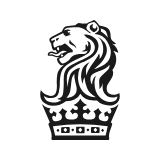
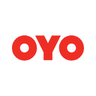

A reference for the Christ Com finals: the world's big hotel groups, the famous luxury houses and India's chains, with founders, name and logo stories, current CEOs and quiz hooks.

## Quiz-ready stories

If you only have ten minutes, revise these. Each one is a likely connect or identify question.

1. **Holiday Inn** is named after a 1942 Bing Crosby film. Its later owner, Bass, had the UK's first registered trademark, the red triangle.
2. **Hyatt** is a man's first name: Hyatt von Dehn sold his LAX motel to Jay Pritzker in 1957.
3. **Shangri-La** comes from James Hilton's novel *Lost Horizon*. A Hilton named a rival chain.
4. **Conrad Hilton** went to Cisco, Texas, to buy a bank and bought a hotel instead (1919).
5. **Marriott** began as an A&W root-beer stand in 1927.
6. **InterContinental** was started by an airline, Pan Am, in 1946. Radisson Blu comes from SAS, another airline.
7. **César Ritz** was "king of hoteliers and hotelier of kings". His name gave English the word "ritzy".
8. **Taj Mahal Palace** opened in 1903. The story that Jamsetji Tata was refused entry to Watson's Hotel is a legend.
9. **The Leela** is named after the founder's wife. Captain C.P. Krishnan Nair came from Kannur.
10. **CGH Earth** began in 1957 as the Casino Restaurant for dock workers on Willingdon Island, Kochi.
11. **OYO** stands for "On Your Own". The parent company is now PRISM, and it owns Motel 6.
12. **Singapore Sling** (Raffles), **Waldorf salad** (Waldorf Astoria) and **piña colada** (Caribe Hilton's claim) all came from hotels.
13. **Aman** means peace; **Schloss** (Leela's company) means castle; **EIH** means East India Hotels.
14. **2026 leadership changes:** Dominic Dragisich became Choice CEO; Mark Hoplamazian became Hyatt chairman and CEO; Isadore Sharp became Four Seasons chairman emeritus; Sébastien Bazin will leave Accor by 2028.

Logos are shown for Marriott, Hilton, Ritz-Carlton and OYO, the only hotel logos available in an open icon set. The others are described in words.

## Taglines, signatures and in-room quirks

These are the small, specific facts quizmasters build questions on, like the copy of Conrad Hilton's *Be My Guest* left in Hilton rooms. Each chain gets its slogan, its signature touch, its loyalty programme and one or two extra tidbits.

### Global groups

| Chain | Tagline / motto | Signature touch | Loyalty programme | More tidbits |
| --- | --- | --- | --- | --- |
| **Marriott** | "Spirit to Serve". The founder's line: "Take care of associates and they'll take care of the customers." | Many Marriott rooms have a **Book of Mormon** beside the Bible, because the Marriotts are Latter-day Saints. | **Marriott Bonvoy** (2019), a play on "bon voyage" | JW Marriott is named after the founder. Courtyard was designed for business travellers. |
| **Hilton** | "Hilton. For the Stay", its first global brand platform. The "It Matters Where You Stay" ads starred Paris Hilton, and later **Deepika Padukone**. | Conrad Hilton's 1957 autobiography **Be My Guest** is placed in Hilton rooms. **DoubleTree** gives a warm chocolate-chip cookie at check-in, and released the recipe in 2020. | **Hilton Honors** | Hampton offers a "100% Hampton Guarantee". Conrad Hilton was called "the man who bought the Waldorf". |
| **Holiday Inn / IHG** | Holiday Inn Express's "Stay Smart" ads ran with the punchline: "No, but I did stay at a Holiday Inn Express last night." | The roadside neon **"Great Sign"**. Kemmons Wilson was annoyed at paying extra for his kids on a family trip, so children stayed free, with a pool and air-conditioning as standard. | **IHG One Rewards**. As Holiday Inn's Priority Club (1983), it was the first hotel loyalty programme. | Kimpton (IHG) runs an evening wine hour and will put a goldfish in your room on request. |
| **Hyatt** | "For a world of understanding" (2017 campaign) | The **atrium lobby** with glass lifts, which Hyatt Regency Atlanta made famous. | **World of Hyatt** (2017; replaced Gold Passport) | **Andaz** is Hindi/Urdu for "personal style". Park Hyatt turned 45 in 2025. |
| **Accor** | Sofitel: "Life is magnifique" | **Movénpick** serves a free daily **chocolate hour**. Ibis offers a "15-minute guarantee" to fix any problem. | **ALL – Accor Live Limitless**. "ALL" was on Paris Saint-Germain's shirts. | Ibis is named after the bird. Pullman takes its name from luxury railway cars. Fairmont runs Canada's old railway castles, such as Château Frontenac. |
| **Wyndham** | — | **Super 8** was named after its $8.88 opening room rate (1974, Aberdeen, South Dakota). It brought that price back for its 50th birthday in 2024. | **Wyndham Rewards** | Ramada is Spanish for a shaded resting place. Days Inn's founder was Cecil Day, and its logo is a sunburst. |
| **Choice** | — | Comfort Inn's free hot breakfast | **Choice Privileges** | Cambria is its upscale brand. Brands it sells under: Comfort, Quality, Clarion, Econo Lodge and Radisson (Americas). |
| **Best Western** | — | Each hotel is independently owned and keeps its own character. | **Best Western Rewards** | In the 1960s it had an eastern partner called **Best Eastern**. It swapped its crown logo for "BW" in 2015. |
| **Radisson** | "Yes I Can!" service culture | Radisson Blu's blue comes from the SAS airline link. | **Radisson Rewards** | Named after the French explorer Pierre-Esprit Radisson. |

### Luxury houses

| Chain | Tagline / motto | Signature touch | Loyalty / club | More tidbits |
| --- | --- | --- | --- | --- |
| **Ritz-Carlton** | "Ladies and gentlemen serving ladies and gentlemen" | Staff carry a **Credo card**, and each can spend up to **$2,000** to fix a guest's problem without asking a manager. | Marriott Bonvoy | At the Paris Ritz, Coco Chanel lived for over 30 years, and Hemingway's bar is named after him. Afternoon tea at the London Ritz is in the Palm Court. |
| **Four Seasons** | The **Golden Rule** as company culture | Credited as the first hotel to put **shampoo** in the bathroom. | No points programme | Runs the Four Seasons Private Jet tours and launched Four Seasons Yachts. |
| **Mandarin Oriental** | **"I'm a fan" / "He's a fan"** celebrity ads | A fan logo, and each hotel has its own fan. | Fans of M.O. | The Oriental, Bangkok's Authors' Wing honours writers who stayed there, such as Somerset Maugham and Joseph Conrad. |
| **The Peninsula** | — | A fleet of **Peninsula-green Rolls-Royces**, page boys in white, and afternoon tea in the lobby with a string ensemble | — | Peninsula Hong Kong has a rooftop helipad. Its Felix bar was designed by Philippe Starck. |
| **Shangri-La** | "It's in our nature" | Asian-style hospitality | **Shangri-La Circle** | The name comes from James Hilton's novel *Lost Horizon*. |
| **Aman** | — | Barely any branding on site. Loyal guests are called "Amanjunkies". | — | "Aman" means peace. Aman New York is in the Crown Building. |
| **Rosewood** | "A Sense of Place" | Each hotel is designed to reflect where it is. | — | Owned by the Cheng family of Hong Kong. |
| **Raffles** | — | The Singapore Sling, peanut shells on the Long Bar floor, and a butler for every suite. | Accor ALL | Legend says Singapore's last tiger was shot under the Raffles billiard room in 1902. |
| **Waldorf Astoria** | — | The lobby clock from the 1893 Chicago World's Fair, and Peacock Alley | Hilton Honors | The Waldorf salad came from here, and it claims eggs Benedict. |
| **Kempinski** | — | **"Lady in Red"**: guest-relations hosts dressed in red | — | Europe's oldest luxury hotel group. |
| **Jumeirah (Burj Al Arab)** | — | A fleet of Rolls-Royces and a helipad | Jumeirah One | Federer and Agassi played tennis on the helipad in 2005. |

### India and Kerala

| Chain | Tagline / motto | Signature touch | Loyalty programme | More tidbits |
| --- | --- | --- | --- | --- |
| **Taj (IHCL)** | Its service ethos is called **"Tajness"** | The Taj Mahal Palace's **Harbour Bar** holds Mumbai's first bar licence (1933). | **Taj InnerCircle – NeuPass** (part of Tata Neu). In 2026 it signed the first loyalty tie-up between a global airline alliance (oneworld) and a hotel programme. | The Taj Lake Palace, Udaipur appears in the Bond film *Octopussy* (1983). Brand Finance named Taj India's strongest brand in 2026, its fifth year running. |
| **Oberoi** | — | At Oberoi Amarvilas, Agra, every room has a view of the Taj Mahal. | — | Its hotel school, STEP, is at the Oberoi Centre of Learning and Development. Its backwater cruiser, the **Motor Vessel Vrinda**, sails in Kerala. The Oberoi Grand, Kolkata is called the "Grande Dame of Chowringhee". |
| **ITC Hotels** | **"Responsible Luxury"** | The **namaste** logo. Hotels are named after Indian dynasties: Maurya, Maratha, Grand Chola, Kakatiya, Rajputana, Mughal, Sonar. **Bukhara** has no cutlery; diners eat with their hands, wearing bibs. | **Club ITC** | It calls itself the world's greenest luxury chain, with LEED Platinum hotels. Dum Pukht cuisine was revived by chef Imtiaz Qureshi. |
| **The Leela** | — | The Leela Palace Bengaluru is modelled on the Mysore Palace. | — | Named after the founder's wife. Its company name, Schloss, is German for castle. |
| **Lemon Tree** | — | Hires "Opportunity Deprived Indians", including people with disabilities. | — | Brands: Aurika, Lemon Tree, Red Fox, Keys. |
| **OYO** | Name = "On Your Own" | Standardised budget rooms under one red logo | — | SoftBank is its biggest investor. It owns Motel 6 in the US. |
| **CGH Earth** | — | Eco-resorts built in local style. Coconut Lagoon, Kumarakom, is reached by boat. | — | Began as a dock canteen on Willingdon Island in 1957. |

## The big global groups

The big groups mostly franchise or manage their hotels; few of them own the buildings. Four CEO changes in 2026 are worth remembering: Choice got a new CEO, Hyatt's Pritzker chairman retired, Four Seasons' founder became chairman emeritus, and Accor's CEO set his exit for 2028.

| Group | Est., HQ | CEO (Oct 2026) | Origin and history | Name, logo and trivia |
| --- | --- | --- | --- | --- |
|  **Marriott International** | 1927, Bethesda, Maryland | Anthony Capuano (since 2021; chairman David Marriott) | J. Willard and Alice Marriott opened an A&W root-beer stand in Washington DC, which became the Hot Shoppes restaurants. Their first hotel was the Twin Bridges Motor Hotel, Arlington (1957). Bought Ritz-Carlton in the 1990s and Starwood in 2016 (Sheraton, Westin, W, St. Regis, Le Méridien). | The world's largest hotel company by rooms, with 30+ brands. The loyalty programme is Bonvoy (2019). Capuano took over after Arne Sorenson died in 2021. He was paid about $23 million in 2025. |
|  **Hilton** | 1919, McLean, Virginia | Christopher Nassetta (since 2007) | Conrad Hilton went to Cisco, Texas, to buy a bank. When that fell through he bought the Mobley Hotel instead. Blackstone bought Hilton in 2007, then the biggest hotel buyout, and relisted it in 2013. | The logo is an "H" inside an orbit. Brands include Waldorf Astoria, Conrad (named after the founder), Hampton and DoubleTree, known for its warm cookie. The Caribe Hilton, Puerto Rico, claims the piña colada (1954). Paris Hilton is Conrad's great-granddaughter. Nassetta was the top-paid hotel CEO of 2025 at about $27.7 million. |
| **IHG Hotels & Resorts** | 2003 as IHG, Denham, UK | Elie Maalouf (since 2023) | Two roots. Pan Am's Juan Trippe founded InterContinental in 1946 to give air travellers hotels. Kemmons Wilson opened Holiday Inn in Memphis in 1952. Bass brewery bought Holiday Inn, later became Six Continents, and its hotels were split off as IHG. | Holiday Inn is named after the 1942 Bing Crosby and Fred Astaire film. Bass's red triangle was the UK's first registered trademark (1876), so it makes a good link question. IHG also owns Six Senses, Regent and Kimpton, and launched the Noted brand in 2026. |
| **Hyatt** | 1957, Chicago | Mark Hoplamazian (CEO since 2006; also chairman from Feb 2026) | Jay Pritzker bought the Hyatt House near Los Angeles airport from Hyatt von Dehn, whose first name became the brand. John Portman's soaring atrium at the Hyatt Regency Atlanta (1967) became the brand's signature. | Thomas J. Pritzker retired as executive chairman in Feb 2026. The Pritzker family also funds the Pritzker Architecture Prize, often called architecture's Nobel. In India, Juniper Hotels owns the Grand Hyatt Mumbai. |
| **Accor** | 1967, Issy-les-Moulineaux, Paris | Sébastien Bazin (chairman and CEO since 2013; to leave by May 2028) | Paul Dubrule and Gérard Pélisson opened the first Novotel near Lille airport in 1967. Ibis followed in 1974. The Accor name came in 1983. | Europe's largest hotel group. Owns Raffles, Fairmont and Sofitel, plus Ennismore (Mama Shelter, SLS). Bazin announced his exit in May 2026, and shareholders pushed back on his pay at the same meeting. |
| **Wyndham Hotels & Resorts** | 1981, Parsippany, New Jersey | Geoff Ballotti | Started in Dallas under Trammell Crow's real-estate company. It became the hotel arm of Cendant and Wyndham Worldwide, then a separate listed company in 2018. | The largest group by number of hotels (about 9,000+), mostly budget franchises: Days Inn, Super 8, Ramada, La Quinta. It fought off a hostile bid from Choice in 2023–24. |
| **Choice Hotels** | 1939, North Bethesda, Maryland | Dominic Dragisich (interim from May 2026, permanent from 31 Aug 2026) | Seven Florida motel owners formed Quality Courts, a referral network. It grew into Comfort Inn, Quality, Clarion, Econo Lodge and Cambria. | Bought Radisson's Americas business in 2022. Patrick Pacious left as CEO in May 2026. Choice is the company that tried to buy Wyndham. |
| **Best Western (BWH Hotels)** | 1946, Phoenix, Arizona | Larry Cuculic (since 2018) | Hotelier M.K. Guertin started it as a referral network of independent motels in the American West. | Run as a membership association: each hotel stays independently owned, so it is a brand without a chain owner. |
| **Radisson Hotel Group** | 1909, Brussels (Europe HQ) | Federico J. González (CEO per company site) | The first Radisson opened in Minneapolis in 1909, named after the 17th-century French explorer Pierre-Esprit Radisson. | Owned by China's Jin Jiang since 2018. "Radisson Blu" comes from the Radisson SAS hotels run with Scandinavian Airlines. |
| **Jin Jiang International** | Shanghai | — | State-owned group whose roots go back to a Shanghai restaurant founded by Dong Zhujun in 1935. | Owns Louvre Hotels (Campanile, Golden Tulip) and Radisson Hotel Group. China's largest hotel group. |
| **H World Group (Huazhu)** | 2005, Shanghai | — | Ji Qi founded it with the budget brand Hanting. | Bought Germany's Deutsche Hospitality (Steigenberger) in 2020. Link: IHCL's Puneet Chhatwal used to run Steigenberger. |
| **Minor Hotels** | 1978, Bangkok | — | Founded by William Heinecke, an American-born Thai entrepreneur. | Runs Anantara and Avani, and bought Spain's NH Hotel Group in 2018. |

## Luxury houses

Most luxury names began as one famous hotel and spread from there. Quizzers ask about the founder, the first hotel and who owns the brand today.

| House | Est., home | Leader (Oct 2026) | Origin and history | Name, logo and trivia |
| --- | --- | --- | --- | --- |
|  **Ritz / Ritz-Carlton** | 1898, Paris | Ritz-Carlton is a Marriott brand | Swiss hotelier César Ritz opened the Hôtel Ritz on Place Vendôme in 1898, then the Carlton and Ritz in London. Edward VII called him "king of hoteliers and hotelier of kings". | Gave English "ritzy" and "Puttin' on the Ritz". The logo is a lion's head over a crown. Motto: "Ladies and gentlemen serving ladies and gentlemen". The Paris Ritz is separate from Ritz-Carlton: Mohamed Al-Fayed bought it in 1979, and Princess Diana left it on her last night in 1997. |
| **Four Seasons** | 1961, Toronto | Alejandro Reynal (president and CEO); Robert Fritz (executive chairman, May 2026) | Isadore Sharp, son of a builder, opened the Four Seasons Motor Hotel in Toronto in 1961. | Credited with putting shampoo in hotel bathrooms. Bill Gates's Cascade Investment is majority owner, with Prince Alwaleed's Kingdom Holding. Sharp became chairman emeritus in 2026. Its logo is a stylised tree. |
| **Mandarin Oriental** | 1963 (Mandarin, Hong Kong); the Oriental Bangkok dates to 1876 | Laurent Kleitman (group CEO) | The Mandarin opened in Hong Kong in 1963 and merged with The Oriental, Bangkok, Asia's grand old hotel. | The logo is a fan, and each hotel has its own fan design. Part of Jardine Matheson, which took it private in 2025 in a $4.2 billion deal. Ads featured celebrity "fans". |
| **The Peninsula** | 1928, Hong Kong (parent founded 1866) | Benjamin Vuchot (CEO of HSH) | The Hongkong and Shanghai Hotels company is controlled by the Kadoorie family. The Peninsula Hong Kong opened in 1928. | Known for its fleet of Peninsula-green Rolls-Royces and its page boys in white uniforms. Peninsula London opened in 2023. |
| **Shangri-La** | 1971, Singapore (now Hong Kong) | Kuok family group | Malaysian sugar king Robert Kuok opened the first Shangri-La in Singapore in 1971. | Named after the mythical valley in *Lost Horizon* (1933), a novel by James Hilton. That is a neat trap: a Hilton named a rival brand. |
| **Aman** | 1988, Phuket | Vladislav Doronin (chairman and CEO) | Adrian Zecha opened Amanpuri ("place of peace") in Phuket. Small, very private resorts became the brand's formula. | "Aman" means peace in Sanskrit. Fans of the brand are nicknamed "Amanjunkies". Janu is its sister brand. |
| **Rosewood** | 1979, Dallas (now Hong Kong) | Sonia Cheng (CEO) | Texan oil heiress Caroline Rose Hunt turned the Mansion on Turtle Creek into a hotel. | Owned by Hong Kong's Cheng family (Chow Tai Fook, New World) since 2011. |
| **Raffles** | 1887, Singapore | Accor brand | The Armenian Sarkies brothers opened Raffles Hotel, named after Stamford Raffles, Singapore's founder. | The Singapore Sling was created at its Long Bar around 1915 by bartender Ngiam Tong Boon. Guests drop peanut shells on the bar floor. |
| **Waldorf Astoria** | 1893, New York | Hilton brand | Feuding Astor cousins built two hotels side by side, the Waldorf and the Astoria, and later joined them. | The Waldorf salad is named after it, created by maître d' Oscar Tschirky. China's Anbang bought the New York hotel in 2014. |
| **Belmond** | 1976 as Orient-Express Hotels | LVMH brand | Started by James Sherwood of Sea Containers. He also revived the Venice Simplon-Orient-Express train. | Renamed Belmond in 2014; LVMH bought it in 2019. Its hotels include the Copacabana Palace, Rio. |
| **Kempinski** | 1897, Berlin (now Geneva) | — | Berthold Kempinski, a wine merchant, started it. | Europe's oldest luxury hotel group. |
| **Jumeirah** | 1997, Dubai | Dubai Holding brand | Built around the Burj Al Arab, the sail-shaped hotel that opened in 1999. | The "seven-star" label came from the press; no official rating goes that high. |
| **Dorchester Collection** | London | Brunei Investment Agency owns it | Built around The Dorchester (1931) on Park Lane. | Also owns the Beverly Hills Hotel and Le Meurice. |

## Indian hotel chains

India's big four luxury chains are Taj, Oberoi, ITC and Leela. Three of them (ITC Hotels, Leela and Taj's parent IHCL) are now separately listed. The Leela founder came from Kannur in Kerala.

| Chain | Est., HQ | CEO / MD (Oct 2026) | Origin and history | Name, speciality and trivia |
| --- | --- | --- | --- | --- |
| **Taj (IHCL)** | 1903, Mumbai | Puneet Chhatwal, MD and CEO since 2017 (about ₹25 crore pay in FY26) | Jamsetji Tata built the Taj Mahal Palace facing the Gateway of India, which opened in December 1903. Legend says he built it after being refused entry to the whites-only Watson's Hotel. That story is unproven, so treat it as a legend. | The hotel had electricity, American fans and German lifts when Bombay barely did. It survived the 26/11 attacks in 2008. IHCL brands include Taj, SeleQtions, Vivanta, Ginger, Gateway and Tree of Life. Taj also runs The Pierre in New York and St James' Court in London, and is often ranked the world's strongest hotel brand by Brand Finance. |
| **The Oberoi Group (EIH Ltd)** | 1934, Delhi | Arjun Singh Oberoi (executive chairman since 2022); Vikram Oberoi (MD and CEO) | Mohan Singh Oberoi started as a clerk at the Cecil Hotel, Shimla. In 1934 he bought the Clarkes in Shimla and the Maidens in Delhi. He later took over Associated Hotels of India, which owned the Cecil. | EIH stands for East India Hotels. The group's two brands are Oberoi (luxury) and Trident. Oberoi Udaivilas and Amarvilas regularly top world hotel rankings. ITC owns a stake in EIH. P.R.S. "Biki" Oberoi, who built the modern group, died in 2023. |
| **ITC Hotels** | 1975, Kolkata (parent ITC) | Anil Chadha (MD) | ITC, the cigarette giant, opened its first hotel, the Welcomgroup Chola in Chennai, in 1975. Hotels were demerged from ITC and listed separately in January 2025. | Its brand idea is "Responsible Luxury": its luxury hotels are LEED Platinum green buildings. Bukhara at ITC Maurya, Delhi, is famous for Dal Bukhara and for hosting US presidents. Brands include ITC Hotels, Mementos, Welcomhotel, Storii and Fortune. |
| **The Leela** | 1986, Mumbai (now Bengaluru) | Anuraag Bhatnagar (CEO) | Captain C.P. Krishnan Nair, an army officer from Kannur and later a textile businessman, opened the Leela Kempinski near Mumbai airport in 1986. | Named after his wife, Leela. Brookfield bought the hotels in 2019. Its company, Schloss Bangalore, listed in 2025 and is now Leela Palaces Hotels & Resorts. "Schloss" is German for castle. Its first hotel outside India is planned on the Palm Jumeirah in Dubai. |
| **Lemon Tree Hotels** | 2004, Gurugram | Neelendra Singh, MD since Oct 2025; founder Patanjali Keswani is chairman | Patanjali Keswani, an IIT Delhi graduate and former Taj executive, started it for the mid-market. | Known for employing people with disabilities and other under-served groups. Brands include Aurika (upscale), Lemon Tree and Red Fox. |
|  **OYO (parent: PRISM)** | 2013, Gurugram | Ritesh Agarwal (founder and CEO) | Ritesh Agarwal, from Rayagada in Odisha, started Oravel Stays at 18 and won a Thiel Fellowship. Oravel became OYO in 2013. | OYO stands for "On Your Own". The parent company was renamed PRISM in 2025. It bought the US chain Motel 6 from Blackstone in 2024. SEBI cleared a ₹6,650 crore IPO in 2026, its third try at listing. |
| **Juniper Hotels** | Mumbai | — | Owned by the Saraf family, with Hyatt as partner. | Owns the Grand Hyatt Mumbai and Andaz Delhi. Listed in 2024. |
| **Sarovar Hotels** | 1994, Mumbai | — | Indian mid-market operator. | Majority owned by France's Louvre Hotels, so it is ultimately Chinese-owned through Jin Jiang. |
| **Chalet Hotels** | Mumbai | — | Hotel-owning arm of the K. Raheja group. | Owns big Marriott, Westin and JW hotels in Mumbai and Bengaluru, and launched its own brand, Athiva. |
| **Club Mahindra (Mahindra Holidays)** | 1996, Mumbai | — | Mahindra group's holiday-ownership business. | Sells holiday membership time rather than rooms. It also owns Finland's Holiday Club Resorts. |

## Kerala hospitality

The finals are run by a Kerala quizmaster, so these local links are worth knowing. The best is that a dockside canteen in Kochi grew into India's best-known eco-resort group.

| Name | Base | Story | Quiz hook |
| --- | --- | --- | --- |
| **CGH Earth** | Kochi | Dominic Joseph Kuruvinakunnal opened the Casino Restaurant on Willingdon Island in 1957 to feed dock workers and commuters. It grew into the Casino Hotel and the Casino Group of Hotels, now CGH Earth. He died in 2007, aged 86. | CGH stands for Casino Group of Hotels; the name has nothing to do with gambling. Its properties include Coconut Lagoon (Kumarakom), Spice Village (Thekkady), Brunton Boatyard (Fort Kochi), Kalari Kovilakom (Ayurveda) and Bangaram (Lakshadweep). The family also started CAFS, a large airline-catering business. |
| **The Leela** | Founder from Kannur | Captain C.P. Krishnan Nair named the chain after his wife (see the India table). | The Leela Kovalam, his famous cliff-top resort, was sold in 2011 to Ravi Pillai's RP Group and is now The Raviz Kovalam. |
| **The Raviz (RP Group)** | Kollam | Hotels of Dr B. Ravi Pillai, a Gulf construction billionaire from Kollam. | The Raviz Kollam is on Ashtamudi Lake. The group owns the former Leela Kovalam and The Raviz Kadavu near Kozhikode. |
| **Twenty14 Holdings (Lulu Group)** | Abu Dhabi, Kerala roots | The hotel arm of M.A. Yusuff Ali's Lulu Group, from Nattika in Thrissur. It is run by Adeeb Ahamed. | Bought the Caledonian in Edinburgh, a Waldorf Astoria, for £85 million in 2018, and turned London's Great Scotland Yard into a hotel. In Kerala it owns the Grand Hyatt Kochi Bolgatty. |
| **KTDC and Kerala Tourism** | Thiruvananthapuram | The state tourism corporation runs hotels, including the Bolgatty Palace (a Dutch-era palace) and the Samudra in Kovalam. | Kerala's slogan is "God's Own Country". Kerala Tourism's Responsible Tourism Mission began in Kumarakom. |
| **Abad Hotels** | Kochi | A Kochi family group that started in seafood export. | It runs heritage and Ayurveda resorts, including Abad Whispering Palms in Kumarakom. |

## Sources

CEO names were checked against 2026 reports. The older history comes from standard company histories, so verify any single detail before relying on it in a tie-breaker.

- [Top hospitality executive moves, Q2 2026 (Hotel Dive)](https://www.hoteldive.com/news/top-hospitality-industry-executive-moves-q2-2026/824125/)
- [Choice names Dominic Dragisich permanent CEO (Travel Weekly)](https://www.travelweekly.com/Travel-News/Hotel-News/Choice-names-Dominic-Dragisich-permanent-CEO)
- [Hyatt: Thomas J. Pritzker retires; Hoplamazian becomes chairman and CEO](https://newsroom.hyatt.com/021626-Hyatt-Announces-Thomas-J-Pritzker-Retires-as-Executive-Chairman-and-Will-Not-Seek-Re-Election-to-Board-of-Directors-Mark-S-Hoplamazian-Assumes-Combined-Role-of-Chairman-of-the-Board-and-Chief-Executive-Officer)
- [Highest-paid hotel group CEOs of 2025](https://www.pulse.bot/hotels/news/which-hotel-group-ceo-was-highest-paid-in-2025-277-million-3faf8177-ddaa-48db-8600-a605394bccfb/)
- [Accor CEO Bazin to step down by 2028 (Skift)](https://skift.com/2026/05/27/accor-ceo-bazin-to-step-down-in-2028-shareholders-push-back-on-pay/)
- [Robert Fritz named Four Seasons chairman](https://www.pulse.bot/ceo-pulse/news/robert-fritz-named-four-seasons-chairman-founder-moves-to-emeritus-role-d3ba925b-c7aa-4e50-8809-ceb8cbb40e5c/)
- [Benjamin Vuchot appointed CEO of The Peninsula Hotels](https://www.hotel-online.com/index.php/news/the-peninsula-hotels-welcomes-new-leadership-as-benjamin-vuchot-appointed-executive-director-and-ceo-of-the-hongkong-and-shanghai-hotels-limited)
- [Mandarin Oriental shareholders approve Jardine buyout](https://www.mingtiandi.com/real-estate/finance/mandarin-oriental-shareholders-approve-4-2b-buyout-by-jardines)
- [Larry Cuculic, BWH Hotels](https://www.bestwestern.com/en_US/about/leadership-team/larry-cuculic.html)
- [Federico J. González, Radisson Hotel Group](https://www.radissonhotels.com/en-us/corporate/about-us/our-team/federico-j-gonzalez)
- [Puneet Chhatwal's FY26 pay (Outlook Business)](https://www.outlookbusiness.com/corporate/ihcl-md-ceo-puneet-chhatwals-remuneration-rose-nearly-9-to-25-cr-in-fy26)
- [The Oberoi Group (Wikipedia)](https://en.wikipedia.org/wiki/The_Oberoi_Group)
- [Anil Chadha, ITC Hotels](https://www.itchotels.com/in/en/corporate/about-us/leadership/strategic-and-executive-management-committee/Anil-Chadha)
- [Leela key managerial personnel](https://www.theleela.com/key-managerial-personnel-and-senior-management)
- [Lemon Tree appoints Keswani chairman and Neelendra Singh MD (IIFL)](https://www.indiainfoline.com/news/companies/lemon-tree-hotels-appoints-patanjali-keswani-as-chairman-and-neelendra-singh-as-md)
- [SEBI approves PRISM's ₹6,650 crore IPO (Kotak Neo)](https://www.kotakneo.com/news/ipos/sebi-approves-oyo-parent-prism-rs-6650-crore-ipo-h2-2026-listing-plans/)
- [CGH founder Dominic dies (Oneindia, 2007)](https://www.oneindia.com/2007/08/13/cgh-founder-dominic-dies-1187026335.html)
- [Twenty14 Holdings buys the Caledonian (Hospitality Net)](https://www.hospitalitynet.org/news/4086446.html)
- Logos: [Simple Icons](https://simpleicons.org) (Marriott, Hilton, Ritz-Carlton, OYO)

Taglines and signatures:

- [Hilton launches "Hilton. For the Stay" (Hospitality Net)](https://www.hospitalitynet.org/news/4111623.html)
- [Hilton and Deepika Padukone: It Matters Where You Stay](https://robbreport.co.th/hilton-and-deepika-padukone-remind-the-world-why-it-matters-where-you-stay)
- [Super 8 brings back $8.88 room rates (Wyndham)](https://corporate.wyndhamhotels.com/news-releases/super-8-by-wyndham-turns-back-the-clock-with-8-88-room-rates/)
- [oneworld and Taj InnerCircle – NeuPass partnership](https://www.oneworld.com/news/oneworld-and-taj-innercircle-neupass-launch-first-ever-global-airline-alliance-and-hotel-loyalty-partnership)
- [Taj named India's strongest brand 2026](https://www.journaldespalaces.com/en/pressrelease-78954-india-rewards-taj-crowned-india-s-strongest-brand-2026-NL.html)
- [Club ITC loyalty programme](https://www.itchotels.com/in/en/corporate/recent/ITC-Hotels-launches-new-Club-ITC-loyalty-programme)
