Eleventh in the Christ Com prep set: every major Indian bank with its founder, year, birthplace, name and logo story, mergers and current head. Built for questions like the Manappuram one in Major Nair's prelims.

## Quiz-ready

These are Manappuram-style questions: a founder, a hometown, a name meaning, a logo or a 2026 deal. If you only have ten minutes, revise these.

1. **Manappuram** is named after the sandy coastal belt of Thrissur where V.C. Padmanabhan started in **1949** at Valapad. Bain Capital took control in 2025.
2. **Thrissur** is home to South Indian Bank (1929), CSB Bank (1920, Catholic Syrian Bank), Dhanlaxmi (1927; centenary in 2027), ESAF (Evangelical Social Action Forum), KSFE and Manappuram.
3. **Federal Bank**: K.P. Hormis, Nedumpuram, 1931, started as Travancore Federal Bank. Blackstone is about to become its biggest shareholder.
4. **Nedungadi Bank** (Kozhikode, 1899) was Kerala's first commercial bank. Its founder Appu Nedungadi wrote *Kundalatha*. It merged into PNB.
5. **State Bank of Travancore** was founded under Sir C.P. Ramaswami Iyer and merged into SBI in 2017. **Lord Krishna Bank** (Kodungallur) ended up in HDFC Bank.
6. **SBI**'s keyhole logo is said to be inspired by Kankaria Lake. It descends from the Bank of Calcutta (1806) and the Imperial Bank (1921).
7. **PNB** (Lahore, 1894): Lala Lajpat Rai and Dyal Singh Majithia; the first bank with only Indian capital.
8. **Bank of Baroda**: Maharaja Sayajirao Gaekwad III; the Baroda Sun logo; absorbed Dena and Vijaya, India's first three-way merger.
9. **Canara Bank** was named after the Canara coast. Mangalore and Udupi gave India Canara, Syndicate, Corporation, Vijaya and Karnataka Bank.
10. **Union Bank** was opened by Gandhi. **UCO Bank** was founded by G.D. Birla as United Commercial Bank. **IOB** was named "Overseas" for its Burma and Malaya trade.
11. **Allahabad Bank**'s logo showed the Triveni Sangam, from Major Nair's prelims; it merged into Indian Bank.
12. **Axis** was UTI Bank. **RBL** = Ratnakar Bank Limited (Kolhapur). **Bandhan** = bond. **IndusInd** is named for the Indus, the Sindhi homeland river. **Kotak Mahindra**: Anand Mahindra was an early investor.
13. **Yes Bank**: co-founder Ashok Kapur died in 26/11. The bank was rescued by SBI in 2020; SMBC is now its top shareholder.
14. **2026 deals**: Emirates NBD owns 60% of RBL; Fairfax is buying 60.72% of IDBI for ₹52,878 crore; SBI's chairman is C.S. Setty; the RBI governor is Sanjay Malhotra.
15. **RBI**: 1 April 1935, Kolkata; a tiger and palm tree (originally a lion); first governor Osborne Smith; first Indian governor C.D. Deshmukh; Manmohan Singh is the only PM who signed banknotes.
16. **Nationalisation**: 14 banks on 19 July 1969; 6 more on 15 April 1980.
17. **Firsts**: Airtel Payments Bank was the first payments bank. ICICI was the first Indian bank on the NYSE. DBS (with Lakshmi Vilas) was the first foreign bank to absorb an Indian one. Kotak was the first NBFC to become a bank.
18. **HDFC** = Housing Development Finance Corporation. **ICICI** = Industrial Credit and Investment Corporation of India. **IDFC** = Infrastructure Development Finance Company. **DCB** = Development Credit Bank (Aga Khan).

## RBI and the history of Indian banking

Indian banking history runs through five dates worth memorising. **1806**: Bank of Calcutta, SBI's ancestor. **1935**: the RBI. **19 July 1969**: 14 banks nationalised. **1994**: the first new private bank licences. **2019–20**: mergers cut public-sector banks to 12. In 2026 the story is foreign ownership: Emirates NBD took RBL, Fairfax won IDBI, and SMBC is Yes Bank's top shareholder.

### The Reserve Bank of India

| Fact | Detail |
| --- | --- |
| Founded | **1 April 1935**, Kolkata, under the RBI Act 1934. It moved to Mumbai in 1937 and was nationalised in 1949. |
| Ideas behind it | The Hilton Young Commission (1926). B.R. Ambedkar's *The Problem of the Rupee* fed into the debate. |
| Logo | A **tiger** and a **palm tree**. It was adapted from the East India Company's double mohur coin; the original **lion** was swapped for the tiger, India's national animal. |
| Governors | First: Sir **Osborne Smith**. First Indian: **C.D. Deshmukh** (1943). **Manmohan Singh** (1982–85) is the only Prime Minister whose signature appeared on banknotes. Raghuram Rajan, Urjit Patel and Shaktikanta Das followed. Now: **Sanjay Malhotra** (since Dec 2024). |
| Monetary Policy Committee | Created in 2016: six members, with an inflation target of 4% ± 2%. |
| Banknotes | The governor signs all notes except the ₹1 note, which the Finance Secretary signs. The ₹ symbol was designed by D. Udaya Kumar (IIT Bombay, 2010). |

### Other regulators and development banks

| Body | Founded | Role |
| --- | --- | --- |
| **NABARD** | 1982 | Rural and farm finance. |
| **SIDBI** | 1990, Lucknow | Small-industry finance. |
| **EXIM Bank** | 1982 | Export finance. |
| **NHB** | 1988 | Housing finance regulator. |
| **NPCI** | 2008 | Runs UPI, RuPay, IMPS and FASTag. |
| **DICGC** | 1961 | Insures deposits up to ₹5 lakh. |

### Milestones and firsts

| Year | Event | Hook |
| --- | --- | --- |
| 1770 | **Bank of Hindostan**, Calcutta | Often called India's first bank. |
| 1806 | **Bank of Calcutta** (Bank of Bengal from 1809) | With the Bank of Bombay (1840) and Bank of Madras (1843), the three **Presidency Banks**. They merged into the **Imperial Bank of India** in 1921, which became **SBI** on 1 July 1955. |
| 1865 | **Allahabad Bank** | Long the oldest joint-stock bank; its logo showed the Triveni Sangam (from Major Nair's prelims). Merged into Indian Bank in 2020. |
| 1894 | **Punjab National Bank**, Lahore | The first bank started by Indians with only Indian capital. |
| 1911 | **Central Bank of India** | The first bank fully owned and run by Indians. |
| 19 July 1969 | **14 banks nationalised** | Indira Gandhi's ordinance, for banks with deposits over ₹50 crore. |
| 15 April 1980 | **6 more nationalised** | — |
| 1991, 1998 | **Narasimham Committees** | Opened banking to private players. |
| 1994 | **New private bank licences** | UTI Bank (now Axis), ICICI, HDFC, IndusInd, Global Trust, Centurion and others. |
| 2014–15 | **Bandhan and IDFC** get universal licences; small finance and payments banks created | — |
| 2017 | **SBI absorbs** its five associate banks and Bharatiya Mahila Bank | Including State Bank of Travancore (Kerala). |
| 2019–20 | **Mega-mergers** cut public-sector banks from 27 to **12** | See the next table. |
| 2020 | **Yes Bank** rescue (SBI-led); **Lakshmi Vilas Bank** taken over by DBS | DBS was the first foreign bank to absorb an Indian bank. |
| July 2023 | **HDFC Ltd merges into HDFC Bank** | India's biggest merger. |
| 2025–26 | **Foreign banks buy in**: SMBC takes about 20% of Yes Bank (2025); Emirates NBD takes 60% of **RBL** (Jun 2026); the Cabinet approves **Fairfax** buying 60.72% of **IDBI Bank** for **₹52,878 crore** (Oct 2026), India's first big public-sector bank privatisation. | Fairfax already owns a large stake in Thrissur's **CSB Bank**. |

## Public sector banks (all 12)

After the 2019–20 mergers India has 12 public-sector banks. Almost every one was born in the **swadeshi** era (1894–1943), usually founded by a prince, a community or a freedom-movement figure. Those founders are what quizmasters ask about.

| Bank | Founded, where | Founder / origin story | Absorbed | Logo / name hook | Head (Nov 2026) |
| --- | --- | --- | --- | --- | --- |
| **State Bank of India** | 1806 (Bank of Calcutta); SBI from 1 July 1955 | Presidency Banks → Imperial Bank of India (1921) → SBI, created on the advice of the Gorwala committee. | Five associate banks and Bharatiya Mahila Bank (2017), including **State Bank of Travancore** | The **keyhole** logo (1971) by NID designers, said to be inspired by Ahmedabad's **Kankaria Lake**. India's largest bank (43rd in the world). Its app is YONO. | Chairman **C.S. Setty** |
| **Punjab National Bank** | 1894, **Lahore** | **Dyal Singh Majithia** and others, with **Lala Lajpat Rai** closely involved. The first bank run by Indians with only Indian capital. Gandhi, Nehru and Jallianwala Bagh committee funds banked here. | Nedungadi Bank (2003), Oriental Bank of Commerce and United Bank of India (2020) | The 2018 **Nirav Modi** fraud of about ₹13,000 crore, through letters of undertaking. | MD Ashok Chandra |
| **Bank of Baroda** | 1908, Vadodara | **Maharaja Sayajirao Gaekwad III** of Baroda. | **Dena Bank** and **Vijaya Bank** (2019, India's first three-way bank merger) | The "**Baroda Sun**" logo (2005). Calls itself "India's International Bank" because of its large overseas network. | MD Debadatta Chand |
| **Canara Bank** | 1906, **Mangalore** | **Ammembal Subba Rao Pai** started it as the Canara Hindu Permanent Fund. | **Syndicate Bank** (2020; founded in Udupi in 1925 by T.M.A. Pai) | Named after the **Canara** coast of Karnataka. Mangalore and Udupi are called the "cradle of Indian banking". | MD K. Satyanarayana Raju |
| **Union Bank of India** | 1919, Mumbai | **Mahatma Gandhi** inaugurated its head office. | **Andhra Bank** (founded in 1923 by Pattabhi Sitaramayya) and **Corporation Bank** (Udupi, 1906) (2020) | — | — |
| **Bank of India** | 1906, Mumbai | Founded by a group of Mumbai businessmen, led by Sir Sassoon David. | — | Its slogan is "Relationship beyond banking". It was among the first Indian banks to open abroad (London, 1946). | MD Rajneesh Karnatak |
| **Indian Bank** | 1907, Chennai | Started in the swadeshi movement after the British firm Arbuthnot & Co collapsed. | **Allahabad Bank** (1865; Triveni Sangam logo) (2020) | — | MD Binod Kumar |
| **Central Bank of India** | 1911, Mumbai | **Sir Sorabji Pochkhanawala**, with **Sir Pherozeshah Mehta** as chairman. | — | Called the first truly swadeshi bank, fully Indian-owned and run. | — |
| **Indian Overseas Bank** | 1937, Chennai | **M. Ct. M. Chidambaram Chettyar**, for trade with **Burma, Malaya and Ceylon**, hence "Overseas". | — | It opened three branches on its first day: Karaikudi, Madras and Rangoon. | — |
| **UCO Bank** | 1943, Kolkata | **G.D. Birla**. | — | Formerly **United Commercial Bank**; renamed UCO Bank in 1985. | — |
| **Bank of Maharashtra** | 1935, Pune | Founded by V.G. Kale and D.K. Sathe. | — | Often tops public-sector banks on efficiency in recent years. | — |
| **Punjab & Sind Bank** | 1908, Amritsar | Bhai Vir Singh, Sir Sunder Singh Majithia and Sardar Tarlochan Singh. | — | Its roots are in the Sikh community. | — |

**Gone in the 2019–20 mergers:** Dena, Vijaya, Oriental Bank of Commerce, United Bank of India, Syndicate, Andhra, Corporation and Allahabad. **IDBI Bank** was classified as private from 2019, after LIC took control, and is now being sold to Fairfax.

## Private banks

The name stories are the quiz gold here. **Axis** was renamed from UTI Bank (2007). **RBL** = Ratnakar Bank Limited. **Bandhan** means "bond". **IndusInd** honours the Sindhi community's Indus roots. **Yes Bank**'s co-founder Ashok Kapur was killed in the 26/11 attack at the Oberoi.

### New-generation private banks (licensed from 1994)

| Bank | Founded, HQ | Founders / origin | Name story / trivia | Head (Nov 2026) |
| --- | --- | --- | --- | --- |
| **HDFC Bank** | 1994, Mumbai | Set up by HDFC Ltd (founded 1977 by **H.T. Parekh**); **Aditya Puri** ran it for 26 years. | HDFC = Housing Development Finance Corporation. The parent merged into the bank in **July 2023**. India's largest private bank, and #73 in the world by assets. | MD **Sashidhar Jagdishan** |
| **ICICI Bank** | 1994 (ICICI from 1955), Mumbai | ICICI was set up in 1955 with **World Bank** backing. **K.V. Kamath** built the modern bank. | ICICI = Industrial Credit and Investment Corporation of India. The first Indian bank listed on the **NYSE** (1999). Former CEO **Chanda Kochhar** was arrested in the Videocon loan case. | MD **Sandeep Bakhshi** (re-appointed to 2028) |
| **Axis Bank** | 1994, Mumbai (registered in Ahmedabad) | Started as **UTI Bank** by UTI, LIC, GIC and others. | Renamed **Axis** in 2007 to avoid confusion with UTI Asset Management. Bought **Citibank's** Indian retail business in 2023. | MD **Amitabh Chaudhry** |
| **Kotak Mahindra Bank** | 1985 (as an NBFC), Mumbai | **Uday Kotak**, with an early investment from **Anand Mahindra**, hence the name. | The first NBFC to become a bank (2003). Bought ING Vysya (2015). | CEO **Ashok Vaswani** |
| **IndusInd Bank** | 1994, Pune/Mumbai | The **Hinduja** family (S.P. Hinduja) and Sindhi community investors. | Named after the **Indus**, the Sindhi community's homeland river. A 2025 accounting lapse in its derivatives book forced its top management out. | CEO **Rajiv Anand** (from Axis, 2025) |
| **Yes Bank** | 2004, Mumbai | **Rana Kapoor** and **Ashok Kapur**. Kapur was killed at the Oberoi during **26/11**. | The family feud and Kapoor's arrest preceded an RBI moratorium and SBI-led rescue in **March 2020**. Japan's **SMBC** became its largest shareholder (about 20%) in 2025. | MD **Vinay Tonse** (ex-SBI, 2026) |
| **IDFC First Bank** | 2015 (IDFC Bank), merged with Capital First in 2018 | V. Vaidyanathan's Capital First merged into IDFC Bank. | IDFC = Infrastructure Development Finance Company. | MD **V. Vaidyanathan** |
| **Bandhan Bank** | 2015, Kolkata | **Chandra Shekhar Ghosh**, a microfinance pioneer. | *Bandhan* means "bond". The first bank set up in eastern India since independence, and the first microfinance lender to become a universal bank. | MD Partha Pratim Sengupta |
| **RBL Bank** | 1943, **Kolhapur** | Started as **Ratnakar Bank**. | RBL = Ratnakar Bank Limited. **Emirates NBD** bought 60% in June 2026; its three Indian branches merge into RBL on **1 Dec 2026**. | MD R. Subramaniakumar |
| **IDBI Bank** | 1964 (development bank) | Industrial Development Bank of India; LIC took control in 2019. | The Cabinet approved selling **60.72%** to **Fairfax** (Prem Watsa) for **₹52,878 crore** in Oct 2026. | — |

### Old private banks

| Bank | Founded, HQ | Origin / hook |
| --- | --- | --- |
| **Federal Bank / South Indian Bank / CSB Bank / Dhanlaxmi Bank** | Kerala | See the Kerala section. |
| **Karnataka Bank** | 1924, Mangalore | Another bank from the Mangalore–Udupi "cradle of banking". |
| **Karur Vysya Bank** | 1916, Karur (Tamil Nadu) | Founded by the Vysya trading community. |
| **City Union Bank** | 1904, Kumbakonam | Started as Kumbakonam Bank. |
| **Tamilnad Mercantile Bank** | 1921, Thoothukudi | Founded by the **Nadar** community; listed in 2022. |
| **Jammu & Kashmir Bank** | 1938, Srinagar | Founded by Maharaja **Hari Singh**; majority owned by the J&K government. |
| **DCB Bank** | 1930s, Mumbai | Development Credit Bank; promoted by the **Aga Khan** Fund. |
| **Nainital Bank** | 1922, Nainital | Started with Govind Ballabh Pant's involvement. |

## Kerala and Thrissur banks

**Thrissur is often called Kerala's banking capital.** South Indian Bank, CSB Bank, Dhanlaxmi Bank, ESAF Small Finance Bank, KSFE and Manappuram Finance all have their head offices in Thrissur district. Expect at least one question from this table. The best "vanished bank" story: Kerala's first commercial bank was founded by the author of an early Malayalam novel.

### Banks headquartered in Kerala today

| Bank | Founded, where | Founder / origin | Hook | Head / owner (Nov 2026) |
| --- | --- | --- | --- | --- |
| **Federal Bank** | 1931, **Nedumpuram** (near Thiruvalla); now Aluva | **K.P. Hormis**, a lawyer, revived it as **Travancore Federal Bank**; renamed Federal Bank in 1949. | His birthday is celebrated as Founder's Day. A major channel for **Gulf remittances** to India. **Blackstone** got RBI approval to become its biggest shareholder. | MD **KVS Manian** |
| **South Indian Bank** | 1929, Round South, **Thrissur** | Founded by Thrissur businessmen in the swadeshi era, to free traders from moneylenders. | Among the first Kerala private banks to become a scheduled bank (1946). | MD **P.R. Seshadri** |
| **CSB Bank** | 1920, **Thrissur** | Started as the **Catholic Syrian Bank**. | Renamed CSB Bank in 2019 after **Fairfax** (Prem Watsa) took control in 2018; Fairfax now holds about 40%. Fairfax's IDBI purchase (Oct 2026) raises the question of what happens to CSB. | MD **Pralay Mondal** |
| **Dhanlaxmi Bank** | 1927, **Thrissur** | Founded by a group of Thrissur entrepreneurs. | Its **centenary** is in 2027. | — |
| **ESAF Small Finance Bank** | Mannuthy, **Thrissur**; small finance bank from 2017 | **K. Paul Thomas**, who began with a Christian NGO, the Evangelical Social Action Forum (1992). | ESAF = **Evangelical Social Action Forum**. Listed in 2023. | MD K. Paul Thomas |
| **Kerala Bank** | 2019, Thiruvananthapuram | Kerala's district cooperative banks merged into the state cooperative bank. | Malappuram's bank joined last. One of India's biggest cooperative banks. | State-owned cooperative |

### Kerala's lending houses (non-bank)

| Company | Founded, where | Origin | Hook |
| --- | --- | --- | --- |
| **Manappuram Finance** | 1949, **Valapad, Thrissur** | **V.C. Padmanabhan** started pawn-broking and money-lending; his son **V.P. Nandakumar** built it from 1986. | **Manappuram** is the name of the sandy coastal strip of Thrissur district where it began. **Bain Capital** took a large stake and joint control in 2025. It appeared in Major Nair's prelims. |
| **Muthoot Finance** | Business from 1887, Kozhencherry; HQ Kochi | The Muthoot family started in the timber and chit trade. | India's largest **gold-loan** company. Muthoot FinCorp (the Muthoot Pappachan Group) is a separate family group. |
| **KSFE** | 1969, **Thrissur** | The Kerala government's chit-fund company. | *Chitty* (chit funds) are a Kerala savings tradition. |

### Kerala banks that vanished into others

| Bank | Founded | What happened | Hook |
| --- | --- | --- | --- |
| **Nedungadi Bank** | 1899, **Kozhikode** | Merged into **PNB** in 2003. | Kerala's first commercial bank, founded by **Rao Bahadur T.M. Appu Nedungadi**, who also wrote ***Kundalatha*** (1887), often called the first Malayalam novel. (*Indulekha*, from 1889, is called the first proper social novel.) |
| **State Bank of Travancore** | 1945, as **Travancore Bank** | Became an SBI subsidiary in 1960; merged into **SBI** in 2017. | Founded under the Travancore Dewan, **Sir C.P. Ramaswami Iyer**. |
| **Lord Krishna Bank** | 1940, **Kodungallur** (Thrissur district) | Merged into Centurion Bank of Punjab (2007), which was absorbed by **HDFC Bank** (2008). | One of Thrissur district's lost banks. |

## Small finance banks, payments banks, lost banks and taglines

### Small finance and payments banks

| Bank | Type, founded | Hook |
| --- | --- | --- |
| **AU Small Finance Bank** | SFB, Jaipur | Founder **Sanjay Agarwal** began with vehicle loans. India's biggest small finance bank; absorbed Fincare (2024). It is applying to become a universal bank. |
| **Equitas / Ujjivan / Jana / Suryoday / Utkarsh / Capital / Shivalik** | SFBs | Most began as microfinance lenders. Jana is Ramesh Ramanathan's (founder of Janaagraha). |
| **Unity SFB** | SFB, 2021 | Created to take over the collapsed **PMC Bank** (2019 fraud). |
| **ESAF SFB** | SFB, Thrissur | See the Kerala section. |
| **Airtel Payments Bank** | Payments bank, 2017 | India's **first** payments bank. |
| **India Post Payments Bank** | Payments bank, 2018 | Uses the postal network; the postman is the banker. |
| **Paytm Payments Bank** | Payments bank, 2017 | The RBI shut down most of its business in **2024**. |
| **Fino / Jio / NSDL Payments Bank** | Payments banks | Jio Payments Bank is a joint venture between Jio Financial Services and SBI. |

### Famous lost or merged private banks

| Bank | What happened | Hook |
| --- | --- | --- |
| **Times Bank** | Times of India group's bank; merged into **HDFC Bank** (2000) | HDFC Bank's first acquisition. |
| **Centurion Bank of Punjab** | Merged into HDFC Bank (2008) | Had absorbed Kerala's Lord Krishna Bank. |
| **Global Trust Bank** | Collapsed; merged into Oriental Bank of Commerce (2004) | A 1994 private licence. |
| **ING Vysya** | Merged into **Kotak** (2015) | — |
| **Bank of Rajasthan** | Merged into **ICICI** (2010) | — |
| **Lakshmi Vilas Bank** | Taken over by **DBS** (2020) | The first time a foreign bank absorbed an Indian bank. |
| **Bharatiya Mahila Bank** | A women's bank (2013), merged into SBI (2017) | — |
| **PMC Bank** | A Mumbai cooperative bank that collapsed in a 2019 fraud | Its deposits went to Unity SFB. |

### Taglines and logos

| Bank | Tagline / logo |
| --- | --- |
| **SBI** | The **keyhole** logo; "The banker to every Indian"; "Pure Banking, Nothing Else" |
| **HDFC Bank** | "We understand your world"; the logo is a white square inside a red-and-blue square |
| **ICICI Bank** | "Hum hai na" / "Khayal aapka"; an orange "i" in a red box |
| **Axis Bank** | "Badhti ka naam zindagi"; a burgundy "A" |
| **Kotak Mahindra Bank** | "Let's make money simple" |
| **Bank of Baroda** | "India's International Bank"; the **Baroda Sun** |
| **PNB** | "The name you can bank upon" |
| **Canara Bank** | "Together we can" |
| **Union Bank** | "Good people to bank with" |
| **Indian Overseas Bank** | "Good people to grow with" |
| **Bank of India** | "Relationship beyond banking" |
| **Federal Bank** | "Your perfect banking partner" |
| **RBI** | The tiger and palm tree |

### Logo gallery and logo stories

Current official logos are shown where available. Defunct banks are listed below the table, without images.

| Logo | Bank | Logo story / hook |
| --- | --- | --- |
| 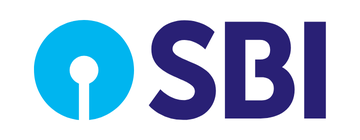 | **SBI** | The **keyhole** (1971) stands for safety and trust. Designed at **NID Ahmedabad** (credited to **Shekhar Kamat**\*). Widely said to be inspired by **Kankaria Lake, Ahmedabad**: a circle with a path running into it. |
|  | **HDFC Bank** | A white square inside a red-and-blue square, read as a stylised **"H"** and a **house**, a nod to its housing-finance parent HDFC Ltd (merged in **July 2023**). |
| 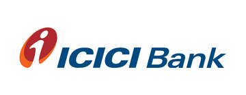 | **ICICI Bank** | The orange-and-red **"i"** looks like a **human figure** with a dot for the head. ICICI = Industrial Credit and Investment Corporation of India (1955).\* |
| 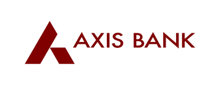 | **Axis Bank** | The burgundy **"A"** looks like a peak or arrow. It was **UTI Bank** until **2007**, when it was renamed to avoid confusion with UTI Mutual Fund. |
|  | **Kotak Mahindra Bank** | A red and blue **infinity-like loop**. The 2015 logo used two interlocking half-circles.\* |
| 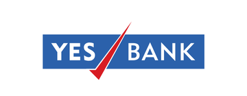 | **Yes Bank** | The red **tick (✓)** slashing through "YES BANK" is a literal "yes". |
|  | **IndusInd Bank** | A wordmark only. The name joins the **Indus** Valley with **Ind**ia. Promoted by the **Hindujas** for the Indian diaspora (1994). |
|  | **IDFC FIRST Bank** | A stylised **"F"** in a square frame. "First" comes from the **2018 merger with Capital First** (V. Vaidyanathan). |
| 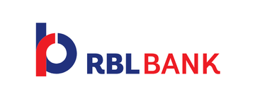 | **RBL Bank** | RBL = **Ratnakar Bank Ltd** (Kolhapur, 1943). **Emirates NBD** now owns 60%. |
| 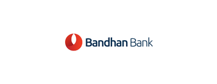 | **Bandhan Bank** | The red **drop / bond** mark. "Bandhan" means **bond**. Founder **Chandra Shekhar Ghosh** went from microfinance to a bank (2015). |
| 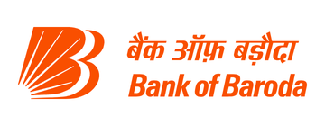 | **Bank of Baroda** | The **"Baroda Sun"** (2005): a **double "B"** shaped like the rays of a rising sun, with the bilingual wordmark. |
| 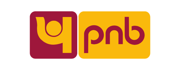 | **Punjab National Bank** | A maroon-and-gold block mark with a lowercase "pnb". Founded in **Lahore (1894)**, inspired by **Lala Lajpat Rai**. |
|  | **Canara Bank** | Interlocking **triangle and square** shapes in blue and yellow. Tagline "**Together we can**". Founded in Mangaluru (1906) by **Ammembal Subba Rao Pai**. **Absorbed Syndicate Bank**, the one with the dog logo, in 2020. |
| 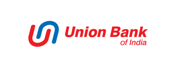 | **Union Bank of India** | An interlocking **"U"** in red and blue. Took in Andhra and Corporation Banks (2020). Founded in 1919; **Gandhi** inaugurated its HQ.\* |
| 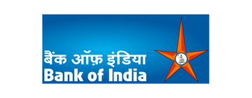 | **Bank of India** | The orange **star**. Older versions had a **pentagon** at the centre with a figure of **Shakti / Durga** leaning on a **lion**. |
| 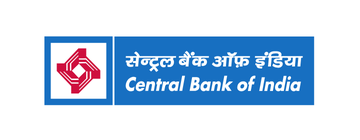 | **Central Bank of India** | Founded in **1911** by **Sir Sorabji Pochkhanawala**, the **first Indian commercial bank wholly owned and managed by Indians**. It issued India's first credit card (1980).\* |
| 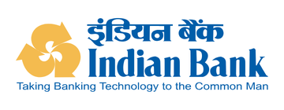 | **Indian Bank** | The yellow emblem is described as a **banyan tree**, India's national tree. Founded in 1907 after the **Arbuthnot crash**. Absorbed **Allahabad Bank** (2020). |
| 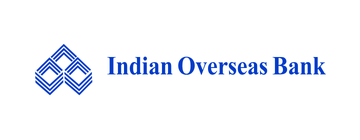 | **Indian Overseas Bank** | Interlocking diamonds. Founded in **1937** by **M.Ct.M. Chidambaram Chettyar** to specialise in **overseas / forex** banking, with branches in **Rangoon, Penang and Singapore** from the start.\* |
|  | **UCO Bank** | A blue box with an **arch / doorway**. UCO = **United Commercial Bank**, founded in Kolkata in **1943** by **G.D. Birla**, and renamed **UCO** in **1985**.\* |
| 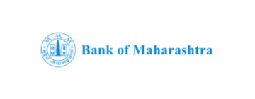 | **Bank of Maharashtra** | A seal-like emblem. Founded in **Pune (1935)**.\* |
| 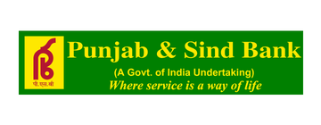 | **Punjab & Sind Bank** | Founded in **Amritsar (1908)** by **Bhai Vir Singh**, **Sir Sunder Singh Majithia** and Sir Tarlochan Singh. Tagline "**Where service is a way of life**".\* |
| 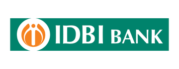 | **IDBI Bank** | An orange circle with an **"i"**. Once the government's development bank; **LIC** bought control in 2019, and **Fairfax** won it in **Oct 2026**. |
| 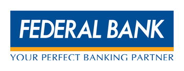 | **Federal Bank** | A wordmark on a blue box. "**Your perfect banking partner**". Founded in Aluva by **K.P. Hormis**. |
| 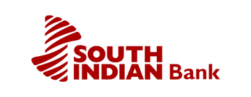 | **South Indian Bank** | A red **striped "S"**. Founded in **Thrissur (1929)**. |
| 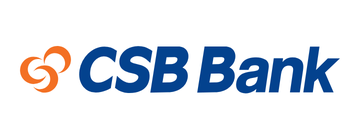 | **CSB Bank** | An orange swirl. Formerly **Catholic Syrian Bank** (Thrissur, 1920), renamed in **2019** under Fairfax. |
| 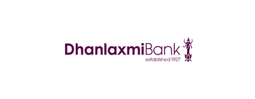 | **Dhanlaxmi Bank** | Includes a **traditional lamp (nilavilakku)**. Dhanalakshmi is the goddess of wealth. **Thrissur, 1927**. |
| 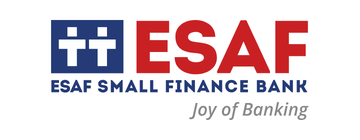 | **ESAF Small Finance Bank** | **Two human figures** (people / family). "**Joy of Banking**". ESAF = Evangelical Social Action Forum (Thrissur). |
| 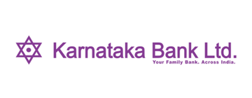 | **Karnataka Bank** | A **six-pointed star** with a central dot. Founded in **Mangaluru (1924)**. "Your Family Bank. Across India."\* |
| 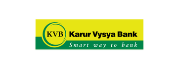 | **Karur Vysya Bank** | The KVB roundel in green and yellow. "**Smart way to bank**". Founded in **Karur (1916)** by the **Vysya** trading community.\* |
| 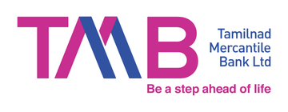 | **Tamilnad Mercantile Bank** | Started in **1921** as the **Nadar Bank** in Thoothukudi and renamed in **1962**. "Be a step ahead of life".\* |
| 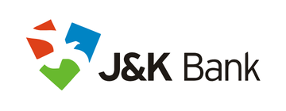 | **Jammu & Kashmir Bank** | A multicoloured abstract mark. Founded in **1938** under **Maharaja Hari Singh**; the state government is the majority owner.\* |
| 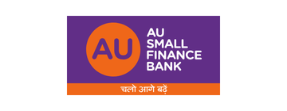 | **AU Small Finance Bank** | **"AU"** is often read as the chemical symbol for **gold**. Tagline "Chalo aage badhein". Jaipur.\* |
| 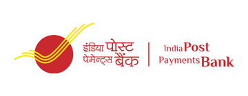 | **India Post Payments Bank** | Uses India Post's **red and yellow "flying envelope" bird** logo (2008).\* |

**Gone, but the logos are still quizzed:**

- **Syndicate Bank**: an **orange dog**, the symbol of loyalty and a watchful guardian of customers' money. Tagline "**Faithful and Friendly**". Merged into **Canara Bank (2020)**. Ex-staff petitioned to keep the dog in Canara's logo.
- **RBI** (not a commercial bank): a **tiger and palm tree**, adapted from the **East India Company's gold mohur**. The mohur had a **lion**, and the tiger was chosen instead to be more Indian.
- **State Bank of Travancore** and the other SBI associates used the **SBI keyhole** with their own names.\*

*\* Logo images are the official files from the open-source **indian-banks** repository. Logo meanings come from Brandloom where marked, and otherwise from general knowledge; check before relying on them.*

## Lost banks of Kerala and Thrissur

At one point Travancore and Cochin had dozens of small community banks: Catholic, Syrian, Latin Christian, Nayar, Thiya and Chaldean. Two crashes (1938 and 1960) and an RBI clean-up in the 1960s folded almost all of them into a few survivors.

### The two great crashes

| Bank | Story | Why it matters |
| --- | --- | --- |
| **Travancore National & Quilon Bank (TNQ Bank)** | Formed **1 Apr 1937** by merging **Travancore National Bank** (1912) and **Quilon Bank** (1919). It was **India's fourth-largest bank**, behind the Imperial Bank, Central Bank and Bank of India. Founded by **K.C. Mammen Mappillai** and **C.P. Mathen**, from the **Kandathil and Chalakuzhy** families of **Thiruvalla**. **Closed in 1938** on charges of "financial irregularities", which supporters call false. | Widely seen as **Dewan C.P. Ramaswami Iyer**'s revenge on founders who backed the **Congress**. The promoters were jailed and later freed without charges being proven. Kerala connect: Mammen Mappillai edited **Malayala Manorama**, which C.P. also shut in 1938, and his son **K.M. Mammen Mappillai** founded **MRF**.\* The Kochi-Muziris Biennale 2025–26 had an exhibition on it. |
| **Palai Central Bank** | Founded **1927** at **Pala** (Travancore) by **Joseph Augusti Kayalackakom**. At its peak it was **Kerala's largest bank** and the **17th largest of 94** scheduled banks in India, with 25 branches and deposits of ₹9.84 cr. **Wound up on 8 Aug 1960** by the Kerala High Court on the **RBI's petition**. | It caused runs across Kerala, and India's scheduled-bank deposits fell more than 10% in six months. **It led directly to the Deposit Insurance Act of 1961 and the DICGC**, India's deposit insurance. Depositors got back more than 90%, but in instalments over years. |

### Absorbed in the 1960s clean-up

| Bank (founded) | Absorbed by (year) |
| --- | --- |
| **Chaldean Syrian Bank** (1918, Thrissur\*) | State Bank of Travancore (1965) |
| **Cochin Nayar Bank** (1929) | SBT (1964) |
| **Latin Christian Bank** (1927) | SBT (1964) |
| **Champakulam Catholic Bank** (1929) | SBT (1964) |
| **Bank of Alwaye** | SBT (1965) |
| **Vasudeva Vilasam Bank** (1930) | SBT (1963) |
| **Travancore Forward Bank** (1929), **Kottayam Orient Bank** (1926), **Bank of New India** (1944) | SBT (1961) |
| **Indo-Mercantile Bank** | SBT (1959). Thrissur's Congress MP **C.R. Iyyunni** chaired its committee. |
| **Thiya Bank** (1945) | Lord Krishna Bank (1964) |
| **Aleppey Bank** (1919), **Chalakudy Public Bank** (1929), **Cochin Union Bank** (1932), **St George Union Bank** (1927), **Marthandom Commercial Bank** (1950) | Federal Bank (1964–68) |
| **Venadu Bank** (1934) | South Indian Bank (1961) |
| **Mukkattukara Catholic Bank**, **Chalakudy Bank**, **Malabar Bank**, **Assyrian Charities Banking Co.**, **Catholic Syrian Christian Bank**, **Kozhuvanal Bank**, **Bharata Union Bank**, **Vijayalakshmi Bank**, **Suburban Bank**, **Public Bank** | South Indian Bank (1964). Its biggest single haul: **10 banks in one year**. |
| **Krishnavilasam Banking Co.**, **Ambat Bank** (Chittur) | South Indian Bank (1963) |
| **Catholic Bank** (1938) | Syndicate Bank (1961) |
| **Bank of Kerala** (1944) | Canara Bank (1961) |
| **Bank of Cochin** (1928) | **SBI** (1985) |

### The later losses

| Bank | What happened | Hook |
| --- | --- | --- |
| **Nedungadi Bank** (1899, Kozhikode) | Merged into **PNB** (2003) | Kerala's first commercial bank. Its founder **Appu Nedungadi** wrote ***Kundalatha*** (1887). |
| **Lord Krishna Bank** (1940, **Kodungallur, Thrissur**) | Centurion Bank of Punjab (2006–07), then **HDFC Bank** (2008) | It had absorbed Thiya Bank. |
| **State Bank of Travancore** (1945, as Travancore Bank) | **SBI** (31 Mar 2017) | Set up on **C.P. Ramaswami Iyer**'s initiative, but **Maharaja Chithira Thirunal** was officially named founder because the Dewan was unpopular. The state supplied only 25% of the capital. HQ **Poojappura**, Thiruvananthapuram. It traded as **SBT**, BSE 532191. 1,157 branches (2015). |
| **North and South Malabar Gramin Banks** (1975) | Merged into **Kerala Gramin Bank** (2013) |  |
| **District co-operative banks** | Merged into **Kerala Bank** (2019) | Malappuram joined last. |

### Thrissur's banks, then and now

- **Still standing:** South Indian Bank (1929, Round South), CSB Bank (1920, as Catholic Syrian Bank), Dhanlaxmi (1927), ESAF SFB (Mannuthy), KSFE (1969), Manappuram (Valapad).
- **Gone:** Lord Krishna Bank (Kodungallur), Chaldean Syrian Bank (the **Chaldean Syrian Church** is centred in **Thrissur**\*), Mukkattukara Catholic Bank, Chalakudy Public Bank and Chalakudy Bank, and probably Cochin Nayar Bank\*.
- **Why Thrissur?** The swadeshi-era trading class, Syrian Christian and Nair communities, the **kuri / chitty** savings tradition, and Cochin State's relatively friendly rules.\*

*\* Location or link from general knowledge, not confirmed in the sources.*

## India's vanished banks

### The earliest banks (all gone)

| Bank | Years | Story |
| --- | --- | --- |
| **Bank of Hindostan** | 1770–1832, Calcutta | Often called **India's first bank**. Set up by the agency house **Alexander & Co.**, and it fell with that house.\* |
| **General Bank of India** | 1786–1791 | An early bank in Calcutta.\* |
| **Bank of Calcutta → Bank of Bengal** | 1806 / 1809 | The first **Presidency Bank**.\* |
| **Bank of Bombay** (1840) and **Bank of Madras** (1843) |  | The other two Presidency Banks. They issued notes until the **Paper Currency Act 1861**.\* |
| **Imperial Bank of India** | 1921–1955 | The three Presidency Banks merged. It became the **State Bank of India on 1 July 1955**, on the **A.D. Gorwala Committee**'s recommendation. That's why SBI is "India's oldest bank" by lineage (1806).\* |
| **Oudh Commercial Bank** | 1881, Faizabad | Called the **first bank entirely managed by Indians**. It failed in 1958.\* |
| **Allahabad Bank** | 1865 | The **oldest joint-stock bank** in India. Merged into **Indian Bank** (2020).\* |
| **Alliance Bank of Simla** | Collapsed 1923 | A British-run bank whose crash hurt Punjab and the hill stations.\* |
| **Arbuthnot & Co** | Crashed 1906, Madras | The crash pushed **V. Krishnaswamy Iyer** and others to found **Indian Bank** (1907) as a swadeshi response.\* |
| **People's Bank of India** | 1901–1913, Lahore | Founded by **Lala Harkishen Lal**, who also co-founded PNB. It collapsed in the 1913 crisis.\* |

### Merged away in 2017–2020 (founders and fun facts)

| Bank | Founded | Merged into | Hook |
| --- | --- | --- | --- |
| **State Bank of Bikaner & Jaipur** | 1963 (merger of 1943/44 banks) | SBI, 2017 |  |
| **State Bank of Hyderabad** | 1941, as **Hyderabad State Bank** under **Nizam Osman Ali Khan** | SBI, 2017 | It was the Nizam's central bank and handled the **Osmania sicca** currency.\* |
| **State Bank of Mysore** | 1913, as Bank of Mysore, at **M. Visvesvaraya**'s urging | SBI, 2017 |  |
| **State Bank of Patiala** | 1917, by **Maharaja Bhupinder Singh** | SBI, 2017 | The Patiala maharaja, of the Patiala Necklace by Cartier.\* |
| **State Bank of Travancore** | 1945 | SBI, 2017 | See the Kerala section. |
| **State Bank of Saurashtra** (2008) and **State Bank of Indore** (2010) |  | SBI | The earlier associate mergers.\* |
| **Bharatiya Mahila Bank** | 2013 | SBI, 2017 | India's first women's bank.\* |
| **Dena Bank** | 1938, by **Devkaran Nanjee** | Bank of Baroda, 2019 | **DENA = DEvkaran NAnjee**. **A Gujarati family bank from Mumbai**.\* |
| **Vijaya Bank** | 1931, Mangaluru, by **A.B. Shetty** | Bank of Baroda, 2019 | Named "Vijaya" for victory; founded on **Vijayadashami**. It was the first three-way merger of public banks.\* |
| **Oriental Bank of Commerce** | 1943, **Lahore**, by **Rai Bahadur Lala Sohan Lal** | PNB, 2020 | Moved to India after Partition.\* |
| **United Bank of India** | 1950, a merger of four Bengal banks | PNB, 2020 |  |
| **Syndicate Bank** | 1925, **Udupi**, by **T.M.A. Pai**, Upendra Pai and Vaman Kudva | Canara Bank, 2020 | Invented the **Pigmy Deposit** scheme, which collected tiny daily savings door to door.\* |
| **Andhra Bank** | 1923, **Machilipatnam**, by **Dr Bhogaraju Pattabhi Sitaramayya** | Union Bank, 2020 | The founder was a freedom fighter**, Congress president (1948) and the official historian of the Congress**.\* |
| **Corporation Bank** | 1906, **Udupi**, by **Khan Bahadur Haji Abdullah Haji Kasim Saheb Bahadur** | Union Bank, 2020 | Started with ₹5,000.\* |
| **Allahabad Bank** | 1865 | Indian Bank, 2020 |  |
| **New Bank of India** | 1936 | PNB, **1993** | The **only merger of two nationalised banks** before 2017.\* |

The coastal Karnataka belt (Udupi and Mangaluru) gave India **Syndicate, Corporation, Vijaya, Canara and Karnataka Bank**, and is often called the **cradle of Indian banking**.\*

### Collapses, rescues and scams

| Bank | When | What happened |
| --- | --- | --- |
| **Laxmi Commercial Bank** | 1985 | Merged into Canara Bank.\* |
| **Bank of Karad** | 1992 | Collapsed in the **Harshad Mehta** securities scam and merged into **Bank of India**.\* |
| **Madhavpura Mercantile Co-op Bank** | 2001 | Collapsed in the **Ketan Parekh** scam.\* |
| **Global Trust Bank** | 2004 | Merged into OBC overnight.\* |
| **United Western Bank** (Satara) | 2006 | Merged into **IDBI**.\* |
| **PMC Bank** | 2019 | HDIL loans hidden in **21,000+ fake accounts**. Taken over by **Unity SFB**.\* |
| **Yes Bank** | Mar 2020 | Moratorium. **SBI-led rescue** (the first under a reconstruction scheme). Now SMBC is its biggest shareholder.\* |
| **Lakshmi Vilas Bank** | Nov 2020 | Given to **DBS India**.\* |
| **New India Co-operative Bank** (Mumbai) | Feb 2025 | RBI restrictions after a reported ₹122 cr embezzlement.\* |

*\* From general knowledge; check before relying on it.*

### Quiz questions on lost banks

1. **Which 1960 Kerala bank failure led India to create deposit insurance (DICGC)?** Palai Central Bank.
2. **Which Travancore bank, India's fourth largest, was shut in 1938, and which Dewan is blamed?** Travancore National & Quilon Bank; Sir C.P. Ramaswami Iyer.
3. **TNQ Bank founder K.C. Mammen Mappillai's son started which tyre company?** MRF.\*
4. **Who was officially named founder of Travancore Bank (1945), even though the Dewan set it up?** Maharaja Chithira Thirunal Balarama Varma.
5. **Which Kozhikode bank, founded by the author of *Kundalatha*, merged into PNB in 2003?** Nedungadi Bank.
6. **Which Kodungallur (Thrissur) bank ended up inside HDFC Bank?** Lord Krishna Bank.
7. **Which Thrissur bank absorbed 10 banks in 1964 alone?** South Indian Bank.
8. **Which bank's name is short for its founder's name, Devkaran Nanjee?** Dena Bank.
9. **Which bank invented the Pigmy Deposit scheme?** Syndicate Bank (Udupi).
10. **The Imperial Bank of India became what on 1 July 1955?** State Bank of India.
11. **Which crash led to the founding of Indian Bank in 1907?** The collapse of Arbuthnot & Co (1906).
12. **What was the only merger of two nationalised banks before 2017?** New Bank of India into PNB (1993).
13. **Which bank was taken over by Unity SFB?** PMC Bank.
14. **Which bank was the first Indian bank absorbed by a foreign bank?** Lakshmi Vilas Bank, by DBS (2020).
15. **Which Kerala bank's founding church community is centred in Thrissur and merged into SBT in 1965?** Chaldean Syrian Bank.\*

## Sources

The 2025–26 deals and appointments were checked against the pages below. Founding stories and taglines are standard Indian banking history; confirm any single founding year or tagline before relying on it. Bank heads with no source are from general knowledge.

- [Cabinet clears ₹52,877 crore IDBI Bank stake sale to Fairfax (Outlook Money)](https://www.outlookmoney.com/news/cabinet-clears-rs-52877-crore-idbi-bank-stake-sale-to-fairfax)
- [IDBI Bank and CSB Bank shares after the Fairfax approval (Business Today)](https://www.businesstoday.in/markets/stocks/story/idbi-bank-shares-jump-13-csb-bank-also-gain-6-after-fairfax-approval-heres-why-561592-2026-10-14)
- [Emirates NBD's Indian branches to merge with RBL Bank from 1 Dec (Business Today)](https://www.businesstoday.in/latest/corporate/story/emirates-nbds-indian-branches-to-merge-with-rbl-bank-from-december-1-562208-2026-10-17)
- [Emirates NBD completes its majority stake in RBL Bank (Free Press Journal)](https://www.freepressjournal.in/business/emirates-nbd-completes-275-billion-majority-stake-acquisition-in-rbl-bank)
- [SMBC completes 20% stake in Yes Bank (Outlook Business)](https://www.outlookbusiness.com/corporate/japans-smbc-completes-20-stake-acquisition-in-yes-bank-becomes-largest-shareholder)
- [RBI approves Vinay Tonse as Yes Bank MD and CEO (Outlook Business)](https://www.outlookbusiness.com/corporate/rbi-approves-appointment-of-former-sbi-md-vinay-tonse-as-yes-bank-md-ceo)
- [RBI clears Sandeep Bakhshi's re-appointment at ICICI Bank to 2028 (Business Today)](https://www.businesstoday.in/latest/corporate/story/rbi-clears-sandeep-bakhshis-reappointment-as-icici-bank-ceo-till-2028-532974-2026-05-23)
- [SBI and HDFC Bank: India's only banks in the world's top 100 (ThePrint)](https://theprint.in/economy/sbi-hdfc-only-indian-banks-in-worlds-100-largest-by-assets-sp-global-market-intelligence/2591669)
- [Wikipedia: Banking in Kerala (defunct banks list)](https://en.wikipedia.org/wiki/Banking_in_Kerala)
- [Wikipedia: Palai Central Bank](https://en.wikipedia.org/wiki/Palai_Central_Bank)
- [Wikipedia: Travancore National and Quilon Bank](https://en.wikipedia.org/wiki/Travancore_National_and_Quilon_Bank)
- [Wikipedia: State Bank of Travancore](https://en.wikipedia.org/wiki/State_Bank_of_Travancore)
- [Wikipedia: South Indian Bank](https://en.wikipedia.org/wiki/South_Indian_Bank)
- [Wikipedia: C.R. Iyyunni](https://en.wikipedia.org/wiki/Iyyunni_Chalakka)
- [Public sector bank consolidation in 2026 (Outlook Business)](https://www.outlookbusiness.com/news/psb-consolidation-to-gain-momentum-in-2026-as-govt-eyes-big-world-class-banks)
