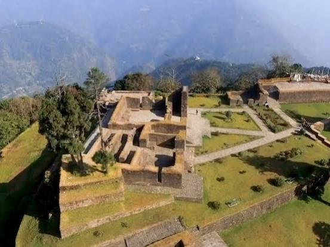
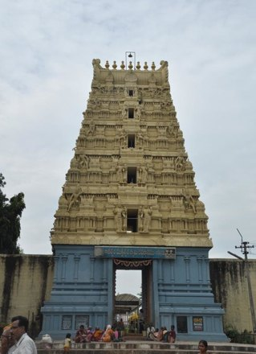
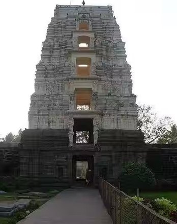
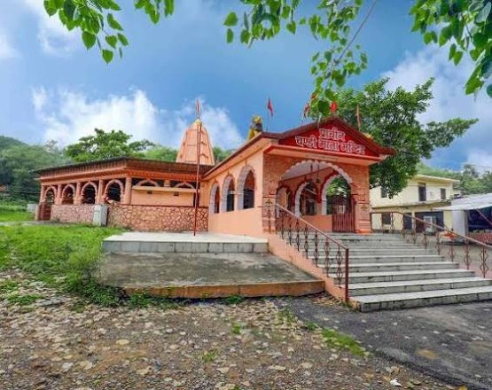
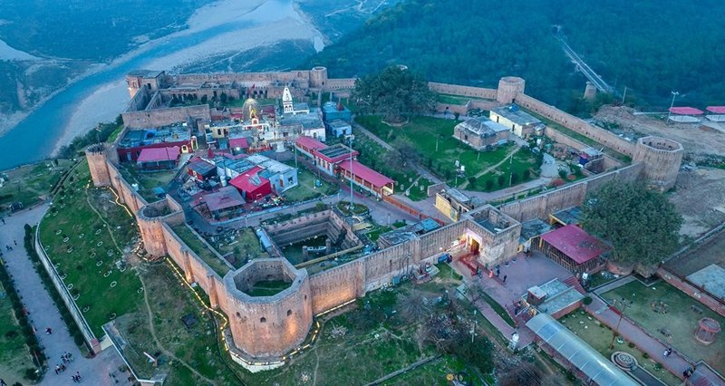
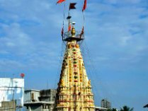
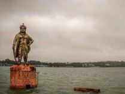
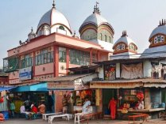
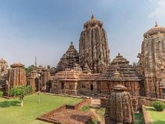

## States named after the land

- **Andhra Pradesh**: from the **Andhras**, an ancient people mentioned in Vedic texts, + *Pradesh* (province).
- **Arunachal Pradesh**: "Land of the Dawn-Lit Mountains" (*Aruna* = dawn/sun, *Achal* = mountain), as India's easternmost state sees the earliest sunrise. It was the **North-East Frontier Agency (NEFA)** until **1972**, when scholar **Bibhabasu Das Shastri** and Chief Commissioner **K.A.A. Raja** gave it its name.
- **Chhattisgarh**: "Thirty-Six Forts" (*Chhattis* = 36, *Garh* = fort), the 36 forts of the **Kalachuris of Ratanpur**. Another theory: a corruption of **Chedisgarh**, "Seat of the Chedi dynasty", a kingdom in the *Mahabharata*.
- **Haryana**: written *Hariyana* in a **1328 CE** Sanskrit inscription in Delhi that calls it "heaven on earth". Three proposed roots: *Hari* (Vishnu) + *Ayana* (abode), "Abode of God"; *Harit* (green) + *Aranya* (forest); or the **Abhira** (Ahir) people, as *Abhirayana*.
- **Himachal Pradesh**: "Land of Snowy Mountains" (*Hima* = snow, *Achal* = mountain), coined in **1948** by **Acharya Diwakar Datt Sharma**. Traditionally *Dev Bhumi* (Land of the Gods); it was formed from about 30 princely hill states.
- **Meghalaya**: "Abode of Clouds" (*Megha* = cloud, *Alaya* = abode), coined in **1970** by Calcutta University geographer **Shiba Prasad Chatterjee**, for the Khasi and Garo Hills, the wettest inhabited region on Earth.
- **Punjab**: Persian *Panj* (five) + *Ab* (water), the land of five rivers: **Jhelum, Chenab, Ravi, Beas and Sutlej**. Popularised under the Mughals (*Ain-i-Akbari*). The *Rigveda* calls the wider region **Sapta Sindhu** ("Land of Seven Rivers"); the *Mahabharata* calls it **Panchanada**, the Sanskrit equivalent of Punjab.
- **Uttarakhand**: "Northern Land" (*Uttara* = north, *Khand* = land). The *Skanda Purana* uses *Kedarkhand* and *Manaskhand* for the region. Carved out of UP in **2000** as **Uttaranchal**, it took back the scriptural name in **2007**.
- **Uttar Pradesh**: "Northern Province". Under the British it was the **United Provinces of Agra and Oudh**, shortened to **United Provinces** in 1937. In **1950** leaders picked a Hindi name that kept the initials **"U.P."**
- **Madhya Pradesh**: "Central Province", for its place in the heart of India.
- **Jharkhand**: "Forest Land" (*Jhar* = thicket/forest, *Khand* = land). Used since at least the **13th century** (copper plates in Odisha) to set the wooded **Chota Nagpur plateau** apart from the Gangetic plains.

## States named after peoples and dynasties

- **Assam**: probably from the **Ahom** dynasty, which ruled for nearly 600 years, or from Sanskrit *Asama* (peerless, uneven), for its terrain.
- **Bihar**: from **Vihara** (Buddhist monastery). In the late 12th century, Turkic invaders saw so many monasteries around Bihar Sharif (**Nalanda, Vikramashila, Odantapuri**) that they called the whole territory *Bihar*.
- **Gujarat**: after the **Gurjaras**, who rose to power in the 6th–9th centuries: *Gurjaratra* ("Land protected by the Gurjaras") became *Gujarata*. In antiquity its regions were called **Anarta** and **Lata**.
- **Maharashtra**: recorded in the 7th-century **Aihole inscription of Pulakeshin II** and by **Xuanzang** (as *Mo-ho-la-ch'a*). Either *Maha* (great) + *Rashtra* (nation), or linked to the **Maharathi** warrior clan or the **Mahar** community, through *Maharashtri Prakrit*.
- **Manipur**: originally **Kangleipak** ("Land of the Meiteis") or **Sanaleibak** ("Land of Gold"). In **1724**, King **Pamheiba (Gharib Nawaz)** adopted Hinduism and renamed it after a kingdom in the *Mahabharata*. Legend: *Mani* (jewel) refers to a celestial serpent that shed glowing jewels to light the valley while watching Shiva and Parvati dance.
- **Mizoram**: Mizo *Mi* (people) + *Zo* (highland) + *Ram* (land), "Land of the Highlanders". The British called it the **Lushai Hills**; it became the **Mizo District** in **1954**, to include all Zo-speaking clans and not just the Lushai, and Mizoram in 1972.
- **Nagaland**: after the **Naga** hill tribes. The root of *Naga* is debated: Burmese *Na-ka* ("pierced ears") or Assamese *Noga* ("naked" or "hillman").
- **Odisha**: from the ancient **Odra** people (*Odra Desha*, Prakrit *Odda Visaya*), named in the *Mahabharata* and by **Pliny the Elder** (as *Oretes*). The British spelling **Orissa** was officially changed to **Odisha** in **2011**.
- **Rajasthan**: "Abode of Kings" (*Raja* + *Sthan*). The British called its princely states **Rajputana**; historian **James Tod** popularised *Rajasthan* in his 1829 *Annals and Antiquities of Rajasthan*, drawing on local usage such as *Raithana*.
- **Tripura**: linked to the goddess **Tripura Sundari** or a legendary **King Tripur**, but most widely traced to **Kokborok** *Tui* (water) + *Pra* (near), "Land Near Water", as the Twipra kingdom once reached the Bay of Bengal.
- **West Bengal**: from the ancient **Vanga** (Banga) kingdom, first named in the *Aitareya Aranyaka*. *Vanga* may come from the Austric *Bonga* (Sun god) or the **Bong** tribe of the Ganges delta (c. 1000 BCE); it became *Vangala*, then *Bangalah*. "West" was added at **Partition in 1947**, when East Bengal went to Pakistan (now Bangladesh).

## States named after language, culture and myth

- **Goa**: the *Mahabharata* calls the region **Goparashtra** ("Nation of Cowherds") or **Gomantak** ("Land of Cows"), from *Go* (cow). Greek geographers knew its port as *Gouba*, the Kadambas called it *Gopakapattana*, and the Portuguese shortened it to **Goa** in **1510**.
- **Karnataka**: Kannada *Karu* (black) + *Nadu* (land), for the **black cotton soil** of the Deccan, or *Karunadu*, "lofty land".
- **Kerala (Keralam)**: "Land of Coconuts" (*Kera* = coconut tree, *Alam* = land), or from the **Chera** dynasty (*Cheralam*).
- **Sikkim**: Limbu *Su* (new) + *Khyim* (palace or house). In the late 17th century the second Chogyal, **Tensung Namgyal**, moved the capital from **Yuksom** to a new palace at **Rabdentse**. His Limbu queen, **Thungwamukma**, called it *Su-Khyim* ("New Palace"), and the name spread to the whole kingdom. The Lepchas called the land **Nye-mae-el** ("Paradise") and Tibetans **Drenjong** ("Valley of Rice"); the British first spelled it *Sukkim*. The dynasty was founded in **1642** at Yuksom's **Norbugang Coronation Throne**.

{: .place-thumb }

- **Tamil Nadu**: "Land of the Tamils" (*Nadu* = land, homeland).
- **Telangana**: from **Trilinga Desha** ("Land of Three Lingas"), the three Shiva temples that marked its borders:
    - **Kaleshwara Mukteswara Swamy Temple**, Kaleshwaram (Telangana)
    - **Mallikarjuna Swamy Temple**, Srisailam (Andhra Pradesh)
    - **Bhimeswara Swamy Temple**, Draksharamam (Andhra Pradesh)

{: .place-thumb } {: .place-thumb }

## Union territories

- **Andaman and Nicobar Islands**: **Andaman** appears in 9th-century Arab travelogues as *Angamanain* and in **Marco Polo** as *Angamanian*, from *Handuman*, the Malay form of **Hanuman**. **Nicobar** comes from Tamil **Nakkavaram** ("Land of the Naked"), in 11th-century **Chola** inscriptions.
- **Chandigarh**: when Lahore went to Pakistan in 1947, **Nehru** commissioned a new capital for Indian Punjab at the foot of the Shivaliks. Instead of naming it after a leader, planners named it after **Chandi Mandir**, a temple to Goddess Chandi (a fierce form of Durga) just outside the city, + *Garh* (fort): "Fort of Chandi". It is the capital of both **Punjab and Haryana**.

{: .place-thumb }

- **Dadra and Nagar Haveli and Daman and Diu**: four former Portuguese enclaves, merged into one UT in **2020**:
    - **Dadra**: Gujarati *dadra* (steps), for the stepped banks of the Daman Ganga.
    - **Nagar Haveli**: "Town of Mansions" (*Nagar* = town, *Haveli* = mansion).
    - **Daman**: from the **Daman Ganga river**, or Sanskrit *daman* ("restraint").
    - **Diu**: from Sanskrit *Dvipa*, "island".
- **Delhi**: traditionally named after **Raja Dhilu**, a legendary king said to have founded a city here in the 1st century BCE. Another legend, from the *Prithviraj Raso*: the 11th-century Tomar king **Anangpal II** disturbed the **Iron Pillar**, said to rest on the head of the serpent king **Vasuki**, and it never stood firm again, so the spot was called *Dhili* ("loose"), which became *Dilli*. **Joginipura**, one of Delhi's earliest recorded names, survives in the **Yogmaya Temple** (to Krishna's sister) near the Iron Pillar.
    - **Delhi's many cities**: **Indraprastha** (*Mahabharata*), **Dhillika** and **Lal Kot** (Tomars), **Siri** (Khiljis), **Tughlaqabad**, **Dinpanah** (Humayun), **Shahjahanabad** (Old Delhi) and **New Delhi**.
- **Jammu and Kashmir**:
    - **Jammu**: founded by **Raja Jambu Lochan** (9th century), who saw a lion and a goat drinking peacefully together from the **Tawi**. His brother **Raja Bahu Lochan** built **Bahu Fort** on the opposite bank, and Jambu Lochan founded *Jambupura* (later Jammu) across the river.
    - **Kashmir**: from *Kashyapa-Mira* ("Lake of Kashyapa"). In the *Nilamata Purana* and *Rajatarangini*, the valley was a lake ruled by a demon until **Sage Kashyapa** drained it and Goddess Parvati dropped a pebble that crushed the demon and became **Hari Parbat** in Srinagar, now topped by the Sharika Devi Temple and a Mughal-era fort.

{: .place-thumb }

- **Ladakh**: Tibetan *La* (mountain pass) + *Dags* (land), "Land of High Passes". It was historically called **Maryul** ("Red Land" or "Lowland").
- **Lakshadweep**: "One Hundred Thousand Islands" (*Laksha* = 1,00,000, *Dweep* = island). Part of **Chera** territory in Sangam literature and *Dibajat* to Arab sailors, it was the **Laccadive, Minicoy and Amindivi Islands** until it was renamed in **1973**.
- **Puducherry**: Tamil *Pudhu* (new) + *Cheri* (village), "New Village". The 1st-century *Periplus of the Erythraean Sea* lists it as the Roman trading port **Poduke**. The French form **Pondichéry** gave way to **Puducherry** in **2006**.

## Regions

- **Konkan**: from the ancient **Kukkana** people of the *Mahabharata* and *Puranas*, or Sanskrit *Kona* (corner), the narrow strip between the Western Ghats and the Arabian Sea.
- **Saurashtra**: Sanskrit *Su-rashtra*, "Good Country", or "Land of the Sun" (*Saura* = solar), for the sun worship of the **Kathiawar** peninsula.
- **Kutch**: from Sanskrit *Kachchha*, "tortoise" or "marshy land", for its salt marshes and tortoise-shaped coast.
- **Rayalaseema**: Telugu "Land of the Rayas" (*Rayala* + *Seema*), after the **Vijayanagara** emperors such as **Krishnadevaraya**.
- **Malabar**: Malayalam/Tamil *Mala* (hill) + Arabic/Persian *Bar* (coast), "Land of Hills", a name given by medieval Arab spice traders.
- **Ghats**: from Sanskrit *Ghatta* (steps, landing). European travellers used it because the flat-topped hills rise from the coast like giant staircases.

## State and UT capitals

### North and the Himalayas

- **Shimla** (Himachal Pradesh, summer): after **Shyamala Devi**, a blue-skinned form of Kali whose temple stood on **Jakhoo Hill**. The British, who made it their summer capital in **1864**, spelled it *Simla*; *Shimla* was restored in 1972.
- **Dharamshala** (Himachal Pradesh, winter): "Spiritual Dwelling" (*Dharma* + *Shala*), the word for a pilgrims' rest house. The British cantonment of **1849** was named after an old *dharamshala* on the site.
- **Dehradun** (Uttarakhand, winter): *Dera* (camp) + *Dun* (a Himalayan valley). In **1676**, **Guru Ram Rai**, eldest son of the seventh Sikh Guru, Har Rai, settled here after being exiled by his father; the town grew around his *dera*.
- **Bhararisain** (Uttarakhand, summer): near **Gairsain**, declared the summer capital in **2020** to bridge Garhwal and Kumaon. Said to come from Garhwali *Bharari* (a local forest goddess) + *Sain* (a flat meadow).†
- **Lucknow** (Uttar Pradesh): traditionally founded as **Lakshmanpur** (*Lakhanpur*) by **Lakshmana**, Rama's brother, on a mound above the **Gomti** still called **Lakshman Tila**. *Lakhanpur* became *Lakhnau* in Awadhi, which the British spelled Lucknow.
- **Jaipur** (Rajasthan): in **1727**, **Maharaja Sawai Jai Singh II** moved his capital from the hill fort of **Amber** to the plains. Designed by **Vidyadhar Bhattacharya** on *Vastu Shastra*, the walled city was named **Jaipur** ("City of Jai") after its astronomer-king founder.
- **Srinagar** (Jammu and Kashmir, summer): "City of Wealth" (*Sri* = Lakshmi, *Nagar* = city). The *Rajatarangini* (Kalhana, 12th century) says **Ashoka** founded *Srinagari* near modern Pandrethan; **King Pravarasena II** built the present city on the Jhelum in the 6th century. **Jammu** is the winter capital.
- **Leh** (Ladakh): from Ladakhi **Sle**, "oasis" or "flat ground", a fertile basin in the Indus valley. A Silk Road crossroads, it became Ladakh's royal capital under **King Sengge Namgyal** (17th century).
- **Chandigarh** (Punjab and Haryana): see Union territories above.

### West and centre

- **Gandhinagar** (Gujarat): when Bombay State split in **1960**, Ahmedabad was the temporary capital. A planned capital was built **23 km north** on the Sabarmati and named after **Mahatma Gandhi**.
- **Mumbai** (Maharashtra): after **Mumba Devi**, patron goddess of the **Koli** fishing community, + *Aai* (Marathi: mother). Her original temple stood at Bori Bunder (near today's CSMT) until it moved to **Bhuleshwar** in **1737**. The Portuguese took the islands in **1534** and called them *Bom Bahia* ("Good Bay"); the British (from **1661**) made it *Bombay*, and the city became Mumbai again in **1995**.

{: .place-thumb }

- **Nagpur** (Maharashtra, winter): founded in the early 18th century by the Gond king **Bakht Buland Shah** of Deogarh, named after the **Nag River**, itself named after the ancient **Naga** people.
- **Panaji** (Goa): from **Panjani** ("ferry"), a riverside crossing on the **Mandovi**. The Portuguese called it **Pangim**, then **Nova Goa** after it replaced plague-hit **Old Goa** as capital in **1843**.
- **Bhopal** (Madhya Pradesh): the 11th-century Paramara king **Raja Bhoja** built a huge earthen dam (*pal*) across the Kolans river to create the **Upper Lake (Bhojtal)**. The settlement became **Bhojpal** ("Bhoja's Dam"), then Bhopal; **Dost Mohammad Khan** founded the modern city in the 1720s.

{: .place-thumb }

- **Raipur** (Chhattisgarh): founded in the late 14th century by **Raja Ramachandra** (or his son **Rai Singh**) of the Ratanpur Kalachuris, on the **Kharun** river: "City of Rai".

### East and the Northeast

- **Patna** (Bihar): one of the world's oldest continuously inhabited cities. It began around **490 BCE** as **Pataligrama**, fortified by **Ajatashatru** of Magadha, and grew into **Pataliputra**, capital of the Mauryas and Guptas (also called **Kusumapura**, "City of Flowers"). **Sher Shah Suri** rebuilt it as a river port in **1541** and named it **Patna**, from *Pattana* ("port"). In **1704** it was renamed **Azimabad** after Mughal prince **Azim-ush-Shan**.
- **Ranchi** (Jharkhand): from **Archi**, a Mundari word for "bamboo grove", the name of an Oraon and Munda village. It became the headquarters of the South-West Frontier Agency in **1834**, and *Archi* turned into Ranchi.
- **Kolkata** (West Bengal): in **1690**, **Job Charnock** merged **Sutanuti, Govindapur and Kalikata**. *Kalikata* comes from **Kalikshetra** ("Field of Kali"), the land around the **Kalighat temple**, one of the **51 Shakti Peethas**, on the Adi Ganga, or from Bengali *Khal* (canal) + *Kata* (dug). It was **Calcutta** until **2001**.

{: .place-thumb }

- **Bhubaneswar** (Odisha): from **Tribhubaneswar**, "Lord of the Three Worlds", the form of Shiva worshipped at the 11th-century **Lingaraj Temple**. Ancient texts call it **Ekamra Kshetra** ("Land of One Mango Tree").

{: .place-thumb }

- **Gangtok** (Sikkim): Bhutia/Tibetan for "hilltop". A hamlet until **Enchey Monastery** was built in the 1840s, it became the capital when the royal family moved from **Tumlong** in **1894**.
- **Dispur** (Assam): Assam moved its capital here, a suburb of Guwahati, after **Shillong** went to the new state of Meghalaya in 1972. Possibly from *Disha-pur* ("City of Direction") or a remnant of **Pragjyotishpura**, the ancient capital of Kamarupa.†
- **Itanagar** (Arunachal Pradesh): "City of Bricks" (*Ita* = brick, *Nagar* = city), after the 14th-15th-century **Ita Fort**, built with millions of baked bricks.
- **Shillong** (Meghalaya): after **U Shyllong**, a Khasi deity believed to live on **Shillong Peak**. The British made it Assam's capital in **1874** and called it the "Scotland of the East".
- **Imphal** (Manipur): Meitei **Yumphal**, *Yum* (house) + *Phal* (cluster), "Cluster of Houses", centred on the **Kangla Palace**, seat of the **Ningthouja** dynasty.
- **Aizawl** (Mizoram): Mizo *Ai* (wild turmeric) + *Zawl* (flat land), "Field of Wild Turmeric". It began as a British outpost in **1890**.
- **Kohima** (Nagaland): the British could not say **Kewhira**, the Angami name meaning "land where the *Kewhi* flower grows", and wrote it as Kohima.
- **Agartala** (Tripura): *Agar* (agarwood, prized for incense) + *Tala* (beneath, storehouse). **Maharaja Krishna Kishore Manikya** moved the capital here from **Old Agartala** in the 19th century to escape raids and floods.

### South and the islands

- **Hyderabad** (Telangana): founded in **1591** by **Muhammad Quli Qutb Shah** around the **Charminar** on the Musi. Lore says he first called it *Bhagnagar* after the dancer **Bhagmati**, and renamed it "City of Hyder" when she took the title **Hyder Mahal** (it also honours Caliph Ali, called *Hyder*).
- **Amaravati** (Andhra Pradesh): a new capital on the Krishna after the **2014** bifurcation, named after the nearby historic **Amaravati**, a **Satavahana** capital (2nd century BCE to 2nd century CE) famous for its Buddhist stupa and the Amaralingeswara temple. *Amaravati* means "Abode of the Immortals".
- **Bengaluru** (Karnataka): a 9th-century hero stone at **Begur** mentions a battle at **Bengaval-uru** ("City of Guards"). Folklore credits **Veera Ballala II** (Hoysala, 12th century): lost while hunting, he was fed boiled beans by an old woman and named the place **Benda-Kaal-Uru** ("Town of Boiled Beans"). It was officially *Bangalore* until **2014**.
- **Chennai** (Tamil Nadu): in **1639** the East India Company got land from the brothers **Damarla Venkatadri and Ayyappa Nayaka** to build **Fort St. George**. They asked that it be named **Chennapatnam** after their father, **Damarla Chennappa Nayaka**, a Vijayanagara governor. Merged with *Madraspatnam*, the city was **Madras** until **1996**.
- **Thiruvananthapuram** (Kerala): "Sacred City of Lord Ananta" (*Thiru* = sacred, *Anantha* = the serpent on which Vishnu reclines, *Puram* = city), after the **Sree Padmanabhaswamy Temple**. It was *Trivandrum* until **1991**.
- **Sri Vijaya Puram** (Andaman and Nicobar Islands): **Port Blair** from **1789** (after British surveyor **Archibald Blair**) until it was renamed in **September 2024**. "City of Victory" recalls the islands' role in the freedom struggle (**Netaji Subhas Chandra Bose** raised the flag here in **1943**) and the **Chola** navy's 11th-century campaigns against the **Srivijaya** kingdom.
- **Kavaratti** (Lakshadweep): local tradition links it to **Kaveri-atti** (after the River Kaveri) or to the fragrant **Kavar** shrub that once covered the atoll.†

## Other cities and their old names

- **Prayagraj**: **Prayag** ("Place of Sacrifice") in Vedic texts, for the **Triveni Sangam** of the Ganga, Yamuna and the mythical Saraswati. **Akbar** built a fort here in **1575** and named the city **Ilahabas** ("Abode of God"), later **Allahabad**; it became Prayagraj again in **2018**.
- **Varanasi**: between the **Varuna** and **Assi** rivers, which meet the Ganga at its northern and southern ends. Ancient texts call it **Kashi** ("City of Light"); the British form was **Benares** (*Banaras*).
- **Ujjain**: **Avantika** (capital of the Avanti kingdom), **Ujjayini** ("City of Victory") and **Vishala** in Sanskrit literature.
- **Ayodhya**: **Saketa** in Buddhist and Jain texts; **Oudh** (*Awadh*) under the Nawabs and the British.
- **Kozhikode**: **Kalikooth** to medieval Arab and Chinese traders, **Calicut** to the Portuguese (and the source of the word **calico**).
- **Kanpur**: originally **Kanhaiyapur** ("Town of Krishna"), shortened to *Kanhpur*; the British spelled it *Cawnpore*.
- **Pune**: from **Punyanagari** ("City of Virtue") or *Punya-Vishaya*, at the sacred meeting of the **Mula and Mutha** rivers, recorded in 8th-century **Rashtrakuta** copper plates.
- **Ahmedabad**: founded in **1411** by **Sultan Ahmed Shah I** of the Gujarat Sultanate on the Sabarmati (*Abad* = city, settlement).
- **Surat**: from **Suryapur** ("City of the Sun"), or Arabic *Surat* (a chapter of the Quran), used by Muslim traders.
- **Kochi**: Malayalam **Kochazhi**, "small lagoon" (*Kochu* = small, *Azhi* = lagoon), for its natural harbour.
- **Indore**: after the **Indreshwar Temple**, an 18th-century Shiva shrine near the meeting of the Khan and Saraswati rivers.

*† Popular or disputed derivation; sources differ.*
