## Records and oddities

- **Oldest flag in continuous use**: Denmark's **Dannebrog**; legend says it fell from the sky at the **Battle of Lyndanisse (1219)** in Estonia. It is the model for every **Nordic cross**. The **Netherlands** has the oldest tricolour; **Austria's** red-white-red dates from about **1230**.
- **Only non-rectangular national flag**: **Nepal**, two stacked pennants. Its **constitution** gives step-by-step geometric instructions for drawing it.
- **Square flags**: only **Switzerland** and **Vatican City**. **Belgium (13:15)** and **Niger (6:7)** are nearly square.
- **Widest**: **Qatar (11:28)**, the only national flag more than twice as wide as tall. **Togo's** is in the **golden ratio**.
- **Different on each side**: **Paraguay** (coat of arms in front, **Treasury seal** with a lion and cap of liberty on the back).
- **Never flown at half-mast**: **Saudi Arabia**, because it carries the **Shahada**; it is made double-sided so the text reads correctly from both sides. The Taliban's **Afghan** flag has the same rule.
- **Only plain single-colour flag**: **Libya**'s all-green flag under **Gaddafi** (1977–2011).
- **A modern rifle**: **Mozambique**, an **AK-47** with a bayonet crossed with a hoe on an open book. The AK-47 is also on the coats of arms of **Zimbabwe** and **Timor-Leste**.
- **Maps on flags**: **Cyprus** (the island in copper-orange) and **Kosovo** (under six stars for its peoples).
- **People on a flag**: **Belize** (two woodcutters). It also has one of the **most colours** of any flag (12). **Mali's** first flag had a stick figure, removed in 1961.
- **Purple**, the rarest flag colour: **Dominica** (the **Sisserou parrot**) and **Nicaragua** (the rainbow).
- **No red, white or blue**: **Jamaica** is the only current one.
- **Buildings**: **Cambodia** (**Angkor Wat** at the centre); also Afghanistan's former flags (a mosque), **Portugal** (castles in the shield) and **San Marino** (three towers).
- **Birds**: Uganda (**grey crowned crane**), Papua New Guinea (**raggiana bird-of-paradise**), Dominica (Sisserou parrot), Zambia (**African fish eagle**), Kiribati (**frigatebird**), Zimbabwe (the **Zimbabwe Bird**), Mexico (golden eagle), Albania (double-headed eagle).
- **Words on flags**: Saudi Arabia, Iraq and Iran (Arabic), **Brazil** ('Ordem e Progresso'), Afghanistan (Taliban flag).
- **Union Jack** in the canton of four UN members: **Australia, New Zealand, Fiji, Tuvalu**.
- **Most stars**: the **United States** (50), then **Brazil** (27).
- **Designed by young people**: **PNG** (Susan Karike, **15**), the **US 50-star flag** (Robert Heft, **17**, graded **B−** as a school project), **UAE** (Abdullah Al Maainah, 19), **Nigeria** (Taiwo Akinkunmi, 23), one of Australia's five winners (Ivor Evans, 14).

## Lookalikes

| Flags | How to tell them apart |
| --- | --- |
| **Chad / Romania** | Practically identical; Chad's blue is darker. Romania's dates from 1848, Chad's from 1959. **Andorra** and **Moldova** add a coat of arms. |
| **Indonesia / Monaco** | Same red over white; Indonesia **2:3**, Monaco **4:5**. **Poland** is white over red. |
| **Netherlands / Luxembourg** | Luxembourg's blue is lighter and the flag longer. The Dutch flag began as orange-white-blue (the **Prince's Flag**). |
| **Ireland / Ivory Coast** | The same colours reversed: Ireland has green at the hoist, Ivory Coast orange. **Italy** and **Mexico** are green-white-red. |
| **Australia / New Zealand** | Australia: white stars and a seven-pointed **Commonwealth Star**. New Zealand: only four **red** stars with white borders. |
| **Mali / Senegal / Guinea** | Senegal adds a green star. Guinea is red-yellow-green (Mali reversed). |
| **Norway / Iceland** | Reversed Nordic crosses: Norway red with a blue cross, Iceland blue with a red cross. |
| **Colombia / Ecuador / Venezuela** | All from **Gran Colombia**: Colombia's yellow is half the flag; Ecuador adds its arms; Venezuela has an arc of eight stars. |
| **Russia / Slovakia / Slovenia / Serbia** | Pan-Slavic white-blue-red; Slovakia and Slovenia add arms; Serbia is red-blue-white. |
| **Bahrain / Qatar** | Bahrain: red, five points. Qatar: maroon, nine points, much longer. |
| **Haiti / Liechtenstein** | Same blue over red until the **1936 Olympics**; Liechtenstein then added a crown. |
| **Bangladesh / Palau / Japan** | Red disc on green, yellow disc on blue, red disc on white; the first two set the disc **towards the hoist**. |
| **Niger / India** | Niger's orange disc is plain and the flag nearly square. |

## Colour families

- **Pan-African** (green, yellow, red): from **Ethiopia**, which escaped colonisation. **Ghana** was the first newly independent African state to use them (1957), adding the **Black Star** from **Marcus Garvey's** Black Star Line.
- **Pan-African (UNIA)** red, black and green: **Marcus Garvey's** 1920 flag, echoed by **Kenya** and **Malawi**.
- **Pan-Arab** (black, white, green, red): from the **Arab Revolt flag (1916)** against the Ottomans. Jordan, Palestine, Sudan, Kuwait, the UAE, Iraq, Syria, Egypt, Yemen.
- **Pan-Slavic** (white, blue, red): from the **Russian** tricolour (said to be based on the Dutch flag), adopted at the **Prague Slavic Congress (1848)**. Serbia, Slovakia, Slovenia, Croatia, Czechia.
- **Nordic cross**: Denmark, Norway, Sweden, Finland, Iceland (and the Faroe and Åland islands). The cross is set towards the hoist.
- **Central American** blue-white-blue: from the **Federal Republic of Central America (1823–41)**. Honduras, El Salvador, Nicaragua, Guatemala (vertical stripes) and **Costa Rica** (red band added in 1848).
- **Gran Colombia** yellow-blue-red: Colombia, Ecuador, Venezuela, from **Francisco de Miranda**.

## Stars, crescents and the sky

- **The Southern Cross**: Australia, New Zealand, Papua New Guinea, Samoa and Brazil.
- **Brazil**: the globe shows the **sky over Rio on 15 Nov 1889**, the morning the republic was proclaimed; **27 stars** for the states and Federal District (**Pará** is the lone star above the band). **'Ordem e Progresso'** comes from **Auguste Comte's** positivism.
- **Crescent flags**: Turkey, Pakistan, Algeria, Tunisia, Malaysia, Singapore, Mauritania, Azerbaijan, Uzbekistan, Turkmenistan, Libya, Comoros, Maldives. **Singapore's** crescent stands for a young nation on the rise, not Islam. Many follow the **Ottoman** flag.
- **Suns**: Argentina and Uruguay (**Sun of May**, for the May Revolution of 1810), Japan, Kazakhstan, Kyrgyzstan (40 rays), Philippines (8 rays), Taiwan (12 rays), Malawi, Namibia, Rwanda, Antigua, North Macedonia, Kiribati.
- **Moons**: Palau (full moon) and Laos (a white disc read as the moon over the Mekong).

## Emblem trivia

- **No official coat of arms**: **Japan** (the Emperor's chrysanthemum; the government's paulownia), **France** (Marianne, the fasces emblem), **Turkey** (crescent and star), **Libya** (since 2011).
- **Eagle of Saladin**: Egypt, Iraq, Palestine. **Double-headed eagle** (from Byzantium): Albania, Russia, Serbia, Montenegro.
- **Animals popularly said not to walk backwards**: the **kangaroo and emu** on Australia's arms. **Dodo**: Mauritius. **Unicorn**: UK and Canada.
- **Numbers that recur**: the US Great Seal's **13** arrows, 13 olive leaves and 13-letter motto **E pluribus unum**; Indonesia's **Garuda** has 17, 8 and 45 feathers for **17-8-1945**.
- **'Unity makes strength'**: the motto of Belgium, Bulgaria, Haiti, Bolivia and others.
- **Mottos in unusual languages**: South Africa (**ǀXam**, extinct), Vanuatu (**Bislama**), Dominica (**Antillean Creole**).
- **Volcanoes**: Costa Rica (three), El Salvador and Nicaragua (five each), Vanuatu (one).
- **Monks with swords**: **Monaco**, recalling François Grimaldi's 1297 capture of the Rock disguised as a friar.
- **Phrygian cap** (liberty): on the arms of Argentina, Colombia, Cuba, El Salvador, Haiti and Nicaragua, and on Paraguay's Treasury seal.
- **Returned treasure**: Germany handed back part of a **Zimbabwe Bird** carving, taken in colonial times, in **2003**.

## Recent flag changes

- **Syria (2024–25)**: after Assad fell in **Dec 2024**, the **independence flag** (green-white-black with three red stars) replaced the red-white-black two-star flag.
- **Kyrgyzstan (2023)**: straight sun rays. **Honduras (2022)**: turquoise. **Mauritania (2017)**: two red stripes added.
- **Afghanistan (2021)**: the Taliban's white flag with the Shahada.
- **Libya (2011)**: back to the red-black-green independence flag.
- **Myanmar (2010)**: yellow-green-red with a large white star.
- **Iraq (2008)**: the three Ba'ath-era green stars removed.
- **Georgia (2004)**: the five-cross flag. **Rwanda (2001)**: blue, yellow and green with a sun, to break with the genocide era.
- **Kept**: **Fiji** dropped a 2015 plan to remove the Union Jack (2016); **New Zealand** kept its flag after two referendums (2015–16).

## National symbols beyond the flag

- **Scotland's** national animal is the **unicorn**; **Wales's** flag is the **red dragon** (Y Ddraig Goch).
- **National flowers**: India's **lotus**, Japan's **cherry blossom** (and chrysanthemum), the Netherlands' **tulip**, Pakistan's **jasmine**, Bangladesh's **water lily**, Nepal's **rhododendron**, England's **rose**, Scotland's **thistle**, Wales's **daffodil** (and **leek**), Ireland's **shamrock**.
- **National animals**: India's **Bengal tiger**, the US **bald eagle**, Australia's **kangaroo**, New Zealand's **kiwi**, China's **giant panda**, Indonesia's **Komodo dragon**.
- **Personifications**: **Marianne** (France), **Columbia** and **Lady Liberty** (US), **Britannia** (UK), **Bharat Mata** (India).

## Flag words

- **Vexillology**: the study of flags, from Latin **vexillum** (a Roman cavalry standard); coined by **Whitney Smith** (1957), who also designed **Guyana's** flag.
- **Hoist**: the half next to the pole. **Fly**: the free end. **Canton**: the upper hoist corner. **Field**: the background.
- **Half-mast** (half-staff): a sign of mourning; the flag is first raised to the top, then lowered.
- **Ensign**: a flag flown by ships to show nationality. **Jack**: a small flag at the bow.

The country tables follow the UN regions (Cyprus is listed under Europe). Within each table, countries are in alphabetical order.

## Asia

| Flag | Country | Flag: origin, meaning, facts | Emblem | Emblem facts |
| --- | --- | --- | --- | --- |
| 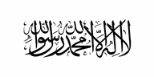{: .flag-thumb } | **Afghanistan** | Afghanistan changed its flag **more often than any other country in the 20th century**. The **Taliban** fly a **white flag with the black Shahada**; the black-red-green tricolour of the Republic (2004–21) is still flown at the **UN** and by many embassies. | 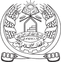{: .emblem-thumb } *Emblem* | The Taliban's emblem keeps the traditional **mosque with mihrab and minbar** framed by **wheat sheaves** under the **Shahada**. The Republic's version also carried the year **1298 (Solar Hijri = 1919)**, the year of independence from Britain. |
| 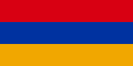{: .flag-thumb } | **Armenia** | **Red** (the Armenian Highlands and blood shed for freedom), **blue** (peaceful skies), **orange/apricot** (creativity and hard work). Adopted **24 Aug 1990**, based on the flag of the First Republic (1918–20). | 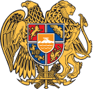{: .emblem-thumb } *Coat of arms* | Coat of arms (1992, from the 1918 design by **Alexander Tamanian** and Hakob Kojoyan): a shield with **Mount Ararat and Noah's Ark** at the centre, held by an **eagle and a lion**; below are a **broken chain, sword, wheat, quill and ribbon**. |
| 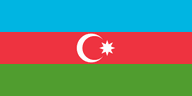{: .flag-thumb } | **Azerbaijan** | **Blue** (Turkic heritage), **red** (progress/modernity), **green** (Islam), with a white **crescent and eight-pointed star**; the eight points are often linked to the eight Turkic peoples. First adopted **1918**, readopted **1991**. | 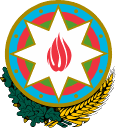{: .emblem-thumb } *National emblem* | Emblem: an **eight-pointed star** in the national colours with a **flame** at its centre (the 'Land of Fire', from burning natural gas), framed by **oak** and **wheat** ears. |
| {: .flag-thumb } | **Bahrain** | Red with a white band separated by a **serrated line of five white triangles**, which stand for the **Five Pillars of Islam** (2002). Bahrain's flag is often confused with **Qatar's**, which is maroon with nine points. | 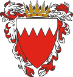{: .emblem-thumb } *Coat of arms* | Coat of arms designed by **Sir Charles Belgrave** in 1932: the same red and white serrated shield, surrounded by red-and-white **mantling**. |
| 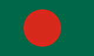{: .flag-thumb } | **Bangladesh** | A **red disc** (the sun rising over Bengal and the blood of the **1971 Liberation War**) on **bottle green** (the land). The disc is set slightly **towards the hoist** so it looks centred when the flag flies. Adopted **17 Jan 1972**; the 1971 version had a yellow map in the disc. Designed with input from **Shib Narayan Das**; final version by **Quamrul Hassan**. | 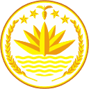{: .emblem-thumb } *National Emblem* | Emblem: a **water lily (shapla)**, the national flower, floating on water, flanked by **rice sheaves**, topped by **three jute leaves** and **four stars** (the founding principles: nationalism, socialism, democracy, secularism). |
| 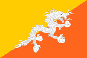{: .flag-thumb } | **Bhutan** | Divided diagonally: **yellow** (the secular authority of the King) and **orange** (Buddhism), with **Druk**, the **white Thunder Dragon**, holding **jewels in its claws** (wealth). 'Druk Yul' means Land of the Thunder Dragon. |  | Emblem: a circle holding a **double vajra (dorje)** over a lotus, a jewel, and **two dragons** (male and female), standing for the dual system of religious and civil government. |
| 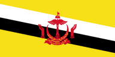{: .flag-thumb } | **Brunei** | Yellow (the Sultan) with **white and black diagonal stripes** (the two chief ministers) and the **national crest** in red at the centre. | 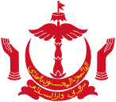{: .emblem-thumb } *Emblem* | Crest: a **parasol (royal umbrella)**, wings, two raised **hands** (the government's care for the people) and a **crescent** inscribed 'Always in service with God's guidance', above a ribbon reading **Brunei Darussalam ('Abode of Peace')**. |
| 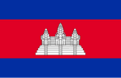{: .flag-thumb } | **Cambodia** | One of very few national flags with a **building** on it: **Angkor Wat** in white on a red band, between blue bands. Some form of Angkor Wat has been on Cambodia's flags since the 1850s; this design was restored in **1993** with the monarchy. | 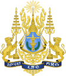{: .emblem-thumb } *Coat of arms* | Royal arms: a shield with the **Royal Sword** over a bowl, flanked by a **gajasingha** (lion with an elephant's trunk) and a **lion (singha)**, holding **five-tiered parasols**, under the **Great Crown**. |
| 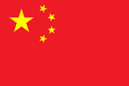{: .flag-thumb } | **China** | The **Five-starred Red Flag**, designed by **Zeng Liansong**, a Shanghai economist, chosen in **1949** from about 3,000 entries. The large star is the **Communist Party**; the four small stars (the four classes in Mao's 'On the People's Democratic Dictatorship') each point to it. | 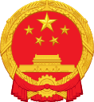{: .emblem-thumb } *National emblem* | National emblem (1950): **Tiananmen Gate** under the five stars, inside a ring of **wheat and rice** and a **cogwheel**. Designed by a team at Tsinghua University led by **Liang Sicheng** and **Lin Huiyin**. |
| 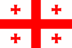{: .flag-thumb } | **Georgia** | The **Five Cross Flag**: a red **St George's Cross** with four **Bolnur-Katskhuri crosses**, based on a medieval Georgian banner. Adopted **2004** after the Rose Revolution, when it had been the flag of Saakashvili's United National Movement. | 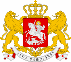{: .emblem-thumb } *Coat of arms* | Coat of arms: **St George slaying the dragon** on a red shield under a **royal crown** (the Iberian crown), supported by **two golden lions**; motto **'Strength is in Unity'**. |
| 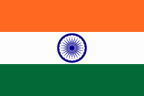{: .flag-thumb } | **India** | Tiranga: **saffron, white, green** with the navy-blue **Ashoka Chakra (24 spokes)**. Based on a design by **Pingali Venkayya**; adopted by the Constituent Assembly on **22 Jul 1947**. The Flag Code allowed only **khadi** until a **2021–22** amendment allowed machine-made and polyester flags; **KKGSS** in Hubballi, Karnataka is the only BIS-certified khadi flag maker. The Supreme Court (**Naveen Jindal**, 2004) held that flying it is a fundamental right. | {: .emblem-thumb } *State Emblem* | State Emblem: the **Lion Capital of Ashoka** from **Sarnath** (four lions, three visible), adopted **26 Jan 1950**; the abacus shows a **bull, horse, elephant and lion** with chakras. Motto **'Satyameva Jayate'** from the **Mundaka Upanishad**. The Constitution's illustrated version is by **Dinanath Bhargava**. |
| 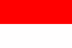{: .flag-thumb } | **Indonesia** | **Sang Saka Merah-Putih** ('the Red-and-White'), from the 13th-century **Majapahit** banner. Red is courage, white is purity. Proportion **2:3**; **Monaco's** flag is identical in colour but **4:5**. Poland's is the same colours reversed. | 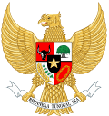{: .emblem-thumb } *National emblem* | **Garuda Pancasila**: a golden **Garuda** with a shield of the five Pancasila symbols (star, chain, banyan tree, buffalo head, rice and cotton). Its feathers encode **17 Aug 1945**: 17 wing feathers, 8 tail feathers, 45 neck feathers. Motto **'Bhinneka Tunggal Ika'** ('Unity in Diversity'). |
| 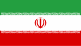{: .flag-thumb } | **Iran** | Green, white, red tricolour with the stylised word **'Allah'** emblem in red, and **'Allahu Akbar' written 22 times** in Kufic script along the band edges, for **22 Bahman** (11 Feb 1979), the date of the Revolution. Adopted **1980**. | {: .emblem-thumb } *Emblem* | Emblem designed by **Hamid Nadimi** (1980): four crescents and a sword forming the word **'Allah'**, also read as a **tulip**, the symbol of martyrdom. Before 1979 the flag carried the **Lion and Sun**. |
| 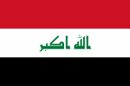{: .flag-thumb } | **Iraq** | Pan-Arab red, white, black. The **Takbir ('Allahu Akbar')**, added by **Saddam Hussein in 1991** in his own handwriting, was rewritten in **Kufic script** in 2008, when the **three green stars** were dropped. | 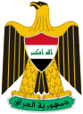{: .emblem-thumb } *Coat of arms* | Emblem: the **Eagle of Saladin**, holding a scroll reading **'Republic of Iraq'**, with the flag on its breast. |
| 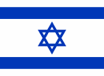{: .flag-thumb } | **Israel** | Blue **Star of David** between two blue stripes, based on the **tallit** (prayer shawl). It grew from the Zionist movement's flag, shown at the **First Zionist Congress (1897)** and credited to **David Wolffsohn**; adopted **28 Oct 1948**. | 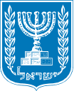{: .emblem-thumb } *Emblem* | Emblem (1949) by **Gabriel and Maxim Shamir**: the **Temple menorah** (modelled on the Arch of Titus relief) between **olive branches**, with 'Israel' in Hebrew. |
| 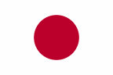{: .flag-thumb } | **Japan** | **Nisshōki** or **Hinomaru** ('circle of the sun'): a crimson disc on white. Used for centuries, it became the official national flag only in **1999** (Act on National Flag and Anthem). | 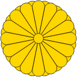{: .emblem-thumb } *Imperial Seal* | No official coat of arms. The **16-petal chrysanthemum (Kiku)** is the **Imperial Seal**, used on passports; the **paulownia (Go-Shichi no Kiri)** is the emblem of the Prime Minister and Government. |
| 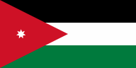{: .flag-thumb } | **Jordan** | Black, white, green stripes and a red triangle, from the flag of the **Arab Revolt (1916)**. The white **seven-pointed star** stands for the **seven verses of Al-Fatiha** (the first sura of the Qur'an). | 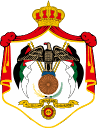{: .emblem-thumb } *Coat of arms* | Coat of arms: an **eagle on a globe** (Hashemite power), the **Hashemite crown**, a robe of royal crimson, and the **Order of the Renaissance**, with flags of the Arab Revolt. |
| 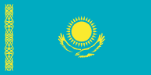{: .flag-thumb } | **Kazakhstan** | **Sky blue** with a golden **sun with 32 rays** above a **steppe eagle (berkut)** and a **koshkar-muiz** (ram's horn) ornament at the hoist. Designed by **Shaken Niyazbekov** (1992). |  | Emblem (1992) by **Zhandarbek Malibekov** and Shot-Aman Ualikhanov: a **shanyrak** (the crown of a yurt) on blue, with sun rays and **two winged horses (tulpars)** with golden horns. |
| 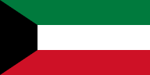{: .flag-thumb } | **Kuwait** | Green, white, red horizontal stripes with a **black trapezium** at the hoist; the colours come from **Safi al-Din al-Hilli's** poem about Arab deeds. Adopted **1961** on independence. | 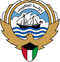{: .emblem-thumb } *Emblem* | Emblem (1962): a **falcon** with outstretched wings holding a disc with a **dhow (boom)** on the sea, the national flag, and the name 'State of Kuwait'. |
| 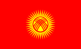{: .flag-thumb } | **Kyrgyzstan** | Red with a yellow **sun of 40 rays**, for the **40 tribes** united by the epic hero **Manas**. In the centre is a **tunduk**, the crown of a yurt. In **Dec 2023** the rays were straightened so the sun looks more like a sun and less like a sunflower. | 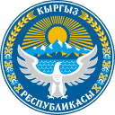{: .emblem-thumb } *Emblem* | Emblem: a **white falcon (Ak Shumkar)** spreading its wings over **Lake Issyk-Kul** and the **Ala-Too mountains**, with the sun rising behind. |
| 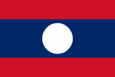{: .flag-thumb } | **Laos** | Red, blue, red with a white **disc** in the middle: the full moon over the **Mekong River**, a sign of unity under Communism. First used by the **Lao Issara** (1945) and adopted **1975**; one of the few communist flags with **no star**. |  | Emblem: **Pha That Luang** (the golden stupa in Vientiane) above rice paddies, a road, a dam and a forest, framed by **rice ears** and a cogwheel. |
| 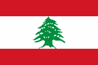{: .flag-thumb } | **Lebanon** | A green **cedar of Lebanon** on a white band between two red bands. The cedar stands for holiness, eternity and peace; it appears often in the Bible. Adopted **1943**. | 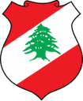{: .emblem-thumb } *Coat of arms* | Coat of arms: a red shield with a **white diagonal band** bearing the **green cedar**. |
| 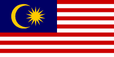{: .flag-thumb } | **Malaysia** | **Jalur Gemilang** ('Stripes of Glory'): **14 red and white stripes** and a **14-point star** for the 13 states plus the federal government; the yellow crescent is Islam. Strongly resembles the US flag. Designed by **Mohamed Hamzah** (1947). |  | Coat of arms: two **tigers** supporting a shield with the **five keris** (the former Unfederated Malay States), Penang and Malacca symbols, and Sabah and Sarawak arms, under a crescent and star; motto **'Bersekutu Bertambah Mutu'** ('Unity is Strength'). |
| 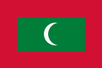{: .flag-thumb } | **Maldives** | Red border (the blood of heroes) with a green rectangle (peace and prosperity) and a white **crescent** (Islam). The plain red flag was used earlier; the current design dates from **1965**. |  | Emblem: a **coconut palm**, a **crescent and star**, and two **crossed national flags**, with the title **'Al-Dawlat Al-Mahaldheebiyya'** on a scroll. |
| 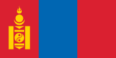{: .flag-thumb } | **Mongolia** | Red, blue, red with the golden **Soyombo** symbol at the hoist: fire, sun and moon, triangles, the **yin-yang (fish)** and pillars, a script symbol created by **Zanabazar in 1686**. The communist star was removed in **1992**. |  | Emblem (1992): a **Windhorse (Khiimori)** over the Soyombo, framed by a traditional ornamental border, a **wheel of dharma** with a **khadag** scarf, and the **Cintamani** jewel at the top. |
| 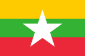{: .flag-thumb } | **Myanmar** | **Yellow, green, red** with a large white **five-pointed star** (the union). Adopted **21 Oct 2010** with the new constitution and capital Naypyidaw; it replaced the 1974 socialist flag. |  | State seal: a **map of Myanmar** inside a cogwheel, framed by **rice stalks** and two **chinthe** (lion guardians), under a star. |
| 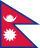{: .flag-thumb } | **Nepal** | The **only non-rectangular national flag**: two stacked **pennants** in crimson (the rhododendron, national flower) with blue borders. The **moon** (upper) and **sun** (lower) express the hope that Nepal will last as long as they do; the pennants are often linked to the **Himalayas** or Hinduism and Buddhism. The Constitution gives detailed **geometric construction instructions**. | 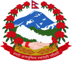{: .emblem-thumb } *Emblem* | Emblem (2006, revised 2020): **Mount Everest**, green hills, the **map of Nepal**, and hands of a man and woman in a **handshake** (gender equality), wreathed by **rhododendrons**; motto **'Janani Janmabhumishcha Swargadapi Gariyasi'** ('Mother and motherland are greater than heaven'). |
| 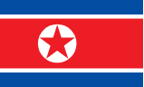{: .flag-thumb } | **North Korea** | **Ramhongsaek Konghwagukgi** ('red-coloured flag of the republic'): blue, red, blue with a red **star in a white disc**. Adopted **1948**. A flag at **Kijong-dong** near the DMZ once flew on one of the world's tallest flagpoles (**160 m**). | 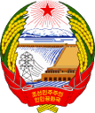{: .emblem-thumb } *Emblem* | Emblem: the **Sup'ung Dam** hydroelectric plant under **Mount Paektu** and a red star, framed by **rice ears** tied with a red ribbon reading the country's name. |
| 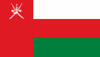{: .flag-thumb } | **Oman** | White (peace and prosperity), red (battles against invaders), green (the Jebel Akhdar mountains and fertility), with the **national emblem** at the top hoist. | 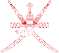{: .emblem-thumb } *National emblem* | National emblem (18th century): a **khanjar** (curved dagger) in its sheath over **two crossed swords**, the symbol of the **Al Said** dynasty. |
| 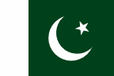{: .flag-thumb } | **Pakistan** | Dark green with a white vertical band; the **crescent** stands for progress and the **star** for light and knowledge. Green represents the Muslim majority and white the religious minorities. Designed by **Syed Amir-uddin Kedwaii**; adopted **11 Aug 1947**. | {: .emblem-thumb } *State emblem* | State emblem (1954): a shield of **cotton, wheat, tea and jute** (the main crops of the time), a **crescent and star**, a **jasmine (national flower)** wreath, and **Jinnah's** motto **'Iman, Ittehad, Nazm'** ('Faith, Unity, Discipline'). |
| 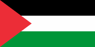{: .flag-thumb } | **Palestine** | Black, white, green with a red triangle, derived from the **flag of the Arab Revolt** (1916). Adopted by the PLO in **1964**. Raised at the **UN in New York in 2015** when non-member observer states were allowed to fly their flags. | {: .emblem-thumb } *Coat of arms* | Coat of arms: the **Eagle of Saladin** holding a shield in the flag's colours, with the word **'Palestine'** below. |
| {: .flag-thumb } | **Philippines** | Blue (peace) over red (patriotism and valour); in wartime the flag is flown **red side up**. White triangle with a golden **sun of 8 rays** (the first eight provinces to revolt against Spain) and **three stars** (Luzon, Visayas, Mindanao). Designed by **Emilio Aguinaldo**; first sewn in Hong Kong by **Marcela Agoncillo**. | {: .emblem-thumb } *Coat of arms* | Coat of arms (1946, by **Galo Ocampo**): the sun and three stars, with the **American bald eagle** and the **Spanish lion** (from the arms of Manila) recording the colonial past. |
| {: .flag-thumb } | **Qatar** | **Maroon** with a white serrated band of **nine points**, marking Qatar as the **ninth member of the 'reconciled Emirates'** of the Persian Gulf after the 1916 treaty with Britain. With a **11:28** ratio it is the **only national flag more than twice as wide as tall**. |  | Emblem: a yellow disc with **two crossed curved swords**, a **dhow** and two **palm trees** on an island, edged in maroon and white with 'State of Qatar'. |
| {: .flag-thumb } | **Saudi Arabia** | Green with the **Shahada** in Thuluth script above a **sword**. Because it carries the creed, it is **never flown at half-mast** and is made **double-sided** so the text reads correctly from both sides. Saudi Arabia marks **Flag Day on 11 Mar**. |  | Emblem: **two crossed swords** (the **Al Saud** and Wahhab unification) under a **date palm** (vitality and growth). |
| {: .flag-thumb } | **Singapore** | Red (universal brotherhood) over white (purity), with a white **crescent** (a young nation on the rise) and **five stars** (democracy, peace, progress, justice, equality). Adopted **3 Dec 1959** under self-government; the committee was led by **Toh Chin Chye**. |  | Coat of arms (1959): a **lion** (Singapore) and a **tiger** (Malaysia link) supporting a red shield with the crescent and stars; motto **'Majulah Singapura'** ('Onward Singapore'). |
| {: .flag-thumb } | **South Korea** | **Taegukgi**: a red and blue **taeguk (yin-yang)** circle with four black **trigrams** from the I Ching: **geon** (heaven), **gon** (earth), **gam** (water) and **ri** (fire). Attributed to **Park Yeong-hyo** (1882); adopted **1883**. | {: .emblem-thumb } *Emblem* | Emblem: the taeguk on a **Rose of Sharon (mugunghwa)**, the national flower, with a ribbon reading **'Daehan Minguk'**. |
| {: .flag-thumb } | **Sri Lanka** | The **Lion Flag**: a golden **lion with a sword** (the Sinhalese) on maroon, with **four bo leaves** (metta, karuna, mudita, upekkha) in the corners. Green and saffron stripes stand for **Muslims** and **Tamils**. Based on the banner of the last king of Kandy, **Sri Vikrama Rajasinha**. | {: .emblem-thumb } *Emblem* | Emblem (1972): the sword-bearing lion on a **lotus**, inside **petals and rice sheaves**, with a **Dharmachakra** above and the **sun and moon** below. |
| {: .flag-thumb } | **Syria** | In **2025** the post-Assad government adopted the **green-white-black flag with three red stars**, first used at independence (1932–58, 1961–63) and carried by the opposition during the civil war. The Ba'ath-era red-white-black flag with two green stars was retired. | {: .emblem-thumb } *Emblem* | A new emblem, a **golden eagle** with a three-star shield, was unveiled in **Jul 2025**, replacing the **Hawk of Quraish**. |
| {: .flag-thumb } | **Taiwan** | **Blue Sky, White Sun and a Wholly Red Earth**: the sun has **12 rays** (12 months and 12 traditional Chinese hours). The canton was designed by **Lu Haodong** (1895); **Sun Yat-sen** added the red field. Taiwan competes at the Olympics as **'Chinese Taipei'** under a separate plum-blossom flag. | {: .emblem-thumb } *National emblem* | National emblem: the **Blue Sky with a White Sun**, the same as the Kuomintang party emblem. |
| {: .flag-thumb } | **Tajikistan** | Red, white, green with a golden **crown** and an arc of **seven stars**. In Persian folklore paradise is seven orchards beyond seven mountains; the crown refers to the word **'taj'** in the country's name. Adopted **1992**. | {: .emblem-thumb } *Emblem* | Emblem: the crown and seven stars in a **sun rising over snowy mountains**, framed by **wheat** and **cotton**, with an open book (the Constitution). |
| {: .flag-thumb } | **Thailand** | **Trairanga** ('tricolour'): red (the nation), white (religion), blue (the monarchy), adopted by **King Vajiravudh** in **1917**. Blue was added partly in solidarity with the WWI Allies. Before that the flag was a **white elephant** on red. |  | Emblem: the **Garuda (Phra Khrut Pha)**, mount of Vishnu, a symbol of royal authority; used on documents and to mark **royal warrants**. |
| {: .flag-thumb } | **Timor-Leste** | Red with a black triangle over a yellow triangle and a white **star**. Yellow: colonialism; black: obscurantism to be overcome; red: the struggle for liberation; white star: peace. Raised at independence on **20 May 2002**. |  | Emblem: a shield in the shape of **Mount Ramelau** (the highest peak), with an AK-47, a bow and arrow, a book and a **cogwheel**; motto **'Unidade, Acção, Progresso'**. |
| {: .flag-thumb } | **Turkey** | **Ay Yıldız** ('moon star') or **Al Bayrak**: a white crescent and star on red, based on late Ottoman flags. Legend says it is the moon and a star reflected in **pools of blood** after a battle. Its geometry was fixed by law in **1936**. |  | **No official coat of arms**. An oval crescent-and-star emblem is used on passports and by embassies. |
| {: .flag-thumb } | **Turkmenistan** | Green with a red stripe carrying **five carpet guls** (patterns of the five main tribes) over **olive branches**, plus a crescent and **five stars** (the five provinces). Often called the **most intricate national flag**. | {: .emblem-thumb } *Emblem* | Emblem: an **octagon (Rub el Hizb)** with the Akhal-Teke horse **Ýanardag**, five carpet guls, **cotton** and **wheat**, under a crescent and stars. |
| {: .flag-thumb } | **United Arab Emirates** | Red vertical band with green, white and black horizontal stripes, the **Pan-Arab colours**. Designed in **1971** by **Abdullah Mohammed Al Maainah**, then 19, chosen from over 1,000 entries. | {: .emblem-thumb } *Emblem* | Emblem: a **golden falcon** with a disc showing the flag and **seven stars** (the seven emirates); until 2008 the disc showed a **dhow**. |
| {: .flag-thumb } | **Uzbekistan** | Blue (sky and water; Timur's colour), white (peace), green (nature) with red fimbriations, a **crescent** and **12 stars** (the 12 months/zodiac signs and the old regions). Adopted **18 Nov 1991**. |  | Emblem: the mythical **Khumo bird** with wings spread over a valley and rising sun, framed by **wheat** and **cotton**. |
| {: .flag-thumb } | **Vietnam** | **Cờ đỏ sao vàng** ('red flag with yellow star'). The five points stand for **workers, peasants, intellectuals, youth and soldiers**. Credited to **Nguyễn Hữu Tiến** (1940 Nam Kỳ uprising); national flag of the North from 1945 and of reunified Vietnam from **1976**. |  | Emblem (1955): a gold star over a **cogwheel** and **rice ears**, edged with red. |
| {: .flag-thumb } | **Yemen** | Plain **red, white, black** tricolour, adopted on **unification on 22 May 1990**. North Yemen's flag had a green star; South Yemen's had a blue triangle and red star. | {: .emblem-thumb } *Emblem* | Emblem: a **golden eagle** with a shield showing a **coffee plant** and the **Marib Dam**, flanked by national flags. |

## Europe

| Flag | Country | Flag: origin, meaning, facts | Emblem | Emblem facts |
| --- | --- | --- | --- | --- |
| {: .flag-thumb } | **Albania** | A black **double-headed eagle** on red, from the seal of **Skanderbeg**, the 15th-century hero who resisted the Ottomans. Raised by **Ismail Qemali** at **Vlorë** on independence, **28 Nov 1912**. Albanians call their country **Shqipëria**, popularly 'land of eagles'. | {: .emblem-thumb } *Coat of arms* | Coat of arms: the double-headed eagle on a red shield under the **helmet of Skanderbeg**, topped by a **goat's head** (the helmet is in Vienna's Kunsthistorisches Museum). |
| {: .flag-thumb } | **Andorra** | Blue, yellow, red vertical tricolour with the coat of arms. The colours mix those of **France** (blue, red) and **Catalonia/Spain** (yellow, red), reflecting its two **co-princes**. Without the arms it looks like **Chad's, Romania's** and Moldova's flags. | {: .emblem-thumb } *Coat of arms* | Arms: four quarters: the **mitre and crozier** of the **Bishop of Urgell**, the **three red pales of the Counts of Foix**, the **four red pales of Catalonia**, and **two cows of Béarn**; motto **'Virtus Unita Fortior'** ('Strength united is stronger'). |
| {: .flag-thumb } | **Austria** | Red-white-red, one of the **oldest national flags** (from about **1230**, Babenberg dukes). Legend: **Duke Leopold V's** white tunic was soaked in blood at the **Siege of Acre** (1191) except where his belt was. |  | A black **single-headed eagle** with a red-white-red shield, holding a **sickle** (farmers) and **hammer** (workers), wearing a **mural crown** (burghers). **Broken chains** were added in **1945** to mark liberation from Nazi rule. |
| {: .flag-thumb } | **Belarus** | Red and green with a **red-on-white ornamental pattern** at the hoist, from a 1917 towel design by **Matrona Markevich**. Adopted after a **1995 referendum** under Lukashenko, replacing the **white-red-white** flag (1991–95), which the opposition still uses. | {: .emblem-thumb } *National emblem* | State emblem: a **green outline map of Belarus** over a rising sun, inside **wheat ears** with **clover and flax flowers**, a red star on top. Close to the Soviet-era design. |
| {: .flag-thumb } | **Belgium** | Black, yellow, red **vertical** tricolour from the arms of the **Duchy of Brabant** (golden lion with red claws on black). Adopted **1831**; its odd **13:15** ratio makes it nearly square. Germany has the same colours horizontally. | {: .emblem-thumb } *Coat of arms* | Arms: the **Lion of Brabant** (gold on black); motto **'L'union fait la force'** ('Unity makes strength'), shared with Bulgaria, Haiti, Bolivia and others. |
| {: .flag-thumb } | **Bosnia and Herzegovina** | Blue with a **yellow triangle** (roughly the country's shape; also the three peoples: Bosniaks, Croats, Serbs) and a line of **white stars** (Europe). Imposed in **1998** by the **High Representative Carlos Westendorp** after parliament could not agree. | {: .emblem-thumb } *Coat of arms* | Coat of arms (1998): the same triangle and stars on a blue shield, replacing the **fleur-de-lis (lily)** arms of the Kotromanić dynasty used in 1992–98. |
| {: .flag-thumb } | **Bulgaria** | White (peace), **green** (fertile land), **red** (courage and blood), adopted **1879** after liberation from the Ottomans. It is the Russian tricolour with **green** in place of blue. | {: .emblem-thumb } *Coat of arms* | Coat of arms: a **crowned golden lion** on a dark red shield, supported by two more lions on oak branches; motto **'Unity makes strength'** ('Saedinenieto pravi silata'). |
| {: .flag-thumb } | **Croatia** | Red, white, blue (Pan-Slavic) with the coat of arms. The famous **'šahovnica'** (red-white chequerboard) is at the centre. |  | The **chequy shield of 25 red and white squares** under a crown of **five small shields**: the oldest Croatian arms, **Dubrovnik**, **Dalmatia**, **Istria** and **Slavonia**. The top-left square must be **red**; the 1941–45 fascist version began with white. |
| {: .flag-thumb } | **Cyprus** | One of only two national flags showing a **map of the country** (with **Kosovo**). The **copper-orange** island (Cyprus is linked with the word for copper) above two **olive branches** for peace between Greek and Turkish Cypriots. Designed in **1960** by **İsmet Güney**. |  | Coat of arms: a **white dove carrying an olive branch** on a copper-yellow shield, with **'1960'** (independence), framed by olive branches. |
| {: .flag-thumb } | **Czech Republic** | White and red with a **blue triangle**, adopted by Czechoslovakia in **1920** (designed by **Jaroslav Kursa**). The Czech Republic kept it in **1993** even though the separation law said neither successor should use federal symbols. |  | Greater coat of arms: the **double-tailed silver lion of Bohemia** (twice), the **red-and-silver chequered eagle of Moravia** and the **black eagle of Silesia**. |
| {: .flag-thumb } | **Denmark** | The **Dannebrog**, the **oldest continuously used national flag** (records from the 14th century). Legend says it fell from the sky during the **Battle of Lyndanisse (Estonia), 15 Jun 1219**. Its **Nordic (Scandinavian) cross** was copied by the other Nordic flags. | {: .emblem-thumb } *Coat of arms* | Arms: **three crowned blue lions** passant with **nine red hearts** (actually water-lily leaves, **søblade**) on gold, under the royal crown. In **2024** King **Frederik X** redesigned the royal arms, dropping the Kalmar Union's **three crowns**. |
| {: .flag-thumb } | **Estonia** | **Sinimustvalge** ('blue-black-white'): blue (sky, loyalty), black (the soil and dark past), white (snow, hope). First used by the **Estonian Students' Society** in **1884** in Otepää. | {: .emblem-thumb } *Coat of arms* | Coat of arms: **three blue lions** on gold, from the arms of Danish King **Valdemar II** (who conquered Tallinn in 1219), framed by **oak branches** in the greater arms. |
| {: .flag-thumb } | **Finland** | **Siniristilippu** ('blue cross flag'): a blue Nordic cross on white, for Finland's **lakes** and **snow**. Adopted **1918**, a design by **Eero Snellman** and **Bruno Tuukkanen**. | {: .emblem-thumb } *Coat of arms* | Coat of arms (c. 1580): a **crowned golden lion** standing on a **curved Russian sabre**, brandishing a straight Western sword, on red with **nine silver roses** (the historic provinces). |
| {: .flag-thumb } | **France** | **Le Tricolore**: blue and red, the colours of **Paris**, framing the white of the Bourbon kings. Adopted in **1794** during the Revolution. Article 2 of the Constitution names it; the navy blue was quietly darkened in **2020** under Macron. | {: .emblem-thumb } *Coat of arms* | **No official coat of arms**. Common symbols: **Marianne** (on stamps and coins, government logo), the **Gallic rooster**, and the **fasces** emblem with 'RF' and 'Liberté, Égalité, Fraternité'. |
| {: .flag-thumb } | **Germany** | **Schwarz-Rot-Gold**: from the uniforms of the **Lützow Free Corps** (black coats, red facings, gold buttons) in the Napoleonic wars, then the **Hambach Festival (1832)** and the **1848 revolutions**. Used by the **Weimar Republic** and again by both German states from **1949**; East Germany added a hammer and compass in 1959. | {: .emblem-thumb } *Coat of arms* | **Bundesadler**: a black eagle with red beak and claws on gold, the successor of the Holy Roman Empire's eagle. The large eagle in the **Bundestag** is nicknamed **'the fat hen' (Fette Henne)**. |
| {: .flag-thumb } | **Greece** | **Nine blue and white stripes**, said to match the **nine syllables of 'Eleftheria i Thanatos'** ('Freedom or Death'). The **white cross** stands for Greek Orthodoxy. Adopted at sea in **1822**, on land only from **1978**. | {: .emblem-thumb } *Coat of arms* | Coat of arms: a white **Greek cross** on a blue shield, framed by **laurel branches**. |
| {: .flag-thumb } | **Hungary** | Red (strength), white (faithfulness), green (hope), based on the **1848 Revolution**. The **1956 uprising** flag had the **communist emblem cut out**, leaving a hole. |  | Coat of arms: split shield: **Árpád stripes** (red and white) and a **double cross on three green hills** (the Tatra, Mátra and Fátra), topped by the **Holy Crown of Hungary** with its **bent cross**. |
| {: .flag-thumb } | **Iceland** | A **red Nordic cross bordered in white on blue**: blue (sky and sea), white (ice and snow), red (**volcanic fire**). Approved in **1915** and made the national flag in **1944** with independence from Denmark. |  | Arms: the flag on a shield held by Iceland's **four guardian spirits (Landvættir)** from the **Heimskringla**: a **bull**, a **giant**, an **eagle (or vulture)** and a **dragon**, standing on basalt rock. |
| {: .flag-thumb } | **Ireland** | Green (the Gaelic tradition), orange (the Protestant supporters of **William of Orange**), white (peace between them). Presented to **Thomas Francis Meagher** by French women in **1848**; raised over the GPO in the **Easter Rising (1916)**. Ivory Coast's flag is the same colours reversed. | {: .emblem-thumb } *Coat of arms* | Arms: a golden **harp with silver strings** on blue, modelled on the **Brian Boru harp** in Trinity College. Ireland is the only country whose national symbol is a **musical instrument**. **Guinness** uses a harp facing the **other way**. |
| {: .flag-thumb } | **Italy** | **Il Tricolore**, based on the French tricolour, brought by Napoleon's army. First adopted by the **Cispadane Republic** at **Reggio Emilia** on **7 Jan 1797** (now **Flag Day**). Popularly: green hills, white Alpine snow, red blood of wars. | {: .emblem-thumb } *Emblem* | Emblem (1948, by **Paolo Paschetto**): a white **five-pointed star (Stella d'Italia)** on a **cogwheel** (work), framed by **olive** and **oak** branches, with a ribbon 'Repubblica Italiana'. |
| {: .flag-thumb } | **Kosovo** | Blue with a golden **map of Kosovo** and **six white stars** (the main ethnic groups: Albanians, Serbs, Turks, Gorani, Roma, Bosniaks). Designed by **Muhamer Ibrahimi** and adopted on independence, **17 Feb 2008**; deliberately avoids the Albanian eagle. | {: .emblem-thumb } *Emblem* | Kosovo's coat of arms uses the same **map and six stars** on a blue shield. |
| {: .flag-thumb } | **Latvia** | **Carmine red** with a white stripe, one of the world's oldest flags. The **Rhymed Chronicle of Livonia** (13th c.) tells of a wounded chieftain wrapped in a white sheet stained with blood. Banned in Soviet times; restored in **1990**. | {: .emblem-thumb } *Coat of arms* | Arms: a **rising sun**, a **red lion** (Courland and Semigallia) and a **silver griffin** (Livonia and Latgale), with **three stars** above for the historic regions; supported by a lion and griffin. |
| {: .flag-thumb } | **Liechtenstein** | Blue and red with a golden **prince's crown**. The crown was added in **1937** after the team at the **1936 Berlin Olympics** found their flag identical to **Haiti's**. |  | Arms of the **House of Liechtenstein**: quarters for **Silesia, Kuenring, Troppau and East Frisia/Rietberg**, with the red-and-gold family shield at the centre and the princely hat. |
| {: .flag-thumb } | **Lithuania** | Yellow (sun and prosperity), green (forests and hope), red (blood shed for freedom). Adopted **1918**; restored **1989**. The historic red flag with the **Vytis** is the state flag. | {: .emblem-thumb } *Coat of arms* | Arms: **Vytis ('the Chaser')**: a silver **knight on a white horse** with a raised sword and a shield bearing the **double cross of Jagiellon**; one of Europe's oldest arms (14th c.). |
| {: .flag-thumb } | **Luxembourg** | Red, white and **light blue** horizontal: almost the same as the **Netherlands'** flag (lighter blue, longer ratio). The colours come from the arms. The **'Roude Léiw'** (red lion) flag is used as a civil ensign, and there have been campaigns to make it the national flag. |  | Arms: a **red lion** with a golden crown on **ten blue and white stripes**, from the House of Limburg (13th c.). |
| {: .flag-thumb } | **Malta** | White and red (legend says from **Count Roger I of Sicily**, 1091), with the **George Cross** in the canton, awarded by **King George VI** in **1942** for the islanders' courage during the WWII siege. |  | Coat of arms (1988): a shield of the flag with the George Cross, a **mural crown** of a fortress city, framed by **olive and palm branches**; ribbon 'Repubblika ta' Malta'. |
| {: .flag-thumb } | **Moldova** | Blue, yellow, red (like **Romania's**, to which it is closely linked) with the coat of arms. Without the arms it would be identical to **Romania's** and nearly to **Chad's**. | {: .emblem-thumb } *Coat of arms* | Arms: a golden **eagle** holding an Orthodox **cross**, a sceptre and an olive branch, with the head of an **aurochs** on its breast, between a rose, crescent and star (from the old arms of **Moldavia**). |
| {: .flag-thumb } | **Monaco** | Red over white, from the **Grimaldi** family's heraldic colours (since 1339). Identical to **Indonesia's** in design but in **4:5** ratio; the two countries argued about it in the 1950s. |  | Grimaldi arms: **red-and-white lozenges** (fusils) held by two **monks wielding swords**, recalling **François Grimaldi**, who captured the Rock of Monaco disguised as a **Franciscan monk** in **1297**. Motto **'Deo Juvante'**. |
| {: .flag-thumb } | **Montenegro** | Red with a **golden border** and the coat of arms, adopted **2004** after a referendum (independence in **2006**). Before that Montenegro used a red-blue-white tricolour. |  | Arms: a **golden double-headed eagle** with a crown, sceptre and orb, and on its breast a **lion passant** (from the **Petrović-Njegoš** dynasty). |
| {: .flag-thumb } | **Netherlands** | Red, white, blue: the **oldest tricolour in continuous use**, from the **Prinsenvlag** (orange-white-blue) of **William of Orange** in the Dutch Revolt. The orange became red in the 17th century, possibly because orange dye faded. On **King's Day** an **orange pennant** is flown above it. | {: .emblem-thumb } *Coat of arms* | Arms: a **crowned golden lion** holding a sword and **seven arrows** (the seven provinces of the Union of Utrecht) on blue, scattered with **billets**; motto **'Je maintiendrai'** ('I will maintain'). |
| {: .flag-thumb } | **North Macedonia** | Red with a yellow **sun of eight broadening rays**: the 'new sun of liberty' (**1995**). The earlier flag (1992–95) showed the **Vergina Sun**, an ancient Macedonian symbol, and was changed after Greek objections and an embargo. |  | The emblem is still the **socialist-era** design (mountains, rising sun, **Lake Ohrid**, wheat, tobacco and poppy); only the **red star** was removed, in **2009**. |
| {: .flag-thumb } | **Norway** | Red with a **blue Nordic cross bordered in white**, designed by **Frederik Meltzer** (1821). It contains the colours of **France, UK and US** (liberty), and has been called the **'mother of all flags'** as it holds the Danish, Dutch, French, US, British and other flags within it. |  | Royal arms: a crowned **golden lion holding an axe** (the axe of **St Olaf**) on red, one of the oldest arms in Europe (13th century). |
| {: .flag-thumb } | **Poland** | White over red, the colours of the **coat of arms** (white eagle on red). Adopted **1919**; Flag Day is **2 May**. **Indonesia** and **Monaco** have the same colours **reversed**. | {: .emblem-thumb } *Coat of arms* | **White Eagle (Orzeł Biały)** with a golden crown on a red shield. Legend: **Lech**, founder of Poland, saw a white eagle's nest against a red sunset at **Gniezno**. Communist Poland removed the eagle's **crown** (1945–90). |
| {: .flag-thumb } | **Portugal** | Green (hope) and red (the blood of those who died for the nation), adopted **1911** after the **1910 Republic**. At the centre is the **armillary sphere** (Age of Discovery) with the national shield. |  | Shield: **five blue escutcheons (quinas)** with five white dots, the five wounds of Christ and the five Moorish kings defeated by **Afonso I at Ourique (1139)**, inside a red border of **seven castles**. |
| {: .flag-thumb } | **Romania** | Blue, yellow, red **vertical** tricolour, the colours of **Wallachia and Moldavia** (1848). Almost identical to **Chad's** (Chad's blue is darker); in 2004 Chad raised the matter at the UN. In the **1989 revolution** protesters cut out the communist emblem. | {: .emblem-thumb } *Coat of arms* | Coat of arms: a golden **eagle holding an Orthodox cross**, a sword and a sceptre, with a shield of the historic provinces: Wallachia, **Moldavia (aurochs)**, Transylvania, Banat and Oltenia, and the **Dobruja dolphins**. |
| {: .flag-thumb } | **Russia** | White, blue, red, used on Russian ships from the late 17th century and popularised by **Peter the Great**; it inspired the **Pan-Slavic colours**. Restored in **1991** after the Soviet red flag. Flag Day is **22 Aug**. | {: .emblem-thumb } *Coat of arms* | **Double-headed golden eagle** (from Byzantium, via Ivan III's marriage to **Sophia Palaiologina**) with three crowns, a sceptre and orb; on its breast **St George slaying the dragon**, which also appears on **Moscow's** arms. |
| {: .flag-thumb } | **San Marino** | White (peace, the snow and clouds of **Mount Titano**) and light blue (sky), with the coat of arms. Formally regulated in **2011**. |  | Arms: **three towers (Guaita, Cesta and Montale)** on the peaks of **Mount Titano**, each topped by an **ostrich feather**; motto **'Libertas'**. San Marino claims to be the **oldest surviving republic (301 AD)**. |
| {: .flag-thumb } | **Serbia** | Red, blue, white tricolour (Pan-Slavic, reverse of Russia's), with the lesser coat of arms. Adopted **2004**. | {: .emblem-thumb } *Coat of arms* | A **white double-headed eagle** on red with a shield showing the **Serbian cross** with four **firesteels (ocila)**, often read as four Cyrillic **'S'** letters for 'Only unity saves the Serbs'. |
| {: .flag-thumb } | **Slovakia** | White, blue, red (Pan-Slavic) with the coat of arms set **towards the hoist** to distinguish it from Russia's and Slovenia's flags. Adopted **1992**. |  | Arms: a silver **double cross** on the middle peak of **three blue hills** (the Tatra, Fatra and Mátra), on red; the same symbol appears in Hungary's arms. |
| {: .flag-thumb } | **Slovenia** | White, blue, red (Pan-Slavic) with the coat of arms in the upper hoist. Adopted **1991**. |  | Arms (by **Marko Pogačnik**): **Mount Triglav** (the highest peak) in white, two wavy lines (sea and rivers), and **three gold stars** from the arms of the **Counts of Celje**. |
| {: .flag-thumb } | **Spain** | **La Rojigualda**: red-yellow-red, with the yellow band **twice as wide**. Chosen in **1785** by **King Charles III** for ships, because it was easy to see at sea; most other royal flags were white. | {: .emblem-thumb } *Coat of arms* | Coat of arms: **Castile** (castle), **León** (lion), **Aragon** (stripes), **Navarre** (chains) and **Granada** (pomegranate), with the Bourbon lilies, between the **Pillars of Hercules** with the motto **'Plus Ultra'** ('Further beyond'). |
| {: .flag-thumb } | **Sweden** | A **yellow Nordic cross on blue**, from the colours of the coat of arms; used since the **16th century**. **National Day (6 Jun)** was long called 'Swedish Flag Day'. |  | Lesser arms: **Tre Kronor**, three golden crowns on blue. Greater arms add the **Folkunga lion** and the arms of the royal house of **Bernadotte**. |
| {: .flag-thumb } | **Switzerland** | A white cross on red: one of only **two square national flags** (with **Vatican City**). From the arms of the canton of **Schwyz**, which gave the country its name. The **Red Cross** emblem is its colours reversed, in honour of founder **Henry Dunant**. |  | Coat of arms: the **Swiss cross** on a red shield. Swiss law protects its use in commerce ('**Swissness**' rules, 2017). |
| {: .flag-thumb } | **Ukraine** | Blue over yellow: often read as a **blue sky over golden wheat fields**. Used in **1848** in Lviv and by the **Ukrainian People's Republic (1918)**; readopted **1992**. | {: .emblem-thumb } *Coat of arms* | The **Tryzub (trident)**, the seal of **Volodymyr the Great** (10th century), stamped on his coins. Readopted **1992**. |
| {: .flag-thumb } | **United Kingdom** | The **Union Jack (Union Flag)** combines the crosses of **St George** (England), **St Andrew** (Scotland) and **St Patrick** (Ireland); current form from **1801**. **Wales** is not represented. It is not symmetrical, so it can be flown **upside down**; the broad white diagonal goes on top at the hoist. | {: .emblem-thumb } *Coat of arms* | Royal arms: **three lions** (England), **lion rampant** (Scotland), **harp** (Ireland), supported by a **lion** and a **unicorn**; mottos **'Dieu et mon droit'** and **'Honi soit qui mal y pense'** (Order of the Garter). |
| {: .flag-thumb } | **Vatican City** | Yellow and white with the **crossed keys of St Peter** (gold and silver) and the **papal tiara**. One of only **two square national flags** (with Switzerland). Adopted **1929** with the Lateran Treaty. |  | Arms: the **crossed keys** (gold for heavenly, silver for earthly power) tied with a red cord, under the **triple tiara**. Each pope also has a personal coat of arms; **Pope Benedict XVI** replaced the tiara with a **mitre** on his. |

## Africa

| Flag | Country | Flag: origin, meaning, facts | Emblem | Emblem facts |
| --- | --- | --- | --- | --- |
| {: .flag-thumb } | **Algeria** | Green (Islam, the land) and white (peace) with a red **crescent and star**. Used by the **FLN** in the War of Independence; adopted **3 Jul 1962**. The crescent's long horns are said to bring happiness. | {: .emblem-thumb } *Emblem* | Emblem (1976): the **Hand of Fatima (khamsa)** over the **Atlas Mountains** and a rising sun, with buildings (industry), plants (agriculture), a crescent and star, and 'People's Democratic Republic of Algeria' in Arabic. |
| {: .flag-thumb } | **Angola** | Red (blood of the liberation struggle) over black (Africa), with a yellow **half cogwheel and machete** (workers and peasants) and a **star**: a design modelled on the **Soviet hammer and sickle**. Adopted **1975**; a new design was proposed in 2003 but never adopted. | {: .emblem-thumb } *Emblem* | Emblem: a **machete and hoe** inside a cogwheel and wreath of **coffee and cotton**, with a star, a rising sun and an **open book** (education). |
| {: .flag-thumb } | **Benin** | Green vertical band with yellow over red, the **Pan-African colours**. First used **1959**; replaced under the Marxist **People's Republic** (1975–90) by a green flag with a red star, and restored in **1990**. | {: .emblem-thumb } *Coat of arms* | Coat of arms: a shield with a **Somba castle (Tata)**, the **Star of Benin**, a **palm tree** and a **ship**, supported by two **leopards**; motto **'Fraternité, Justice, Travail'**. |
| {: .flag-thumb } | **Botswana** | **Light blue** (water and rain; the motto **'Pula'** means rain) with a **black stripe edged in white**: black and white stand for racial harmony and the **zebra**, the national animal. Adopted at independence in **1966**; one of the few African flags without Pan-African colours. |  | Coat of arms: a shield with **three cogwheels** (industry), **wavy lines** (water) and a **bull's head** (cattle), held by **two zebras**, one with an **elephant tusk** and one with **sorghum**; motto **'Pula'**. |
| {: .flag-thumb } | **Burkina Faso** | Red over green with a yellow **star**: Pan-African colours chosen by **Thomas Sankara** in **1984**, when he renamed **Upper Volta** to Burkina Faso ('land of upright people'). |  | Coat of arms: a shield in the flag's colours held by **two white stallions**, with **two crossed spears** and an **open book**. |
| {: .flag-thumb } | **Burundi** | A white **saltire** dividing red (struggle) and green (hope), with **three red six-pointed stars** for the three ethnic groups (**Hutu, Tutsi, Twa**) and the national motto 'Unity, Work, Progress'. |  | Coat of arms: a **lion's head** on a red shield, behind **three crossed spears**; motto **'Ubumwe, Ibikorwa, Iterambere'** ('Unity, Work, Progress'). |
| {: .flag-thumb } | **Cabo Verde** | Blue with a white and red stripe and a **circle of ten yellow stars** (the **ten main islands**). Adopted **1992**, replacing a flag in the colours of **PAIGC** that resembled Guinea-Bissau's. |  | Emblem: a blue triangle with a **torch** inside a ring with the country's name, ten stars, palm leaves, and a **plumb line** for justice and righteousness. |
| {: .flag-thumb } | **Cameroon** | Green, red, yellow vertical tricolour with a gold **star** (unity) in the red band, modelled on the French tricolour. The star replaced two stars in **1975** after the federation of French and British Cameroon became a unitary state. | {: .emblem-thumb } *Coat of arms* | Coat of arms: a shield with a **map of Cameroon**, the **scales of justice**, and **fasces** behind, with the motto **'Paix – Travail – Patrie'**. |
| {: .flag-thumb } | **Central African Republic** | Four horizontal bands (blue, white, green, yellow) crossed by a vertical **red band** with a yellow **star**. Designed by **Barthélemy Boganda** (1958): the French colours plus Pan-African ones, the red band uniting them as the blood of all humanity. |  | Coat of arms: a shield with an **elephant's head**, a **baobab**, a **hand** (MESAN party), a **map of Africa** with a star, and **diamonds**; motto **'Unité, Dignité, Travail'**. |
| {: .flag-thumb } | **Chad** | Blue, yellow, red vertical tricolour, a mix of French and Pan-African colours, adopted **1959**. It is almost identical to **Romania's**, with a slightly darker blue: in **2004** Chad asked the UN to look into it. |  | Coat of arms: a blue shield of **wavy lines** (Lake Chad), held by a **goat** and a **lion**, with a **rising sun** and **salt** crystals; motto **'Unité – Travail – Progrès'**. |
| {: .flag-thumb } | **Comoros** | Four stripes (yellow, white, red, blue) for the four main islands, **Mohéli, Mayotte, Anjouan and Grande Comore**, with a green triangle and white **crescent with four stars**. **Mayotte** is still administered by **France**. The current flag dates from **2001**. |  | Seal: a **crescent with four stars** inside a sun with rays, framed by **olive branches**, with 'Union des Comores' in French and Arabic. |
| {: .flag-thumb } | **Congo (DR)** | Sky blue (peace) with a yellow-edged **red diagonal** (blood of martyrs) and a yellow **star** (a radiant future). Adopted **2006**; it closely echoes the **1963–71** flag. Under **Mobutu** (1971–97, Zaire) the flag showed a hand holding a **flaming torch**. | {: .emblem-thumb } *Emblem* | Coat of arms: a **leopard's head**, with an **elephant tusk** and a **spear**; motto **'Justice – Paix – Travail'**. |
| {: .flag-thumb } | **Congo (Republic)** | A yellow **diagonal** band between green (forests) and red, in Pan-African colours. Adopted **1959**, replaced in the Marxist People's Republic (1970–91) by a red flag with hammer and hoe, and restored in **1991**. |  | Coat of arms: a red **lion** holding a torch, on a gold shield with a green wavy band (the **Congo River**), supported by two **elephants**; motto **'Unité, Travail, Progrès'**. |
| {: .flag-thumb } | **Djibouti** | Light blue (the **Issa** Somalis, and the sea) and green (the **Afar**, and the earth) with a white triangle and a red **star** (unity). Raised at independence from France, **27 Jun 1977**. |  | Emblem: a **shield and spear** with two **Afar daggers (jile)** held by two **hands**, inside a laurel wreath, topped by a red star. |
| {: .flag-thumb } | **Egypt** | Red, white, black: the **Arab Liberation Flag** colours of the 1952 revolution. Red for the struggle, white for the bloodless revolution, black for the end of oppression. The gold **Eagle of Saladin** sits in the middle. Current form from **1984**. |  | The **Eagle of Saladin**, holding a scroll 'Arab Republic of Egypt'. From **1972–84** the emblem was the **Hawk of Quraish**. |
| {: .flag-thumb } | **Equatorial Guinea** | Green, white, red with a blue triangle (the sea joining the mainland and islands) and the coat of arms. Under dictator **Francisco Macías Nguema** (1972–79) the arms were replaced with tools and a cockerel. | {: .emblem-thumb } *Coat of arms* | Arms: a **silk-cotton tree (God tree)**, under which a treaty with Spain was signed, with **six six-pointed stars** (the mainland and five islands); motto **'Unidad, Paz, Justicia'**. |
| {: .flag-thumb } | **Eritrea** | Red triangle (blood of the independence war) dividing green (agriculture) and blue (the Red Sea), with a gold **olive wreath and branch** with **30 leaves** for the **30-year war** of independence. Adopted **1995**. |  | Emblem: a **camel** in the desert, the 'ship of the desert' used to carry supplies in the war, inside an olive wreath, with the country's name in **Tigrinya, English and Arabic**. |
| {: .flag-thumb } | **Eswatini** | A black and white **Nguni shield**, two **spears** and a **staff** decorated with **widowbird (injobo) tassels** on a crimson band. Based on the flag given to the **Swazi Pioneer Corps** in **1941**. The country changed its name from **Swaziland** in **2018**. | {: .emblem-thumb } *Coat of arms* | Coat of arms: the Nguni shield supported by a **lion** (the King) and an **elephant** (the Queen Mother), with a feather headdress (**lidlabe**) on top; motto **'Siyinqaba'** ('We are the fortress'). |
| {: .flag-thumb } | **Ethiopia** | Green, yellow, red: Ethiopia, which escaped colonisation (apart from Italy's **1936–41** occupation), inspired the **Pan-African colours**. The blue disc with a **yellow pentagram and rays** (unity and equality of nations) dates from **1996**; imperial flags showed the **Lion of Judah**. | {: .emblem-thumb } *Emblem* | The emblem is the same **pentagram with rays on a blue disc**. Ethiopia's imperial **Lion of Judah** is still widely seen; the **Rastafari** movement uses it with Ethiopia's colours. |
| {: .flag-thumb } | **Gabon** | Green (the equatorial forest), **yellow** (the **Equator**, which crosses the country, and the sun) and blue (the sea). Adopted **1960**. |  | Arms: a shield with a **ship** (Gabon moving to a better future), held by two **black panthers**, with an **okoumé tree**; mottos **'Union, Travail, Justice'** and 'Uniti progrediemur'. |
| {: .flag-thumb } | **Gambia** | Red (sun and savanna), blue with white edges (the **Gambia River**, which the country follows), green (forests and farming). Adopted **1965**. |  | Arms: two **lions** holding an **axe and a hoe** (a Mandinka hoe and a Fula hoe), with an oil palm at the top; motto **'Progress, Peace, Prosperity'**. |
| {: .flag-thumb } | **Ghana** | Red, gold, green with a **black star**, designed by **Theodosia Okoh** (1957). Ghana was the **first sub-Saharan colony to win independence** and the first to use the **Pan-African colours** after Ethiopia. The Black Star echoes **Marcus Garvey's Black Star Line**; the national football team is the **Black Stars**. | {: .emblem-thumb } *Coat of arms* | Coat of arms (1957, by **Amon Kotei**): a shield with **crossed linguist staff and sword**, **Osu Castle**, a **cocoa tree**, a **gold mine**, and a **lion** on St George's cross, held by two **eagles**; motto **'Freedom and Justice'**. |
| {: .flag-thumb } | **Guinea** | Red, yellow, green vertical tricolour (**Labour, Justice, Solidarity**), adopted **1958**. It is **Mali's flag reversed**. Guinea was the only French colony to vote **'No'** to de Gaulle's 1958 referendum. |  | Coat of arms: a **dove carrying an olive branch** over a shield in the national colours, with the motto **'Travail, Justice, Solidarité'**. |
| {: .flag-thumb } | **Guinea-Bissau** | Red vertical band with a **black star** (African unity), yellow over green; based on the flag of the **PAIGC**, led by **Amílcar Cabral**. Adopted **1973** at independence from Portugal. |  | Emblem: a **black star** with a **scallop shell** below, framed by **palm branches**; motto **'Unidade, Luta, Progresso'** ('Unity, Struggle, Progress'). |
| {: .flag-thumb } | **Ivory Coast (Côte d'Ivoire)** | Orange, white, green vertical tricolour, adopted **1959**: orange is the savanna, white peace, green the forests. It is the **mirror of Ireland's** flag (orange at the hoist, and a squatter ratio). |  | Coat of arms: the head of an **African elephant** (the country's namesake 'Côte d'Ivoire', from the **ivory trade**) on a green shield, with a **rising sun** and **two palm trees**. |
| {: .flag-thumb } | **Kenya** | Black (people), red (blood of the independence struggle), green (land), white fimbriations (peace), with a **Maasai shield and two crossed spears** in the centre. Based on the **KANU** party flag; adopted **1963**. |  | Coat of arms: a shield with a **cockerel holding an axe** (KANU), held by two **lions**, standing on **Mount Kenya** with crops; motto **'Harambee'** ('let us pull together'). |
| {: .flag-thumb } | **Lesotho** | Blue (sky, rain), white (peace), green (prosperity), with a black **mokorotlo**, the traditional **Basotho straw hat**. Adopted **2006** to project a peaceful image; previous flags showed military symbols. | {: .emblem-thumb } *Coat of arms* | Coat of arms: a **crocodile** (the Bakoena clan of King **Moshoeshoe I**) on a Basotho shield, with a spear and **knobkerrie**, held by two **horses**, above **Thaba Bosiu** mountain; motto **'Khotso, Pula, Nala'** ('Peace, Rain, Prosperity'). |
| {: .flag-thumb } | **Liberia** | The **'Lone Star'**: **11 red and white stripes** (the signers of the **1847 Declaration of Independence**) and a white star on a blue canton. Modelled on the US flag, as Liberia was founded by the **American Colonization Society** for freed African Americans. It is a popular **flag of convenience** for ships. | {: .emblem-thumb } *Coat of arms* | Seal: a **sailing ship** arriving (the freed slaves), a **palm tree**, a **plough and spade**, a rising sun and a **dove with a scroll**; motto **'The love of liberty brought us here'**. |
| {: .flag-thumb } | **Libya** | Red, black, green with a white **crescent and star**: the flag of the **Kingdom of Libya** (1951–69), restored by the rebels in **2011**. **Gaddafi's** flag (1977–2011) was **plain green**, the **only national flag of a single colour with no design**. | {: .emblem-thumb } *Government seal* | Libya has had **no official coat of arms** since 2011; the government uses a seal built on the **crescent and star**. |
| {: .flag-thumb } | **Madagascar** | White vertical band (purity), red (sovereignty) and green (hope; the coastal people). The red and white come from the **Merina Kingdom** (Kingdom of Madagascar), which fell to France in **1896**. Adopted **1958**. | {: .emblem-thumb } *Emblem* | Seal: a **map of Madagascar** with the head of a **zebu** (humped cattle), and **rice paddies** with rays, inside a red-and-green ring; motto **'Fitiavana, Tanindrazana, Fandrosoana'** ('Love, Fatherland, Progress'). |
| {: .flag-thumb } | **Malawi** | Black (the people), red (blood of martyrs), green (nature), with a red **rising sun of 31 rays** (Africa's hope of freedom). Briefly changed to a **full white sun** (2010–12) under **Bingu wa Mutharika**; reverted in **2012**. | {: .emblem-thumb } *Coat of arms* | Coat of arms: a shield with wavy lines (**Lake Malawi**), a **lion** and a rising sun, held by a **lion** and a **leopard**, standing on **Mount Mulanje**, with a **fish eagle** on top; motto **'Unity and Freedom'**. |
| {: .flag-thumb } | **Mali** | Green, gold, red vertical tricolour (Pan-African). The original 1959 flag of the **Mali Federation** had a black stick figure (**kanaga**) in the gold band; it was removed in **1961** due to Muslim objections to depicting humans. | {: .emblem-thumb } *Emblem* | Seal: the **Great Mosque of Djenné** with a **vulture**, a rising sun and two **bows and arrows**; motto **'Un peuple, un but, une foi'**. |
| {: .flag-thumb } | **Mauritania** | Green with a gold **crescent and star** (Islam). In **2017** two **red stripes** were added (blood of those who fought France) after a referendum; the 1959 flag had none. | {: .emblem-thumb } *Seal* | Seal: the green and gold **crescent and star**, framed by a **palm tree** and **millet**, with the country's name in Arabic and French. |
| {: .flag-thumb } | **Mauritius** | Four horizontal stripes: **red** (struggle for independence), **blue** (Indian Ocean), **yellow** (a bright future), **green** (agriculture). Adopted **1968**. Mauritius was home to the extinct **dodo**. | {: .emblem-thumb } *Coat of arms* | Coat of arms (1906): a shield with a **galley**, three **palm trees**, a **key** and a **star**, held by a **dodo** and a **sambar deer**, each holding a **sugarcane** stalk; motto **'Stella Clavisque Maris Indici'** ('Star and Key of the Indian Ocean'). |
| {: .flag-thumb } | **Morocco** | Red with a green **pentagram (Seal of Solomon)**. Red recalls the ruling **Alaouite** dynasty; the star was added in **1915** under French rule. |  | Royal arms: the pentagram shield over the **Atlas Mountains** and a rising sun, held by two **lions**, under the royal crown; motto from the Qur'an: 'If you help God, He will help you'. |
| {: .flag-thumb } | **Mozambique** | The **only national flag with a modern assault rifle**: an **AK-47** with a bayonet crossed with a **hoe** on an **open book** and yellow star. Based on the **FRELIMO** party flag; adopted **1983**. A 2005 proposal to remove the AK-47 was rejected. | {: .emblem-thumb } *Emblem* | Emblem: the same **AK-47 and hoe** with a book, over a **map of Mozambique**, the sea and a rising sun, inside a cogwheel and wreath of **maize and sugar cane**. |
| {: .flag-thumb } | **Namibia** | Blue, red and green on a **diagonal**, with a gold **sun of 12 triangular rays**. Chosen from **835 entries**; designed by three Namibians and adopted on independence, **21 Mar 1990**. | {: .emblem-thumb } *Coat of arms* | Coat of arms: a shield with the flag held by two **oryxes (gemsbok)**, a **fish eagle** on top, and the **Welwitschia mirabilis** plant on a sand dune; motto **'Unity, Liberty, Justice'**. |
| {: .flag-thumb } | **Niger** | Orange (the **Sahara**), white (purity), green (the south and the **Niger River**) with an orange **disc** (the sun). Adopted **1959**. Similar to **India's** flag, but the disc is plain and the ratio nearly square (**6:7**). | {: .emblem-thumb } *Coat of arms* | Coat of arms: a sun, a **Tuareg sword** and spears, millet heads and a **zebu's head** on a green shield, with four national flags behind; motto **'Fraternité, Travail, Progrès'**. |
| {: .flag-thumb } | **Nigeria** | Green-white-green vertical stripes, designed by **Michael Taiwo Akinkunmi**, a 23-year-old student in London, chosen from almost **3,000 entries** in **1959**. His original had a red **sun** in the white band, which the judges removed. | {: .emblem-thumb } *Coat of arms* | Coat of arms: a black shield with a white **'Y'** (the confluence of the **Niger and Benue** rivers), held by two **white horses**, with a red **eagle** above and **costus spectabilis** flowers below; motto **'Unity and Faith, Peace and Progress'**. |
| {: .flag-thumb } | **Rwanda** | Blue (happiness and peace), yellow (economic development), green (prosperity), with a **sun of 24 rays**. Adopted **2001** to break with the flag associated with the **1994 genocide**; designed by **Alphonse Kirimobenecyo**. | {: .emblem-thumb } *Emblem* | Seal (2001): a green-and-blue knot, a **traditional basket**, a **cogwheel**, **sorghum and coffee**, and two shields; motto **'Ubumwe, Umurimo, Gukunda Igihugu'** ('Unity, Work, Patriotism'). |
| {: .flag-thumb } | **São Tomé and Príncipe** | Green, yellow, green stripes with a red triangle and **two black stars** (the islands of **São Tomé and Príncipe**). Adopted **1975**. |  | Coat of arms: a **cocoa tree** on a shield, held by a **falcon** and a **parrot**, with a blue star; motto **'Unidade, Disciplina, Trabalho'**. |
| {: .flag-thumb } | **Senegal** | Green, gold, red vertical tricolour with a green **star**; it resembles **Mali's** flag, as they were once the **Mali Federation** (1959–60). |  | Coat of arms: a **lion** (strength) and a **baobab tree** on a split shield with a **green star**, framed by palm branches; motto **'Un Peuple, Un But, Une Foi'**. |
| {: .flag-thumb } | **Seychelles** | Five **oblique bands** (blue, yellow, red, white, green) fanning from the lower hoist: a dynamic country moving into the future. Adopted **1996**. | {: .emblem-thumb } *Coat of arms* | Coat of arms: a **giant Aldabra tortoise** under a **coco de mer** palm, with a sailing ship, held by two **sailfish**, and a **white-tailed tropicbird** on top; motto **'Finis Coronat Opus'**. |
| {: .flag-thumb } | **Sierra Leone** | Green (agriculture, mountains), white (unity, justice) and blue (the natural harbour of **Freetown**). Adopted **1961**. |  | Coat of arms (1960): a **lion** under a zigzag (the **Lion Mountains**, which name the country) and **three torches**, with wavy lines below, held by two lions; motto **'Unity, Freedom, Justice'**. |
| {: .flag-thumb } | **Somalia** | Light blue with a white **five-pointed star**, the **Star of Unity**, whose points stand for the five Somali-inhabited regions: Italian Somaliland, British Somaliland, Djibouti, the Ogaden (Ethiopia) and **north-east Kenya**. Designed by **Mohammed Awale Liban** (1954); the blue honours the **UN**. |  | Coat of arms: a blue shield with the white star, held by two **leopards**, on **crossed spears** and **palm leaves**. |
| {: .flag-thumb } | **South Africa** | Designed by State Herald **Fred Brownell** in a few weeks before the **1994** election; first raised on **27 Apr 1994**. The **horizontal 'Y'** shows **diverse elements converging** into unity. One of the few national flags with **six colours**. |  | Coat of arms (**2000**, designed by **Iaan Bekker**): a **secretary bird**, the **protea**, and two **Khoisan figures** from the **Linton Stone** rock art; motto **'!ke e: ǀxarra ǁke'** in the extinct **ǀXam** language ('diverse people unite'). |
| {: .flag-thumb } | **South Sudan** | Black (the people), red (blood), green (land), white (peace), with a blue triangle (the **Nile**) and a gold **star of Bethlehem** (unity). Based on the **SPLM** flag; raised at independence, **9 Jul 2011** (the **newest UN member state**). | {: .emblem-thumb } *Coat of arms* | Coat of arms: an **African fish eagle** with a shield and crossed spear and shovel; motto **'Justice, Liberty, Prosperity'**. |
| {: .flag-thumb } | **Sudan** | Red, white, black with a green triangle at the hoist (Pan-Arab colours), adopted **1970**. The original flag (1956) was blue, yellow and green. | {: .emblem-thumb } *Emblem* | Emblem: the **secretary bird** with a shield from the **Mahdist revolt**; mottos **'Victory is ours'** and the country's name. |
| {: .flag-thumb } | **Tanzania** | A gold-edged black **diagonal** band between green (Tanganyika) and blue (Zanzibar), blending the flags of the two states that united in **1964**: **Tan(ganyika) + Zan(zibar) = Tanzania**. |  | Coat of arms: a warrior's shield with a **torch**, the flag, a red band (the fertile soil), and **crossed spear and axe**, held by a **man and a woman**, on **Mount Kilimanjaro** with coffee and cotton plants; motto **'Uhuru na Umoja'** ('Freedom and Unity'). |
| {: .flag-thumb } | **Togo** | Five green and yellow stripes (the **five regions**) and a red canton with a white **star**. Designed by **Paul Ahyi** (1960); its ratio is the **golden ratio** (approx. 1:1.618). | {: .emblem-thumb } *Emblem* | Coat of arms: a shield with the letters **'RT'** (République Togolaise) held by two **red lions** with **bows and arrows**, and two national flags; motto **'Travail, Liberté, Patrie'**. |
| {: .flag-thumb } | **Tunisia** | Red with a white disc holding a red **crescent and star**: based on the flag of the **Ottoman Empire**. Created in **1831** by **Al-Husayn II ibn Mahmud**, Bey of Tunis. | {: .emblem-thumb } *Coat of arms* | Coat of arms: a **Carthaginian galley**, the **scales of justice** and a **lion holding a sword**. |
| {: .flag-thumb } | **Uganda** | Six stripes of **black, yellow, red** (Africa's people, sunshine, brotherhood) with a white disc showing the **grey crowned crane**, the national bird, with **one leg raised**. Designed by **Grace Ibingira** (1962). |  | Coat of arms: a shield and spears, with the **sun**, a **drum** and wavy lines (**Lake Victoria**), held by a **Uganda kob** and a **crested crane**; motto **'For God and My Country'**. |
| {: .flag-thumb } | **Zambia** | Green with an orange **African fish eagle** flying over a block of red, black and orange stripes in the **fly**, an unusual position for a national flag. Adopted **1964**. |  | Coat of arms: a shield with **black and white wavy lines** (the **Victoria Falls**), with a **pick and hoe**, held by a man and a woman; motto **'One Zambia, One Nation'**. |
| {: .flag-thumb } | **Zimbabwe** | Seven stripes of green, gold, red and black with a white triangle carrying the **Zimbabwe Bird** on a red star. The bird is the soapstone carving found at **Great Zimbabwe**, the medieval city that named the country. Adopted **1980**. | {: .emblem-thumb } *Coat of arms* | Coat of arms: a shield with a **depiction of Great Zimbabwe**, an **AK-47** and a **hoe**, held by two **kudu**, with the Zimbabwe Bird on top; motto **'Unity, Freedom, Work'**. |

## North America & Caribbean

| Flag | Country | Flag: origin, meaning, facts | Emblem | Emblem facts |
| --- | --- | --- | --- | --- |
| {: .flag-thumb } | **Antigua and Barbuda** | A red field with a black, blue and white **'V' for victory** and a golden **rising sun** with **seven points**. Designed by art teacher **Reginald Samuel** in **1967**, chosen from over 600 entries. | {: .emblem-thumb } *Coat of arms* | Coat of arms (1966, by **Gordon Christopher**): a **pineapple** on top, a **sugar mill**, the rising sun over the sea, held by two **deer**, with **century plant** and red **hibiscus**; motto **'Each endeavouring, all achieving'**. |
| {: .flag-thumb } | **Bahamas** | Aquamarine, gold, aquamarine (the sea and the sandy beaches) with a black triangle (the people's strength). Adopted on independence, **10 Jul 1973**. |  | Coat of arms: a shield with **Columbus's ship Santa María**, held by a **marlin** and a **flamingo**, with a **conch shell** on top; motto **'Forward, Upward, Onward, Together'**. |
| {: .flag-thumb } | **Barbados** | Blue (sea and sky), gold (sand) and blue, with a black **broken trident**: the trident of **Britannia** from the colonial badge, with its shaft broken to mark the **break from Britain** (1966). Designed by **Grantley Prescod**. Barbados became a **republic** in **2021**. | {: .emblem-thumb } *Coat of arms* | Coat of arms (1966): a shield with a **bearded fig tree** (Los Barbados, 'the bearded ones', may name the island) and two **Pride of Barbados** flowers, held by a **dolphin fish** and a **pelican**, with a hand holding **sugar cane** on top; motto **'Pride and Industry'**. |
| {: .flag-thumb } | **Belize** | Blue with red stripes and the coat of arms in a white disc ringed by **50 leaves**. With **12 colours** it is often said to use **the most colours** of any national flag, and it is one of the few to show **human beings**. |  | Coat of arms: two **woodcutters** (one Mestizo, one Creole) with an **axe** and a **paddle**, a shield with tools of the **logwood/mahogany** trade and a ship, under a **mahogany tree**; motto **'Sub Umbra Floreo'** ('Under the shade I flourish'). |
| {: .flag-thumb } | **Canada** | The **Maple Leaf (l'Unifolié)** with **11 points**, red-white-red with a nearly square white centre (the **Canadian pale**). Adopted **15 Feb 1965** (now **National Flag of Canada Day**) after the **'Great Flag Debate'**; the final design is credited to **George Stanley**. |  | Royal coat of arms: the **three lions** of England, **lion** of Scotland, **lilies** of France and **harp** of Ireland, with **three red maple leaves**; held by a **lion** and a **unicorn**; motto **'A Mari Usque ad Mare'** ('From sea to sea'). |
| {: .flag-thumb } | **Costa Rica** | Blue, white, **red (double width)**, white, blue, inspired by the French tricolour. Designed in **1848** by **Pacífica Fernández Oreamuno**, wife of President José María Castro Madriz. | {: .emblem-thumb } *Coat of arms* | Coat of arms: **three volcanoes** between the **Caribbean and Pacific**, with merchant ships and a rising sun; **seven stars** for the seven provinces. |
| {: .flag-thumb } | **Cuba** | **La Estrella Solitaria** ('the Lone Star'): three blue stripes (the old three departments) and two white, a red triangle and white star. Designed by **Narciso López** and poet **Miguel Teurbe Tolón** in **1849**, adopted **1902**. |  | Coat of arms: a **key** (Cuba, 'the key to the Gulf') between two capes, a **royal palm**, a **Phrygian cap** and the flag stripes, with **fasces** behind and laurel and oak branches. |
| {: .flag-thumb } | **Dominica** | Green with a yellow, black and white **cross** and a red disc holding a **Sisserou parrot** (Imperial amazon, the national bird), ringed by **ten stars** (the parishes). It is one of only two national flags with **purple** (the parrot), with Nicaragua's rainbow. |  | Coat of arms: a shield with a **coconut palm**, a **toad (crapaud)**, a **canoe** and a **banana tree**, held by **two Sisserou parrots**; motto in Creole **'Après Bondie, C'est La Ter'** ('After God, the earth'). |
| {: .flag-thumb } | **Dominican Republic** | A white cross dividing blue and red quarters with the coat of arms. Designed by **Juan Pablo Duarte** (1844). Its coat of arms is the only one on a national flag to show a **Bible** (open at John 8:32). | {: .emblem-thumb } *Coat of arms* | Coat of arms: an **open Bible** with a **golden cross**, flags and spears, with ribbons reading **'Dios, Patria, Libertad'** and 'República Dominicana'. |
| {: .flag-thumb } | **El Salvador** | Blue, white, blue, from the flag of the **Federal Republic of Central America** (1823–41), which also inspired the flags of **Honduras, Nicaragua** and **Guatemala**. Adopted **1912**. |  | Coat of arms: a triangle with **five volcanoes** (the five former Central American states), a **Phrygian cap** and a rainbow, five national flags and a laurel wreath with **14 bunches** (departments); motto **'Dios, Unión, Libertad'**. |
| {: .flag-thumb } | **Grenada** | Red border with **six stars** (the parishes) and a **nutmeg** pod in the green hoist triangle: Grenada is the **'Isle of Spice'**, a top nutmeg producer. Adopted **1974**. |  | Coat of arms: a shield with **Columbus's ship**, a **lion** and a **Madonna lily**, held by an **armadillo** and a **Grenada dove**; motto **'Ever conscious of God we aspire, build and advance as one people'**. |
| {: .flag-thumb } | **Guatemala** | Sky blue, white, sky blue **vertical** stripes, with the coat of arms. Blue is the **Pacific and Caribbean**; white is peace. |  | Coat of arms: a **resplendent quetzal** (the national bird; also the currency) on a scroll reading **'Libertad 15 de Septiembre de 1821'**, with crossed rifles and swords and laurel. |
| {: .flag-thumb } | **Haiti** | Blue over red, said to have been created in **1803** by **Jean-Jacques Dessalines**, who **tore the white out of the French tricolour**. The seamstress **Catherine Flon** sewed it; Flag Day is **18 May**. | {: .emblem-thumb } *Coat of arms* | Coat of arms: a **royal palm** topped by a **Phrygian cap**, cannons, flags, a drum and anchors; motto **'L'Union fait la force'**. |
| {: .flag-thumb } | **Honduras** | Blue, white, blue with **five blue stars** for the five members of the **Federal Republic of Central America**, expressing hope for its reunion. In **2022** the blue was changed to **turquoise**. |  | Coat of arms: a triangle with a volcano between two castles over the sea, and a rainbow, with **cornucopias**, mining tools and an oak and pine forest; the date **15 Sep 1821** (independence). |
| {: .flag-thumb } | **Jamaica** | A gold **saltire** dividing green (land, hope) and black (the people's strength and creativity). Adopted **1962**. It is the **only current national flag with no red, white or blue**. |  | Coat of arms: a red cross with **five pineapples**, held by a **Taíno man and woman**, with a **crocodile** on top; motto **'Out of Many, One People'**. |
| {: .flag-thumb } | **Mexico** | Green, white, red with the coat of arms. Green: independence/hope; white: religion/unity; red: the blood of heroes. Without the arms it looks like **Italy's** flag (different shades and ratio). **24 Feb** is Flag Day. | {: .emblem-thumb } *Coat of arms* | Coat of arms: a **golden eagle on a prickly pear cactus devouring a snake**, from the **Aztec legend** of the founding of **Tenochtitlan**: the god **Huitzilopochtli** told the Mexica to build their city where they saw this sight. |
| {: .flag-thumb } | **Nicaragua** | Blue, white, blue (Central American Federation) with a triangle holding **five volcanoes**, a **Phrygian cap** and a **rainbow**. One of two national flags with **purple** (in the rainbow), with Dominica's. |  | Coat of arms: the same **triangle** with five volcanoes, rays and a rainbow, inside a ring reading 'República de Nicaragua – América Central'. |
| {: .flag-thumb } | **Panama** | Quartered: white with a blue star (purity, honesty; the **Conservatives**), white with a red star (authority; the **Liberals**), and plain red and blue quarters for the two parties. Designed by **Manuel Amador Guerrero**, first president, and sewn by his wife **María Ossa** in **1903**. | {: .emblem-thumb } *Coat of arms* | Coat of arms: a shield with the **isthmus** between two seas, a sword and rifle, a spade and hoe, a cornucopia and a **winged wheel**, with an **eagle** holding the motto **'Pro Mundi Beneficio'** ('For the benefit of the world'). |
| {: .flag-thumb } | **Saint Kitts and Nevis** | Green and red triangles with a black diagonal band, edged in yellow, carrying **two white stars** (hope and liberty, or the two islands). Designed by **Edris Lewis**; adopted **1983**. |  | Coat of arms: a shield with a **Carib's head**, a **fleur-de-lis** and a **Tudor rose** (France and Britain), a **poinciana** flower, held by **two pelicans**; motto **'Country Above Self'**. |
| {: .flag-thumb } | **Saint Lucia** | Cerulean blue with a **black and white triangle** in front of a **golden triangle**: the twin **Pitons**, volcanic peaks rising from the sea. Designed by local artist **Dunstan St Omer** (1967). | {: .emblem-thumb } *Coat of arms* | Coat of arms: a shield with **two Tudor roses**, **two fleurs-de-lis** and an **African stool**, held by two **Saint Lucia parrots**; motto **'The Land, The People, The Light'**. |
| {: .flag-thumb } | **Saint Vincent and the Grenadines** | Blue, gold, green vertical bands with **three green diamonds** in a **'V' for Vincent**; the islands are the 'Gems of the Antilles'. Adopted **1985**. |  | Coat of arms: **two women** in Roman dress beside an altar, one holding an **olive branch** (peace) and one the **scales** (justice), with a **cotton plant** on top; motto **'Pax et Justitia'**. |
| {: .flag-thumb } | **Trinidad and Tobago** | Red with a white-edged black **diagonal**: red is the sun's energy, black the people's dedication and wealth of the land, white the sea. Adopted **1962**. |  | Coat of arms: **three ships of Columbus** and two **hummingbirds**, held by a **scarlet ibis** and a **cocrico**, standing on the two islands; motto **'Together we aspire, together we achieve'**. |
| {: .flag-thumb } | **United States** | **Stars and Stripes** ('Old Glory'): **13 stripes** (the original colonies) and **50 stars** (states). The current 50-star design was by **Robert G. Heft**, a 17-year-old school student (graded **B−**), adopted **4 Jul 1960**. It has changed **27 times**. **Flag Day is 14 Jun** (the 1777 Flag Resolution). | {: .emblem-thumb } *Great Seal* | **Great Seal of the US** (1782, finalised by **Charles Thomson**): a **bald eagle** holding **13 arrows** and an **olive branch with 13 leaves**, with **'E Pluribus Unum'**; its reverse, the **unfinished pyramid** with the **Eye of Providence**, is on the **$1 bill**. |

## South America

| Flag | Country | Flag: origin, meaning, facts | Emblem | Emblem facts |
| --- | --- | --- | --- | --- |
| {: .flag-thumb } | **Argentina** | Light blue and white stripes with the golden **Sun of May**, the Inca sun god **Inti**. Created by General **Manuel Belgrano** in **1812** at **Rosario**; Flag Day is **20 Jun**, the anniversary of Belgrano's death. The colours inspired the flags of the Central American Federation. |  | Coat of arms (1813): **clasped hands** holding a **pike** with a **Phrygian cap** (liberty), under the **Sun of May**, inside a laurel wreath. |
| {: .flag-thumb } | **Bolivia** | Red (blood of heroes), yellow (mineral wealth) and green (nature). The **Wiphala**, a seven-colour chequered flag of the Andean peoples, has been a **co-official** national symbol since **2009**. |  | Coat of arms: **Cerro Rico of Potosí** (the silver mountain), an **alpaca**, a **breadfruit tree** and wheat, with **ten stars** (nine departments plus lost **Litoral**, the coast lost to Chile in 1879–84), held by a **condor**. |
| {: .flag-thumb } | **Brazil** | **Auriverde**: green and yellow with a blue globe showing the **night sky over Rio de Janeiro on 15 Nov 1889** (the Republic's proclamation), with **27 stars** (states and the Federal District). The banner reads the positivist motto **'Ordem e Progresso'**. **Spica** stands for **Pará**, the only star above the banner. |  | Coat of arms: a **five-pointed star** with the **Southern Cross**, a **sword**, framed by **coffee** and **tobacco** branches, with the date **15 Nov 1889**. |
| {: .flag-thumb } | **Chile** | **La Estrella Solitaria**: white over red with a blue canton and white star, adopted **1817**. Blue is the sky, white the snow of the **Andes**, red the blood of the independence fight. Often confused with **Texas's** flag. | {: .emblem-thumb } *Coat of arms* | Coat of arms: a white star on blue and red, held by an **Andean condor** and a **huemul** (deer), both crowned with gold naval crowns; motto **'Por la razón o la fuerza'** ('By reason or by force'). |
| {: .flag-thumb } | **Colombia** | Yellow (half the flag: gold and wealth), blue (the two oceans), red (blood). Created by **Francisco de Miranda**; Venezuela and Ecuador use the same colours, from **Gran Colombia**. | {: .emblem-thumb } *Coat of arms* | Coat of arms: a **pomegranate** (granada, for New Granada), **cornucopias**, a **Phrygian cap** and the **Isthmus of Panama** with two ships, under an **Andean condor**; motto **'Libertad y Orden'**. |
| {: .flag-thumb } | **Ecuador** | Yellow, blue, red (from **Gran Colombia**, like Colombia's) with the coat of arms, which tells them apart. Adopted **1860** (modified 1900). | {: .emblem-thumb } *Coat of arms* | Coat of arms: **Mount Chimborazo**, the **Guayas River** with the steamboat **'Guayas'** (the first in South America), a sun with **zodiac signs** (Aries to Cancer, the months of the **March Revolution of 1845**), under an **Andean condor**. |
| {: .flag-thumb } | **Guyana** | **The Golden Arrowhead**: a gold arrowhead (mineral wealth and the future) bordered in white over green, with a black-edged red triangle (zeal). Designed by **Whitney Smith**, the US vexillologist who coined the word **'vexillology'**. | {: .emblem-thumb } *Coat of arms* | Coat of arms: a shield with a **Victoria amazonica** water lily, a **canje pheasant (hoatzin)**, and wavy lines, held by **two jaguars** with a **pickaxe**, sugar cane and rice; motto **'One People, One Nation, One Destiny'**. |
| {: .flag-thumb } | **Paraguay** | Red, white, blue, and the **only national flag with different emblems on each side**: the **national coat of arms** on the front and the **Treasury seal** (a lion and Phrygian cap, 'Paz y Justicia') on the back. |  | Coat of arms: a yellow **May Star** inside a wreath of **palm and olive** branches, ringed by 'República del Paraguay'. |
| {: .flag-thumb } | **Peru** | Red, white, red vertical stripes. Legend says **José de San Martín** saw a flock of **flamingos** with red wings and white chests and chose the colours. The state flag adds the coat of arms. | {: .emblem-thumb } *Coat of arms* | Coat of arms: a **vicuña** (animal kingdom), a **cinchona tree** (plant kingdom; quinine) and a **cornucopia of gold coins** (mineral kingdom). |
| {: .flag-thumb } | **Suriname** | Green, white, red, white, green stripes with a yellow **star** (unity and a golden future). Adopted at independence from the Netherlands, **25 Nov 1975**. | {: .emblem-thumb } *Coat of arms* | Coat of arms: a **sailing ship** (the colonial past) and a **royal palm**, with a **diamond (lozenge)** star at centre, held by two **Arawak natives** with bows; motto **'Justitia – Pietas – Fides'**. |
| {: .flag-thumb } | **Uruguay** | Nine white and blue stripes (the nine original departments) with the **Sun of May** in the canton. Adopted **1830**. The **Artigas flag** and **Flag of the Treinta y Tres** are also official. |  | Coat of arms: quarters with the **scales**, **Cerro de Montevideo**, a **horse** and an **ox**, under the rising Sun of May. |
| {: .flag-thumb } | **Venezuela** | Yellow, blue, red (from **Francisco de Miranda**, like Colombia and Ecuador) with an arc of **eight stars** (the seven provinces of the 1811 declaration plus **Guayana**, added by **Hugo Chávez** in **2006**, following Bolívar's decree of 1817). | {: .emblem-thumb } *Coat of arms* | Coat of arms: a sheaf of **20 wheat ears** (the states), flags and weapons, and a **white horse** galloping freely; in **2006** the horse was turned to gallop **left** (forward) instead of looking back. |

## Oceania

| Flag | Country | Flag: origin, meaning, facts | Emblem | Emblem facts |
| --- | --- | --- | --- | --- |
| {: .flag-thumb } | **Australia** | Blue Ensign with the **Union Jack**, the seven-pointed **Commonwealth Star** (six states plus the territories) and the **Southern Cross** (four seven-pointed stars and the five-pointed **Epsilon Crucis**). Chosen in a **1901** competition with about **32,800 entries**; five joint winners shared the prize, among them a 14-year-old, **Ivor Evans**. The **Aboriginal** and **Torres Strait Islander** flags have been official flags since **1995**. |  | Coat of arms (1912): a shield of the **six state badges** held by a **kangaroo** and an **emu**, popularly said to be chosen because neither can easily **walk backwards**; the Commonwealth Star on top and **golden wattle** below. |
| {: .flag-thumb } | **Fiji** | **Light blue** ensign with the **Union Jack** and the shield from the coat of arms. A plan to drop the Union Jack was **abandoned in 2016**, partly after Fiji's **rugby sevens gold** at the Rio Olympics. |  | Coat of arms (1908): a **St George's cross** with **sugar cane**, a **coconut palm**, **bananas** and a **dove of peace**, and a **British lion** holding a **cocoa pod**; held by two **Fijian warriors** with a spear and a club; motto **'Rerevaka na Kalou ka Doka na Tui'** ('Fear God and honour the King'). |
| {: .flag-thumb } | **Kiribati** | A golden **frigatebird** flying over a **rising sun** with **17 rays** (the 16 Gilbert Islands plus Banaba) above **blue and white waves** (the Pacific). Based on the colonial badge designed by **Sir Arthur Grimble** (1932). Kiribati is the only country in **all four hemispheres**. |  | The coat of arms repeats the **frigatebird, sun and waves** on a shield; motto **'Te Mauri, Te Raoi ao Te Tabomoa'** ('Health, Peace and Prosperity'). |
| {: .flag-thumb } | **Marshall Islands** | Blue (the Pacific) with two diagonal rays, orange (**Ralik** chain, courage) and white (**Ratak** chain, peace), widening towards the fly, and a white **star with 24 points** (the municipalities); its **four long rays** form a cross. Designed by **Emlain Kabua**, the first First Lady (1979). |  | Seal: an **angel** with outstretched wings, a **palm tree**, a **fishing net**, an **outrigger canoe** and a **stick chart** (the islanders' navigation charts); motto **'Jepilpilin ke Ejukaan'** ('Accomplishment through joint effort'). |
| {: .flag-thumb } | **Micronesia** | Light blue (the Pacific; also the **UN**) with **four white stars** in a diamond for the four states: **Chuuk, Pohnpei, Kosrae and Yap**. Adopted **1978**; modelled on the flag of the **UN Trust Territory**. | {: .emblem-thumb } *Seal* | Seal: a **coconut palm** on the sea, with **four stars** and the words 'Government of the Federated States of Micronesia' and **'Peace, Unity, Liberty'**. |
| {: .flag-thumb } | **Nauru** | Blue (the Pacific) with a yellow line (the **Equator**) and a white **12-pointed star** below it (Nauru lies **just south of the Equator**; the points are the **12 original tribes**). Adopted on independence, **31 Jan 1968**. |  | Coat of arms: the **chemical symbol for phosphorus** and a **frigatebird** on a perch, with **tomano** flowers; motto **'God's Will First'**. Nauru grew rich, then poor, on **phosphate** mining. |
| {: .flag-thumb } | **New Zealand** | Blue Ensign with the Union Jack and **four red stars with white borders** for the **Southern Cross** (Australia's has white stars and adds two more). Two **referendums (2015–16)** chose to **keep** it over a black-and-blue **silver fern** design (by **Kyle Lockwood**) by **56.6%–43.2%**. |  | Coat of arms: a shield with **Southern Cross** stars, a **golden fleece**, **wheat**, **crossed hammers** and **three ships**, held by a **Māori warrior** and a **European woman** with the flag, over **silver fern** fronds. |
| {: .flag-thumb } | **Palau** | Light blue (the Pacific and independence) with a yellow **full moon** placed **slightly off-centre towards the hoist**; for Palauans the full moon is the best time for **fishing, planting and celebrations**. Designed by **Blau Skebong**; adopted **1981**. Often compared with **Bangladesh's** flag. |  | Seal: a **traditional meeting house (bai)** on stilts, with the words 'Olbiil Era Kelulau' ('Palau National Congress'). |
| {: .flag-thumb } | **Papua New Guinea** | Divided diagonally: black lower half with the **Southern Cross**, red upper half with a golden **Raggiana bird-of-paradise**. Designed in **1971** by **Susan Huhume (Karike)**, a 15-year-old schoolgirl. |  | Emblem: a **bird-of-paradise** perched on a traditional **kundu drum** and a **ceremonial spear**. |
| {: .flag-thumb } | **Samoa** | Red with a blue canton holding **five white stars of the Southern Cross**; adopted in **1949**, when the fifth (smallest) star was added. The national rugby team is **Manu Samoa**. |  | Coat of arms: a shield with the **Southern Cross** and a **coconut palm**, with a **cross** on top and the **UN laurel** behind; motto **'Fa'avae i le Atua Samoa'** ('Samoa is founded on God'). |
| {: .flag-thumb } | **Solomon Islands** | Blue (water) and green (land) divided by a thin yellow **diagonal** (sunshine), with **five white stars** (originally the five districts). Adopted **1977**. |  | Coat of arms: a shield with an **eagle**, **turtles**, **spears and arrows** and a **frigatebird**, held by a **crocodile** and a **shark**, under a **canoe**; motto **'To lead is to serve'**. |
| {: .flag-thumb } | **Tonga** | Red with a white canton containing a **red cross**, representing Christianity. The **1875 Constitution** says the flag can **never be changed**. Proposed by **King George Tupou I**; the original (1862) had a white field with a red cross, too close to the **Red Cross** emblem. | {: .emblem-thumb } *Coat of arms* | Coat of arms: a shield with **three swords** (the three royal lines), **three stars**, the **crown** and a **dove** with an olive branch; motto **'Ko e ʻOtua mo Tonga ko hoku Tofiʻa'** ('God and Tonga are my inheritance'). |
| {: .flag-thumb } | **Tuvalu** | Light blue ensign with the **Union Jack** and **nine yellow stars** in the pattern of the **nine islands** on a map ('Tuvalu' means 'eight standing together'). A 1995–97 version without the Union Jack was dropped. |  | Coat of arms: a shield with a **maneapa** (meeting house) under a blue sky over golden waves, bordered by **eight banana leaves** and **eight cowrie shells**; motto **'Tuvalu mo te Atua'** ('Tuvalu for the Almighty'). |
| {: .flag-thumb } | **Vanuatu** | Red and green halves divided by a black-and-gold **horizontal 'Y'** (the island chain), with a **boar's tusk** (prosperity) encircling **two crossed namele fern leaves** (peace) in the black triangle. Adopted **1980**. |  | Coat of arms: a **Melanesian warrior** with a spear in front of a **volcano**, with the boar's tusk and namele leaves; motto **'Long God yumi stanap'** ('In God we stand', in **Bislama**). |

## Sources

- [Wikipedia: Gallery of sovereign state flags](https://en.wikipedia.org/wiki/Gallery_of_sovereign_state_flags)
- [Wikipedia: List of national flags of sovereign states](https://en.wikipedia.org/wiki/List_of_national_flags_of_sovereign_states)
- [Wikipedia: National coats of arms](https://en.wikipedia.org/wiki/Armorial_of_sovereign_states)
- [Flags of the World (CRW Flags)](https://www.crwflags.com/fotw/flags/)

*Image credits: all flags and emblems are from [Wikimedia Commons](https://commons.wikimedia.org/), where they are in the public domain or freely licensed; see each file's Commons page for its author and licence.*
